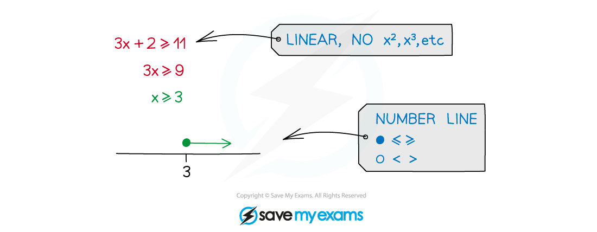
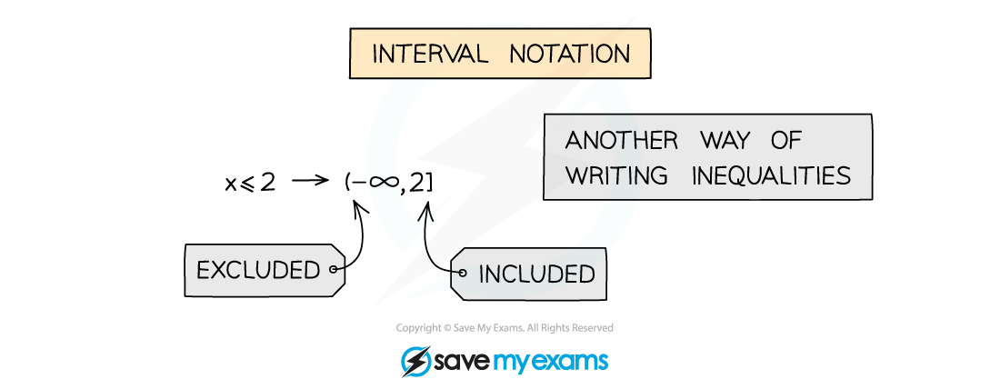
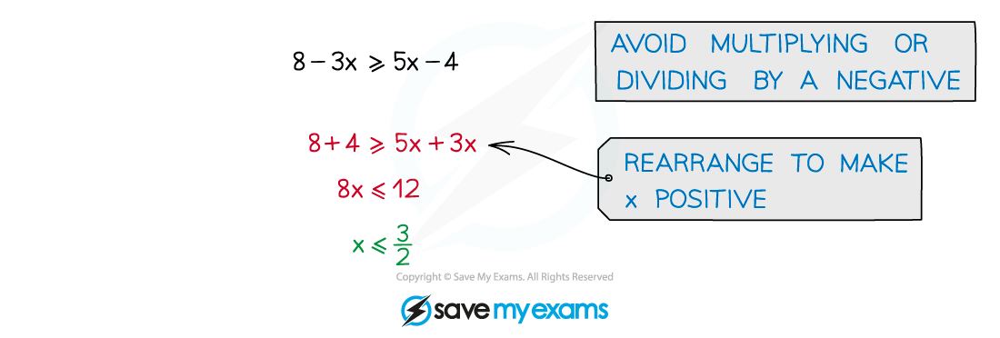

# Linear Inequalities

## Linear Inequalities

> **Spec point** — `spcpt_N3twfd2vQRbVyNy7`

## Linear inequalities

### What are linear inequalities?

- Similar to equations but answers take a range of values
- Linear means there will be no terms other than degree 1

  - no squared terms or higher powers, no fractional or negative powers
- Number line diagrams are often used

### What is interval notation?

- Use of square [] and round () brackets
- [ or ] mean included
- ( or ) mean excluded

  - (4,8] means 4 < *x* <u><</u> 8
- Note ∞ always uses ( or )

### How do I solve linear inequalities?

- treat as equations but

  - avoid multiplying or dividing by a negative
  - if unavoidable, “flip” the inequality sign so < → >, ≥ → ≤, etc
  - do rearrange to make the x term positive

> **Worked Example**
> 
