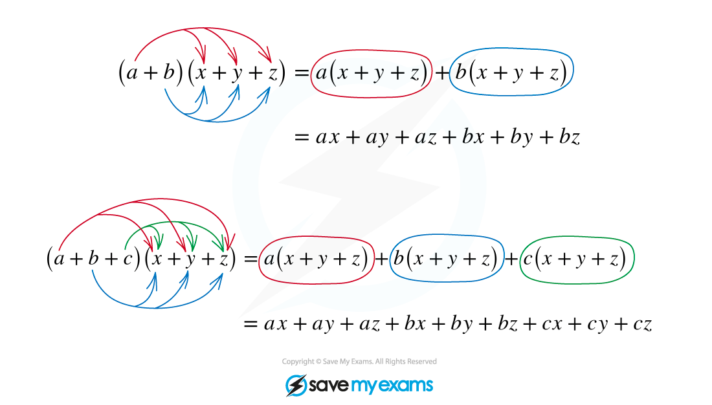

# Expanding Brackets

## Expanding Quadratics

> **Spec point** — `spcpt_nmXTYZr7f4GYGMVq`

## Expanding quadratics

You should be familiar with all aspects of basic algebra including manipulating expressions; simplifying; expanding and factorising brackets with both linear and quadratics.  In Pure Mathematics it is important that you are confident working with quadratics.

### How do I expand two brackets?

- You will have learnt a method for expanding double brackets in previous courses

  - The quickest and most common method is to use **FOIL**
  
    - **First** term in each bracket
    - **Outside** terms
    - **Inside** terms
    - **Last** terms
  - For (*ax* + *b*)(*cx* + *d*) you will have *acx*2 + *adx* + *bcx* + *bd*
- Once you have expanded and multiplied all four terms simplify the two middle terms to give you a three-term quadratic

  - *acx*2 + (*ad* + *bc*)x + *bd*
- Take extra care when working with negatives
- Look out for a linear expression squared, this must still be treated as double brackets

  - (*ax* + *b*)2 = *a*2*x*2 + 2*abx* + *b*2
- Makes sure you can recognise when a problem involves the **difference of two squares**

  - (*ax* + *b*)(*ax* – *b*) = *a*2*x*2 + *abx* - *abx* - *b*2 = *a*2*x*2 - *b*2
  - Spotting this will be particularly useful in many areas of Pure Mathematics

### How do I expand brackets with quadratic terms?

- Treat these the same as expanding double brackets with two linear expressions
- Take care with powers, remember the laws of indices
- Look carefully to see if the terms can be simplified or not

  - For (*ax*2 + *b*)(*cx*2 + *d*) you will have *acx*4 + *adx*2 + *bcx*2 + *bd* = *acx*4 + (*ad* + *bc*)x2 + *bd*
  - For (*ax*2 + *b*)(*cx* + *d*) you will have *acx*3 + *adx*2 + *bcx* + *bd*

> **Worked Example**
> 

> **Exam Hint**
> Be extra careful with negatives!

## Further Expanding

> **Spec point** — `spcpt_hdXTr8Z4VwKvhRrV`

## Further expanding

### How do I expand brackets with more than two terms?

- To expand brackets, the rule is that each term in one set of brackets must be multiplied by each term in the other set of brackets

- 'FOIL' is a special case of this, when each set of brackets contains two terms
- If you are trying to expand something like **(*****a***** + *****b*****)*****n***** **for powers of ***n*** greater than 2 or 3, use the **binomial expansion**
- If you have to expand more than two sets of brackets, just expand them two at a time:

> **Worked Example**
> 

> **Worked Example**
> 
