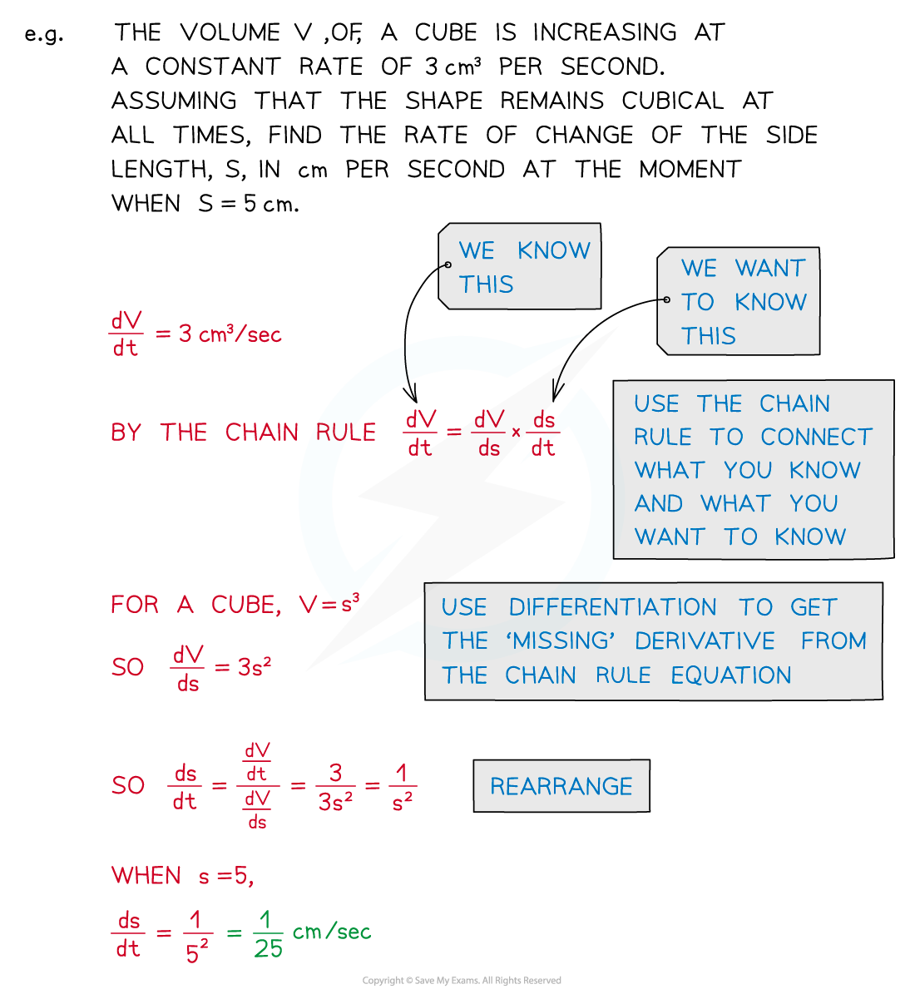

# Connected Rates of Change

## Connected Rates of Change

> **Spec point** — `spcpt_VfT8s6pRmfktfZDb`

## Connected Rates of Change

#### What are connected rates of change?

- In situations involving more than two variables you can use the **chain rule** to connect multiple rates of change into a single equation

> **Exam Hint**
> - These problems can involve a lot of letters – be sure to keep track of what they all refer to.
> - Be especially sure that you are clear about which letters are **variables** and which are **constants** – these behave very differently when differentiation is involved!

> **Worked Example**
> 
