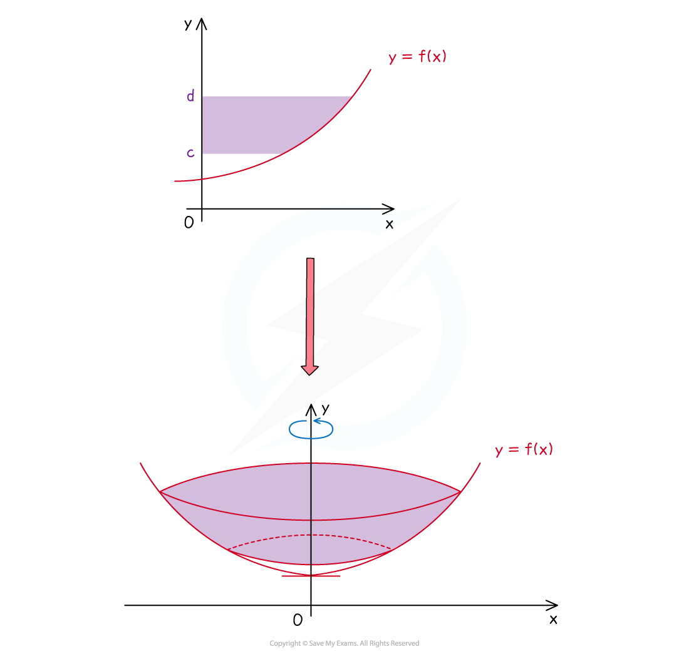

# Volumes of Revolution

## Volumes of revolution around the x-axis

> **Spec point** — `spcpt_n23tkV4bCqrNVV52`

## Volumes of revolution around the x-axis

#### What is a volume of revolution around the x-axis?

- A **solid** of **revolution** is formed when an **area** bounded by a function $y=f(x)$ (and other boundary equations) is rotated 360° around the *x*-axis
- A **volume** of **revolution** is the volume of this solid formed

***Example of a solid of revolution that is formed by rotating the area bounded by the function ***$y=f(x)$ ***, the lines ***$x=a$ *** and  ***$x=b$*** and the ***$x$***-axis ***$360^{\circ}$*** about the ***$x$***-axis***

#### How do I find the volume of revolution around the x-axis?

- To find the **volume** of **revolution** created when the area bounded by the function $y=f(x)$, the lines $x=a$ and $x=b$, and the *x*-axis is rotated 360° about the *x*-axis use the formula

$V = \pi \int_{a}^{b} y^{2} d x$

- The formula may look complicated or confusing at first due to the *y* and d*x*

  - remember that *y *is a function of *x*
  - once the expression for *y* is substituted in, everything will be in terms of *x*
- π is a constant so you may see this written either inside or outside the integral
- This is **not** given in the formulae booklet

  - The formulae booklet does list the volume formulae for some common 3D solids – it may be possible to use these depending on what information about the solid is available

#### How do I solve problems involving volumes of revolution around the x-axis?

- **Visualising** the solid created is helpful

  - Try sketching some functions and their solids of revolution to help
- **STEP 1** Square *y*

  - Do this first without worrying about π or the integration and limits
- **STEP 2** Identify the limits *a* and *b* (which could come from a graph)
- **STEP 3** Use the formula by evaluating the integral and multiplying by π

  - The answer may be required in **exact form **(leave in terms of π)
  
    - If not, round to **three significant figures** (unless told otherwise)
- Trickier questions may give you the volume and ask for the value of an unknown constant elsewhere in the problem

> **Worked Example**
> 

> **Exam Hint**
> - To help remember the formula note that it is only $y^{2}$ - volume is 3D so you may have expected a cubic expression
> 
>   - If rotating a **single** **point** around the *x*-axis a **circle** of radius would be formed
>   
>     - The **area** of that circle would then be $πy^{2}$
>     - Integration then adds up the areas of all circles between *a* and *b* creating the third dimension and **volume**
>     (In 2D, integration creates area by adding up lots of 1D lines)

## Volumes of revolution around the y-axis

> **Spec point** — `spcpt_VrW7TGsVKVSz59w3`

## Volumes of revolution around the y-axis

#### What is a volume of revolution around the y-axis?

- A **solid** of **revolution** is formed when an **area** bounded by a function $y=f(x)$ (and other boundary equations) is rotated 360° around the *y*-axis
- A **volume** of **revolution** is the volume of this solid formed

***Example of a solid of revolution that is formed by rotating the area bounded by the function ***$y=f(x)$ ***, the lines ***$y=c$*** and  ***$y=d$***and the ***$x$***-axis ***$360^{\circ}$*** about the ***$y$***-axis***

#### How do I find the volume of revolution around the y-axis?

- To find the **volume** of **revolution** created when the area bounded by the function $y=f(x)$, the lines $y=c$ and $y=d$, and the *y*-axis is rotated 360° about the *y*-axis use the formula

$V = \pi \int_{c}^{d} x^{2} d y$

- Note that although the function may be given in the form $y=f(x)$ it will first need rewriting in the form $x=g(y)$
- This is **not** given in the formulae booklet

#### How do I solve problems involving volumes of revolution around the y-axis?

- **Visualising** the solid created is helpful

  - Try sketching some functions and their solids of revolution to help

- **STEP 1** Rearrange $y=f(x)$ into the form $x=g(y)$ (if necessary)

  - This is finding the **inverse** **function **$f^{-1}(x)$
- **STEP 2** Square *x*

  - Do this first without worrying about π or the integration and limits
- **STEP 3** Identify the limits *c* and *d* (which could come from a graph)
- **STEP 4** Use the formula by evaluating the integral and multiplying by π

  - The answer may be required in **exact form **(leave in terms of π)
  
    - If not, round to **three significant figures** (unless told otherwise)

- Trickier questions may give you the volume and ask for the value of an unknown constant elsewhere in the problem

> **Worked Example**
> 
> 
> 

> **Exam Hint**
> - Double check questions to ensure you are clear about which axis the rotation is around
> - Separating the rearranging of $y=f(x)$into $x=g(y)$ and the squaring of *x* is important for maintaining accuracy
> 
>   - In some cases it can seem as though *x *has been squared twice
>   
>     - in the worked example above, *x *has been squared twice
>     - but it needed to be – once as part of the rearranging, once as part of the volume formula
