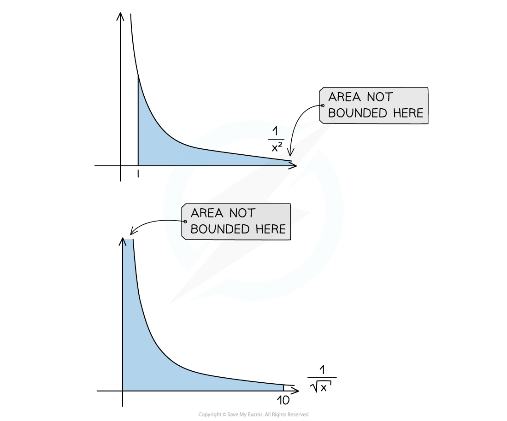

# Improper Integrals

## Improper Integrals

> **Spec point** — `spcpt_y96dW6qr3hvnDpFJ`

## Improper Integrals

#### What are improper integrals?

- An **improper integral** is a definite integral where one or both of the limits is either:

  - Positive or minus infinity
  - A point where the function is undefined
  
    - Consider the graph of $y=\frac{1}{\sqrt{x}}$
    - It is undefined at the point *x = 0*
    - The integral of  $y=\frac{1}{\sqrt{x}}$ with a **limit of zero** would be an improper integral
- Examples include:

  - $\int_{0}^{5} \frac{1}{ \sqrt[3]{x} } d x$
  - $integral_{1}^{infinity} \frac{1}{x} ^{3} d x$

#### How do we find the value of an improper integral?

- Use algebra to **replace the limit** which cannot be found with a variable

  - E.g. let the undefined limit of zero be *a *or the infinite limit be *b*
- **Evaluate the integral** and substitute your chosen variable into the expression
- Consider what will happen to your answer as the value of your chosen variable **tends towards the limit**

  - E.g. what happens as *a *gets closer to zero or as *b* gets closer to infinity?
- Your final answer will be the value you get if you substitute this into your answer

  - E.g. as *a *tends to zero *a**2** *tends to zero and so this part of your solution will be zero
- It is useful to remember as *a* tends to infinity then $\frac{1}{a}$ tends to 0

> **Worked Example**
> 
> 
> 

> **Exam Hint**
> - Be careful if a limit of your integral is zero, always check to see if the function is defined at zero and if not treat it as an improper integral.
> - Infinite limits will always be treated as improper integrals.
