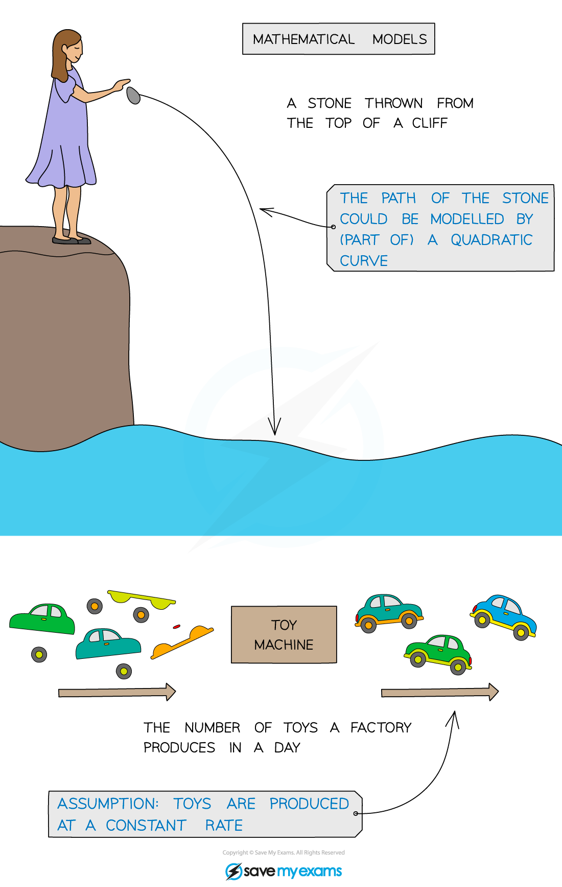
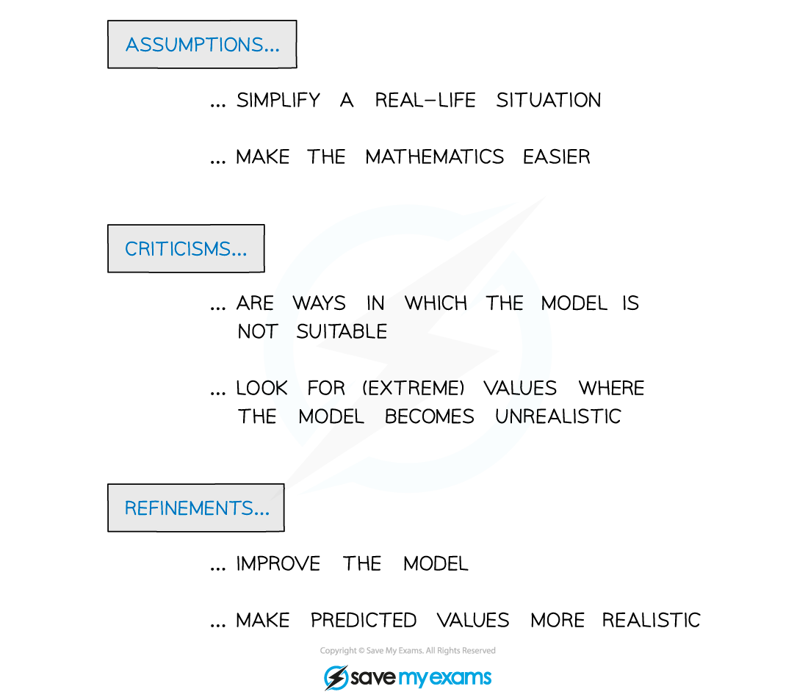
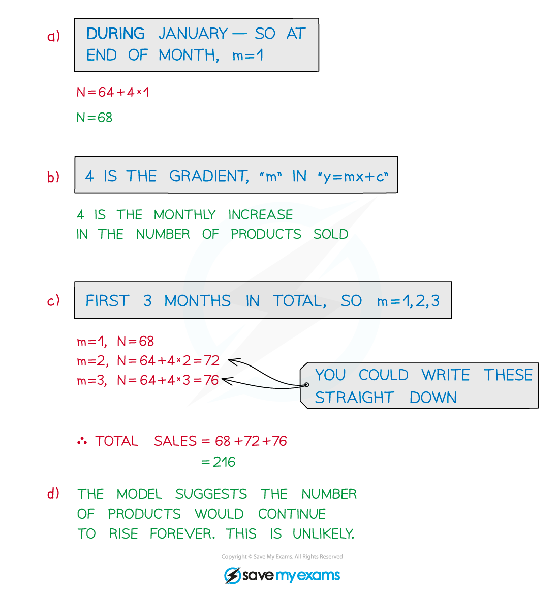

# Further Modelling with Functions

## Further Modelling with Functions

> **Spec point** — `spcpt_cffRdQH46dWwJ4FV`

## Further modelling with functions

### How do I solve modelling problems?

- There will be no one-size-fits-all step-by-step guide to solving modelling questions
- A combination of skills and **problem**-**solving** skills will be needed

** **

### Making assumptions, criticisms and refinements of a model

- Modelling is a large part of A level mathematics
- **Assumptions** and **refinements** to models often need to be considered
- Real-life general knowledge and common sense can really help in mathematical modelling

** **

** **

> **Exam Hint**
> Read – and re-read – the question carefully. Try to “get involved” in the context of the question – however boring it may be!
> 
> - Imagine what happens to a stone as you throw it from a cliff
> - What would it be like to manage a toy factory?
> 
> Draw a diagram – **sketch** a graph of the function being used as the model.
> 
> If you are completely stuck try “doing something” with the maths. For example, if there’s a quadratic function – sketch it, factorise it, solve it. Or if there’s a polynomial – use f**actor theorem** and **algebraic division** to factorise it.

> **Worked Example**
> 
