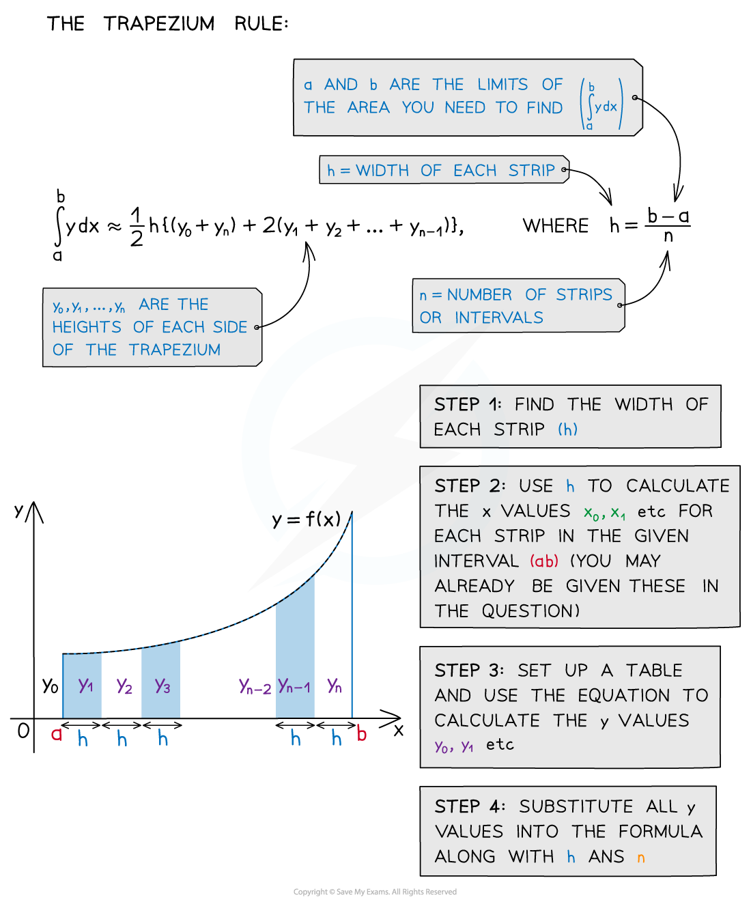
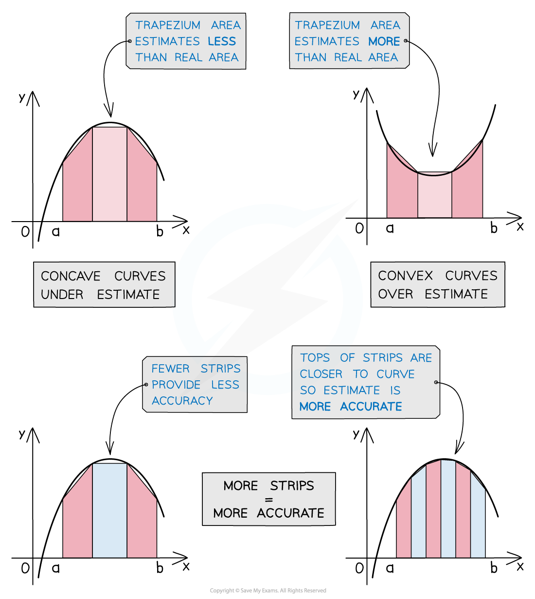

# Trapezium Rule (Numerical Integration)

## Trapezium Rule (Numerical Integration)

> **Spec point** — `spcpt_QzpfK3ZQD5hPS8bj`

## Trapezium rule (numerical integration)

### What is the trapezium rule?

- The **trapezium rule** is a numerical method of integration used to find the **approximate area** under a curve
- It can be used when **analytical methods** of **integration** won’t work
- It finds an **approximation** of the area by finding the **sum of the areas** of trapeziums beneath the curve
- The **formula **for an **estimate** of the area when splitting it into *n* strips (trapezium) is

`integral _ a ^ b y d x ~= 1 half h left curly bracket ( y _ 0 + y _ n ) + 2 ( y _ 1 + y _ 2 +... + y _ n - 1 end _ ) right curly bracket` where $h=\frac{b-a}{n}$

- If you have ***n *****strips** then you need ***n *****+ 1 *****y*****-values**

### How do I know if it is an underestimate or an overestimate?

- Depending on the shape of the curve, the trapezium rule could be an **underestimate** or **overestimate**
- The **more trapezium strips** used the **more accurate** the estimate

> **Exam Hint**
> The formula for the trapezium rule is not given in the formula booklet. You must remember it.

> **Worked Example**
> 
