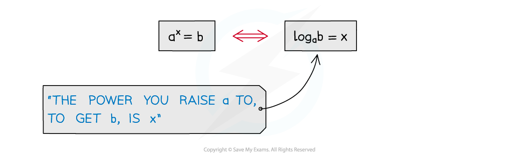

# Laws of Logarithms

## Laws of Logarithms

> **Spec point** — `spcpt_PCpf3jBwZjZyVDhQ`

## Laws of logarithms

### What are the laws of logarithms?

- There are many laws or rules of indices, for example

  - **a****m**** x a****n**** = a****m+n**
  - **(a****m****)****n**** = a****mn**
- There are equivalent laws of logarithms (for a > 0)

  - $\mathrm{log}_{a}xy=\mathrm{log}_{a}x+\mathrm{log}_{a}y$
  - $\mathrm{log}_{a}(\frac{x}{y})=\mathrm{log}_{a}x-\mathrm{log}_{a}y$
  - $\mathrm{log}_{a}x^{k}=k\mathrm{log}_{a}x$

- There are also some particular results these lead to

  - $\mathrm{log}_{a}a=1$
  - $\mathrm{log}_{a}a^{x}=x$
  - $a^{\mathrm{log}_{a}x}=x$
  - $\mathrm{log}_{a}1=0$
  - $\mathrm{log}_{a}(\frac{1}{x})=-\mathrm{log}_{a}x$

- Two of these were seen in the notes Logarithmic Functions
- Beware …

  - … **log (x + y) ≠ log x + log y**
- Results apply to** ln **too

  - $\mathrm{ln}x\equiv\mathrm{log}_{e}x$
  - In particular $e^{\mathrm{ln}x}=x$ and $\mathrm{ln}(e^{x})=x$

### How do I use log laws?

- Laws of logarithms can be used to … 

  - … simplify expressions
  - … solve logarithmic equations
  - … solve exponential equations

> **Exam Hint**
> - Remember to check whether your solutions are valid. log (x+k) is only defined if x > -k.
> - You will lose marks if you forget to reject invalid solutions.

> **Worked Example**
> 
