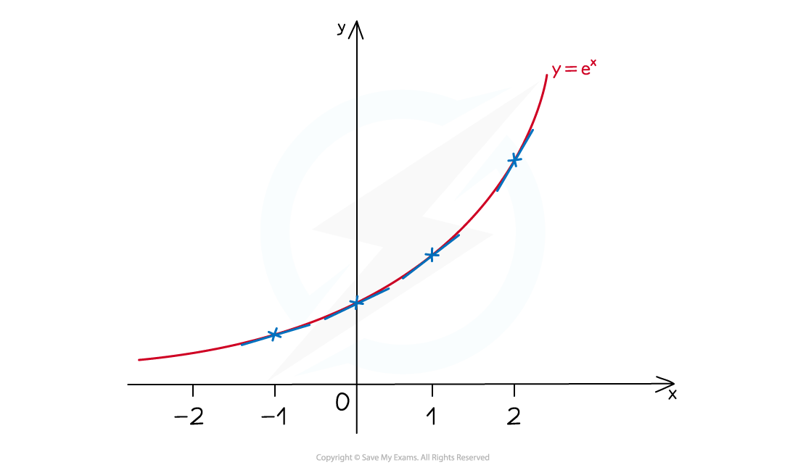
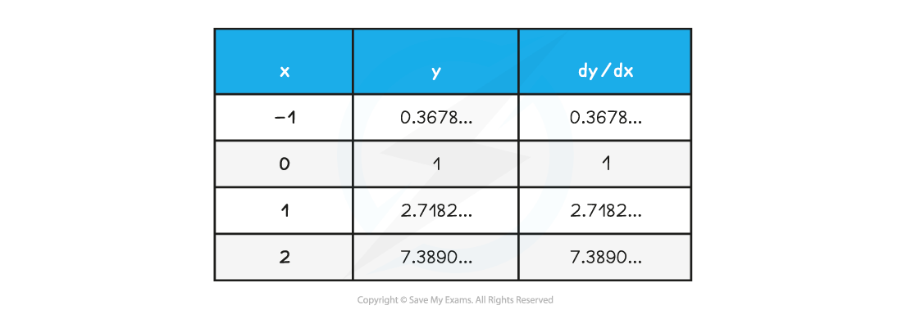
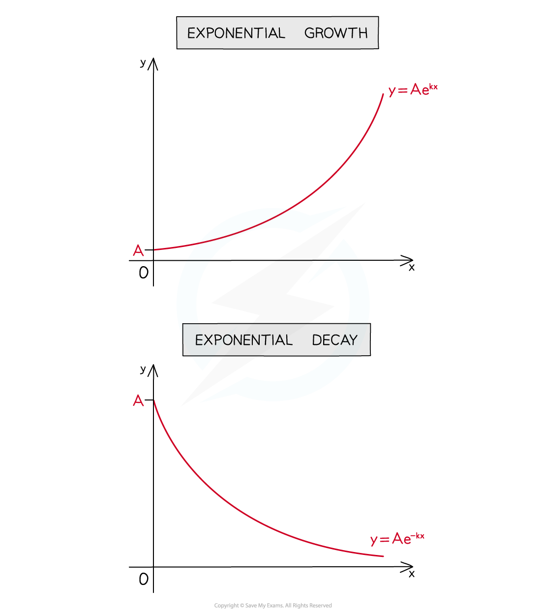

# "e"

## "e"

> **Spec point** — `spcpt_bT9c3ZnCxT8fhbqM`

## "e"

### What is the number "e" in maths?

- **e** is an *irrational* number, sometimes called Euler's number

  - **e ≈ 2.718**

### How do I sketch y = ex?

- The exponential function is **y = e****x**

  - As with other exponential graphs **y = e****x** 
  
    - passes through (0, 1)
    - has the x-axis as an asymptote

### What is the special property of "e"?

- **y = e****x** has the particular property that

$\frac{dy}{dx}=e^{x}$

- ie for *every* real number **x**, the gradient of **y = e****x** is also equal to **e****x **(see Derivatives of Exponential Functions)

### How do I sketch y = e-x?

- **y = e****-x** is a reflection in the **y**-axis of **y = e****x**
- They are of the form **y = f(x)** and **y = f(-x) **(see Transformations of Functions - Reflections) 

** **

### What is exponential growth and decay?

** **

- **y = Ae****kx** (**k > 0**) is exponential growth
- **y = Ae****-kx** (**k > 0**) is exponential decay
- **A** is the initial value
- **k** is a (usually positive) constant
- “-“ is used in the equation making clear whether it is growth or decay

> **Worked Example**
> 
> 
> 
