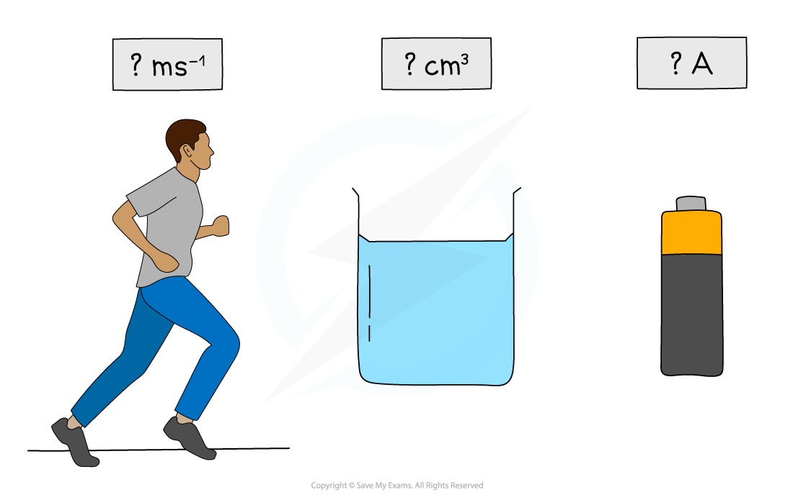

# Physical Quantities

## What is a Physical Quantity?

> **Spec point** — `spcpt_JKyMNb7Tn4JVGkDb`

## What is a physical quantity?

- Speed and velocity are examples of physical quantities; both can be measured
- All physical quantities consist of a numerical magnitude and a unit
- In physics, every letter of the alphabet (and most of the Greek alphabet) is used to represent these physical quantities
- To represent a physical quantity, it must contain both a numerical value and the **unit** in which it was measured
- For example, the letter *v* can be used to represent the physical quantities of velocity, volume or potential difference (voltage)
- The units provide the context as to what *v* refers to:

  - If *v* represents velocity, the unit would be **m s****–1**
  - If *v *represents volume, the unit would be **m****3**
  - If *V *represents potential difference, the unit would be **V**

***All physical quantities must have a numerical magnitude and a unit***

## Estimating Physical Quantities

> **Spec point** — `spcpt_WNW77SZx5TnZVtYy`

## Estimating physical quantities

- There are important physical quantities to learn in physics
- It is useful to know these physical quantities, they are particularly useful when making estimates
- A few examples of useful quantities to memorise are given in the table below (this is by no means an exhaustive list)

#### Estimating physical quantities table

| **Quantity** | **Size** |
|---|---|
| Diameter of an atom | 10−10 m |
| Wavelength of UV radiation | 10 nm |
| Height of an adult human | 2 m |
| Distance between Earth and Sun (1 AU) | 1.5 × 1011 m |
| Mass of a hydrogen atom | 10−27 kg |
| Mass of an adult human | 70 kg |
| Mass of a car | 1000 kg |
| Seconds in a day | 90 000 s |
| Seconds in a year | 3 × 107 s |
| Speed of sound in air | 300 m s−1 |
| Power of a light bulb | 60 W |
| Atmospheric pressure | 1 × 105 Pa |

> **Worked Example**
> Estimate the energy required for an adult man to walk up a flight of stairs.
> 
> **Answer:**
> 
> **Step 1: Recall the equation for energy for gain in gravitational potential energy:**
> 
> - For a man of mass *m* to gain height *h* in a gravitational field of strength *g*, the energy *E* required to do so is: $\DeltaE_{p}=mg\Deltah$
> 
>   - Here, *g* is approximately 10 N kg−1
> 
> **Step 2: Estimate the mass and height**
> 
> - An adult person has a mass of approximately 70 kg
> - A flight of stairs gains around 3 m of height
> 
> 
> 
> ***Estimation of the adult man's mass and the height of the stairs***
> 
> **Step 3: Substitute these estimates into the equation:**
> 
> - The energy required for the man to walk up the stairs is approximately:
> 
> $\DeltaE_{p}=70\times10\times3=2100J$

> **Exam Hint**
> You will only ever be asked to estimate physical quantities that you are familiar with from your studies, or that can be estimated due to your everyday experience, such as the speed of a person walking (1 - 1.5 m/s).
> 
> The mark schemes for calculations involving estimates are normally quite generous and offer a range of values as the final answer to accommodate for the range of acceptable values.
> 
> Many values are already given in your data booklet that therefore may not be given in the question, so make sure to check there too!
