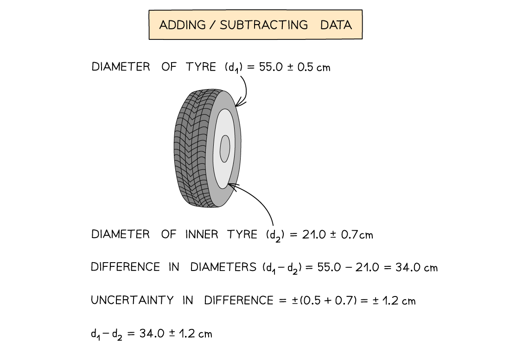

# Calculating Uncertainties

## Calculating Uncertainty

> **Spec point** — `spcpt_kHV3G2J8QHxHDrwD`

## Calculating uncertainty

### What is uncertainty?

- When measurements are taken, there is always a degree of **uncertainty** in those measurements due to **errors** in the experimental technique

- Uncertainties are not the same as errors

  - Errors can be thought of as the **difference** between the **actual** reading taken and the **true** **value**
  - The uncertainty is a range of values around a measurement within which the true value is expected to lie, and is an **estimate**

- For example, if the length of a box is measured multiple times as 12.55 cm, 12.45 cm and 12.51 cm, we can say the length is 12.50 cm with an uncertainty of 0.05 cm

  - This is often written as 12.50 ± 0.05 cm

### Calculating uncertainty

- Uncertainties can be represented in a number of ways:

  - **Absolute uncertainty:** where uncertainty is given as a fixed quantity (as above)
  - **Fractional uncertainty:** where uncertainty is given as a fraction of the measurement
  - **Percentage uncertainty: **where uncertainty is given as a percentage of the measurement

$\mathrm{percentage} \mathrm{uncertainty}=\frac{\mathrm{absolute} \mathrm{uncertainty}}{\mathrm{measured} \mathrm{value}}\times100$

- To find uncertainties in different situations:

  - **The uncertainty in a reading (e.g. from a voltmeter):** ± half the smallest division
  - **The uncertainty in a measurement (e.g. from a ruler):** at least ±1 smallest division
  - **The uncertainty in repeated data:** half the range i.e. ± ½ (largest - smallest value)
  - **The uncertainty in digital readings:** ± the last significant digit unless otherwise quoted

#### Diagram showing a reading from an ammeter

### Combining uncertainties

- When combining two measurements that both have uncertainties, the uncertainties have to be combined too

#### Adding or subtracting data

- When adding or subtracting two values with uncertainties, just **add **the **absolute uncertainties**

#### Adding or subtracting data example

#### Multiplying or dividing data

- When multiplying or dividing measurements with uncertainties, **add **their **percentage uncertainties**

#### Multiplying or dividing data example

- When the measurement is raised to a power, **multiply **the **fractional **or **percentage **uncertainty **by the power**

#### Raising to a power example

