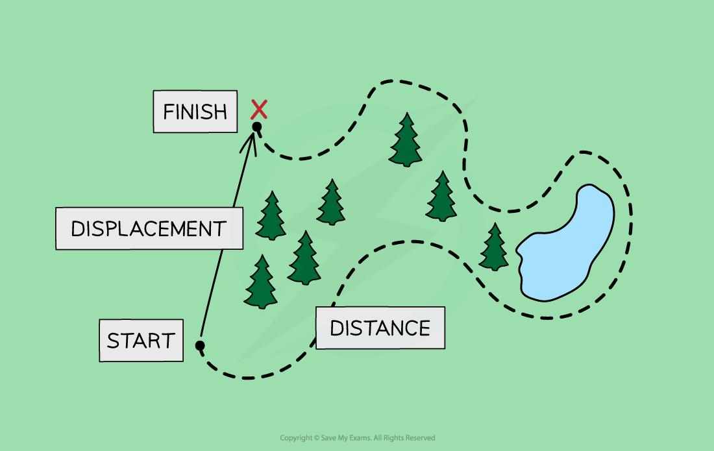
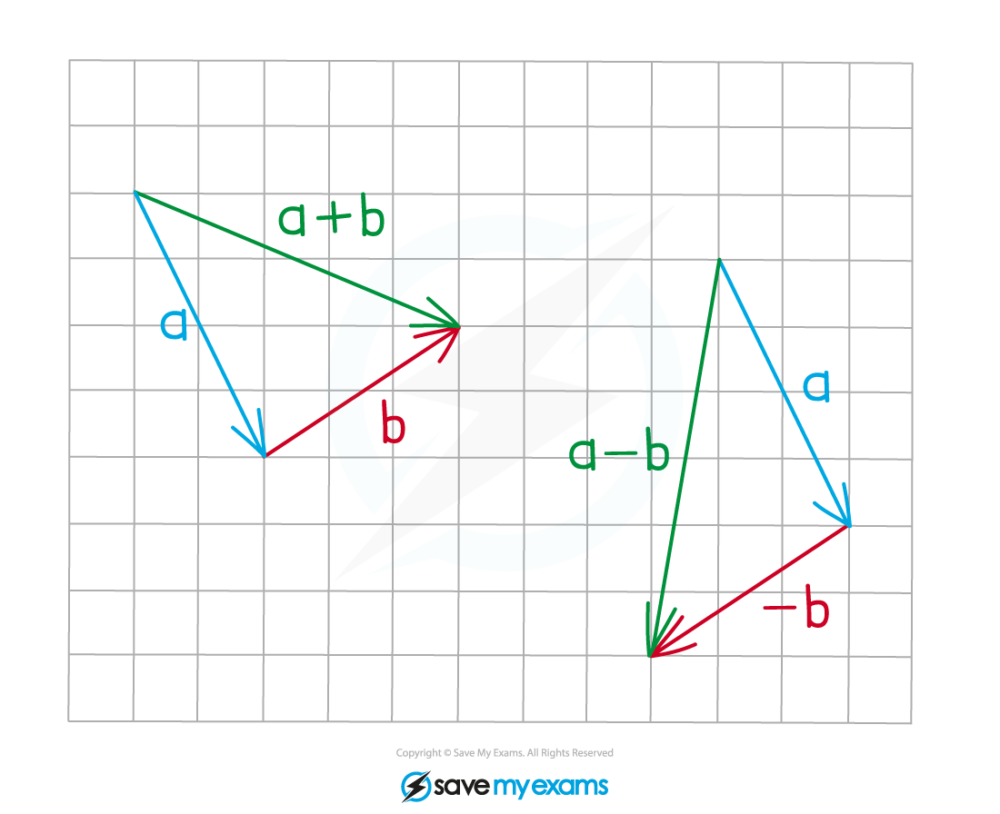
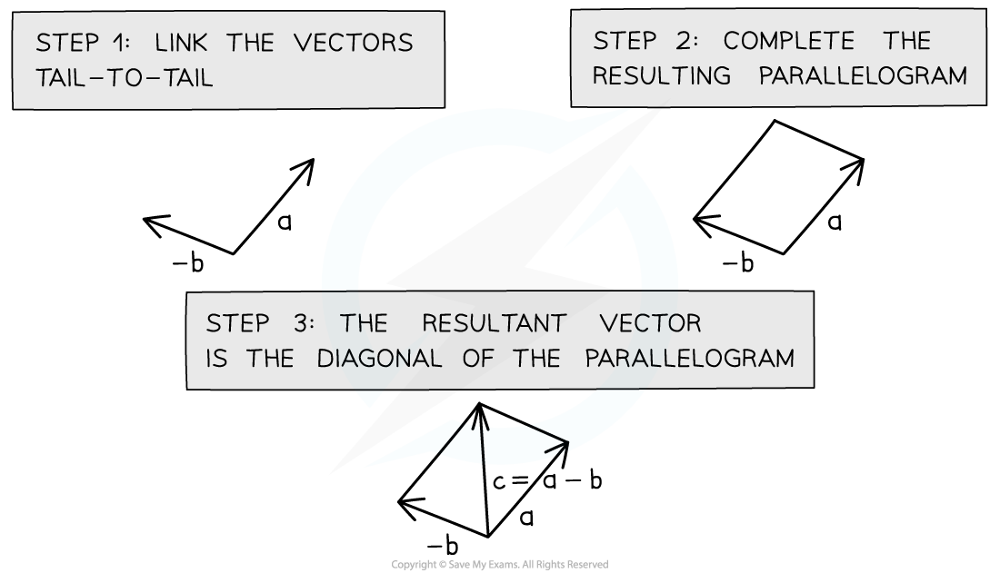
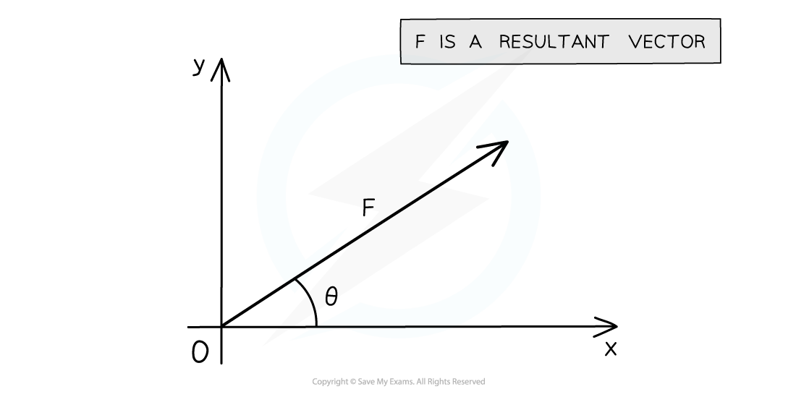

# Scalars & Vectors

## What are Scalar & Vector Quantities?

> **Spec point** — `spcpt_kzcXNKXm2xNWgV9t`

## What are scalar & vector quantities?

- All quantities can be one of two types:

  - a **scalar**
  - a **vector**

### Scalars

- Scalars are quantities that have ***magnitude*** but not direction

  - For example, **mass** is a **scalar **quantity because it has **magnitude **but no direction

### Vectors

- Vectors are quantities that have both **magnitude** and **direction**

  - For example, **weight **is a **vector **quantity because it is a force and has **both **magnitude and direction

### Distance and displacement

- **Distance **is a measure of how far an object has travelled, **regardless of direction**

  - Distance is the total length of the path taken
  - Distance, therefore, has a **magnitude **but **no direction**
  - So, distance is a **scalar **quantity

- **Displacement **is a measure of how far it is between two points in space, **including the direction**

  - Displacement is the **length **and **direction** of a **straight line** drawn from the starting point to the finishing point
  - Displacement, therefore, has a **magnitude **and a **direction**
  - So, displacement is a **vector **quantity

#### What is the difference between distance and displacement?

***Displacement is a vector quantity while distance is a scalar quantity***

- When a student travels to school, there will probably be a **difference **in the distance they travel and their displacement

  - The **overall distance** they travel includes the total lengths of all the roads, including any twists and turns
  - The **overall displacement **of the student would be a straight line between their home and school, regardless of any obstacles, such as buildings, lakes or motorways, along the way

### Speed and velocity

- **Speed **is a measure of the **distance **travelled by an object per unit time, **regardless of the direction**

  - The speed of an object describes how fast it is moving, but **not **the direction it is travelling in
  - Speed, therefore, has **magnitude **but **no direction**
  - So, speed is a **scalar **quantity

- **Velocity **is a measure of the **displacement **of an object per unit time,** including the direction**

  - The velocity of an object describes how fast it is moving **and **which direction it is travelling in
  - An object can have a **constant speed** but a **changing velocity** if the object is **changing direction**
  - Velocity, therefore, has **magnitude and direction**
  - So, velocity is a **vector **quantity

### Examples of scalars & vectors

- The table below lists some common examples of scalar and vector quantities

#### Table of scalars and vectors

| **Scalars** | **Vectors** |
|---|---|
| distance | displacement |
| speed | velocity |
| mass | acceleration |
| time | force |
| energy | momentum |
| volume |   |
| density |   |
| pressure |   |
| electric charge |   |
| temperature |   |

## Combining Vectors

> **Spec point** — `spcpt_wFM62cQnHjHTB8NT`

## Combining vectors

- **Vectors** are represented by an **arrow**

  - The **arrowhead **indicates the **direction** of the vector
  - The **length **of the arrow represents the **magnitude**
- Vectors can be combined by **adding** or **subtracting** them from each other
- There are two methods that can be used to combine vectors: the** triangle method** and the** parallelogram method**

### Triangle Method

- To combine vectors using the triangle method:

  - **Step 1:** link the vectors head-to-tail
  - **Step 2:** the resultant vector is formed by connecting the tail of the first vector to the head of the second vector
  - To subtract vectors, change the direction of the vector from positive to negative and add them in the same way

#### Triangle method for adding and subtracting vectors

***The triangle method links vectors tip to tail to find the resultant vector***

### Parallelogram method

- To combine vectors using the parallelogram method:

  - **Step 1:** link the vectors tail-to-tail
  - **Step 2:** complete the resulting parallelogram
  - **Step 3:** the resultant vector is the diagonal of the parallelogram

#### Parallelogram method for adding and subtracting vectors

***The parallelogram method links vectors tail to tail to find the resultant vector ***

- When two or more vectors are added together (or one is subtracted from the other), a single vector is formed, known as the **resultant** vector
- The **magnitude **of the resultant vector can be found using Pythagoras' theorem or trigonometry

### Condition for equilibrium

- ***Coplanar forces*** can be represented by vector triangles
- In equilibrium, these are **closed** vector triangles.

  - The vectors, when joined together, form a closed path

#### Forces in equilibrium

***If three forces acting on an object are in equilibrium; they form a closed triangle***

> **Worked Example**
> A swimmer is crossing a river by swimming due north at 2.7 m s−1. The current flows east at 5.1 m s−1.
> 
> Determine the resultant velocity of the swimmer's motion.
> 
> **Answer:**
> 
> **Step 1: Sketch a vector diagram of the scenario**
> 
> 
> 
> **Step 2: List the known quantities**
> 
> - Velocity 1, $v_{1}=2.7ms^{-1}N$
> - Velocity 2, $v_{2}=5.1ms^{-1}E$
> 
> **Step 3: Calculate the magnitude of the resultant vector, **$v$
> 
> - Using Pythagoras
> 
> $v^{2}=v_{1}^{2}+v_{2}^{2}$
> 
> $v=\sqrt{v_{1}^{2}+v_{2}^{2}}$
> 
> $v=\sqrt{2.7^{2}+5.1^{2}}$
> 
> $v=5.8ms^{-1}$
> 
> **Step 3: Calculate the direction of the resultant vector**
> 
> - Using trigonometry
> 
> $\mathrm{tan}θ=\frac{\mathrm{opposite}}{\mathrm{adjacent}}=\frac{v_{1}}{v_{2}}$
> 
> $\\theta = \tan ^{- 1} ( \frac{2.7}{5.1} )$
> 
> $\\theta = 28^{\circ} ( 2 \mathrm{s} . \mathrm{f} . )$

## Resolving Vectors

> **Spec point** — `spcpt_ydx9sYYRygKDv6dp`

## Resolving vectors

- Two vectors can be represented by a single **resultant vector** that has the same effect
- A single resultant vector can be **resolved **and represented by **two** vectors, which in combination have the same effect as the original one
- When a single resultant vector is broken down into its **parts**, those **parts** are called **components**
- For example, a force vector of magnitude *F* and an angle of *θ* to the horizontal is shown below

#### Resultant vector diagram

***A resultant vector, F***

- It is possible to **resolve** this vector into its **horizontal** and **vertical** components using trigonometry

#### Horizontal and vertical vector components

***Horizontal and vertical components of F***

- For the **horizontal** **component**, *F**x* = *F*cos*θ*
- For the **vertical** **component**, *F**y* = *F*sin*θ*
