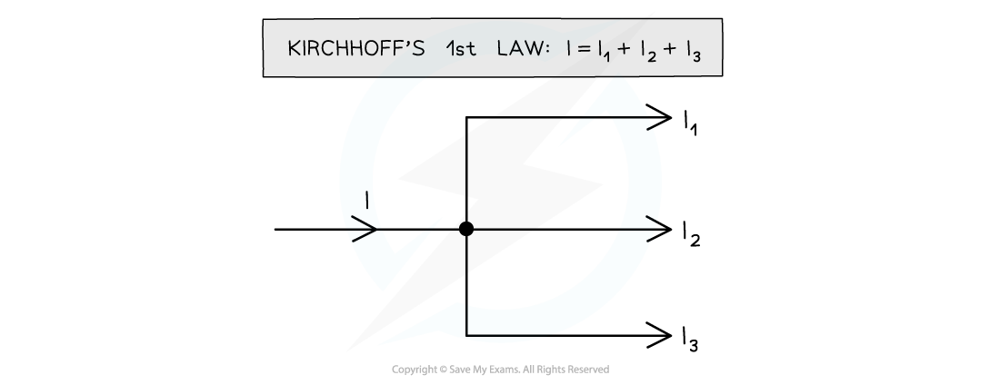
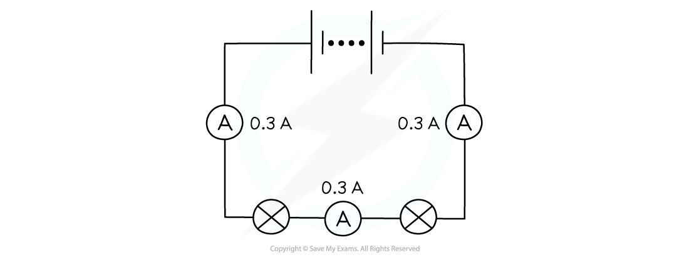
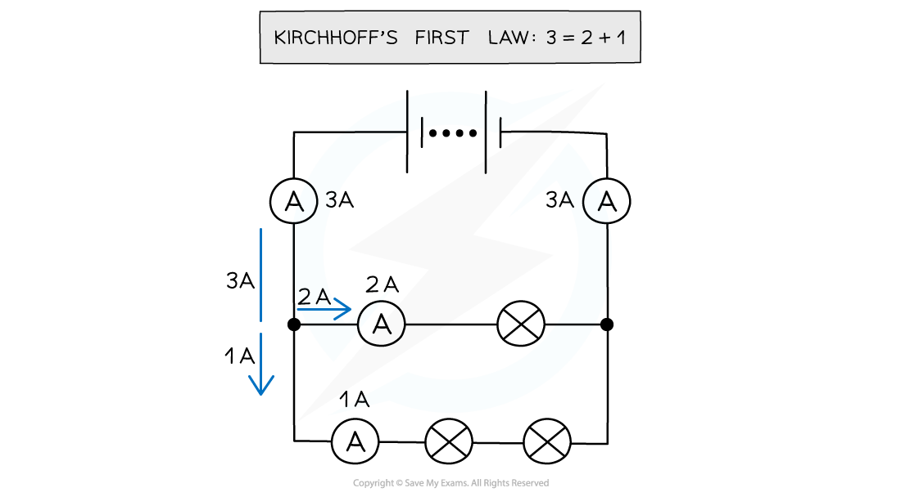

# Kirchhoff's First Law

## Kirchhoff's First Law

> **Spec point** — `spcpt_P2rfpHgMm83QNhhm`

## Kirchhoff's first law

- Kirchhoff's first law states that:

**The sum of the currents entering a junction is always equal to the sum of the currents leaving the same junction**

- This is a consequence of conservation of **charge - **current shouldn’t decrease or increase in a circuit when it splits
- In a circuit:

  - A **junction** is a point where at least three circuit paths meet
  - A **branch** is a path connecting two junctions
- If a circuit splits into two branches, then the current before the circuit splits should be equal to the current after it has split
- The circuit below illustrates Kirchhoff’s first law:

#### Kirchhoff's first law

***The current I into the junction is equal to the sum of the currents out of the junction***

- The charge is conserved on both sides of the junction
- In a **series** circuit, the current is the same at any point

#### Current in a series circuit

***The current is the same at all points in a series circuit***

- In a **parallel** circuit, the current divides at the junctions and each branch has a different value. Kirchhoff’s first law applies at each junction

#### Current in a parallel circuit

***The current divides at each junction in a parallel circuit***

> **Exam Hint**
> Junctions only appear in parallel circuits, and as circuits become more complex, it can be confusing as to which currents are into the junction and which are out.
> 
> Drawing arrows on the diagram for the current flow (making sure it’s from positive to negative) at each junction like in the worked example will help with this.
