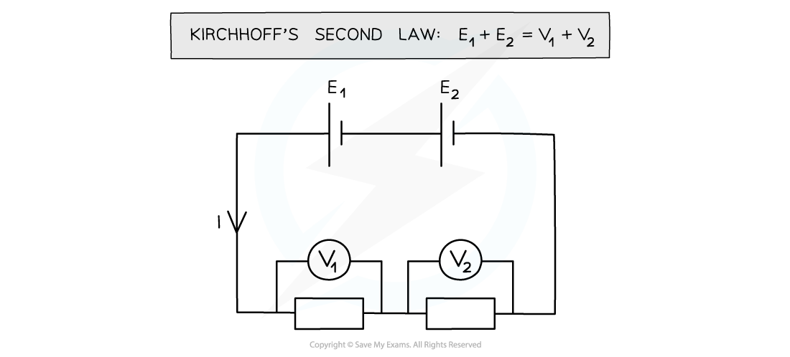
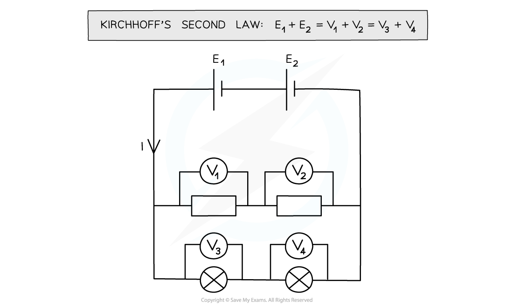
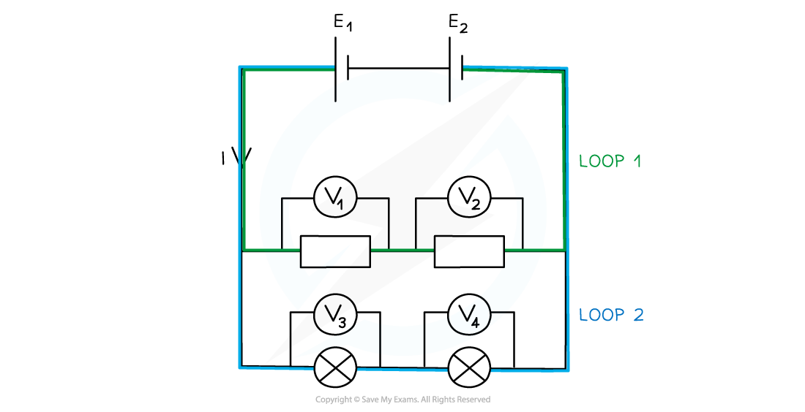

# Kirchhoff's Second Law

## Kirchhoff's Second Law

> **Spec point** — `spcpt_vX8cGYn6Cjp6cKRW`

## Kirchhoff's second law

- Kirchhoff's second law states that:

**The total e.m.f in a closed circuit is equal to the sum of the potential differences across the components**

- This is a consequence of conservation of **energy**
- The energy transferred **into **the circuit is equal to the energy transferred **out **of the circuit
- The circuit below illustrates Kirchhoff’s second law:

#### Kirchhoff's second law in a series circuit

***The sum of the potential difference across the individual components is equal to the sum of the e.m.f supplied by the batteries***

*** ***

- In a **series** circuit, the potential difference is split across all components depending on their resistance

  - The sum of the potential difference across each component is equal to the total e.m.f of the power supply
- In a **parallel** circuit, the potential difference is the same across each closed loop

  - The sum of the potential difference **in each closed circuit loop** is equal to the total e.m.f of the power supply:

#### Kirchhoff's second law in a parallel circuit

***The total potential difference across the components is the sum of the potential difference across each individual component***

- A closed circuit loop acts as its own independent series circuit and each one separates at a junction. A parallel circuit is made up of two or more of these loops

#### Loops in a parallel circuit

***Each circuit loop acts as a separate, independent series circuit***

- This makes parallel circuits incredibly useful for home wiring systems
- A single power source supplies all lights and appliances with the same potential difference
- If one light breaks, current can still flow through the rest of the lights and appliances
