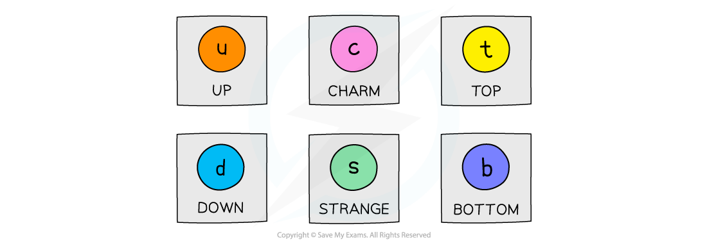
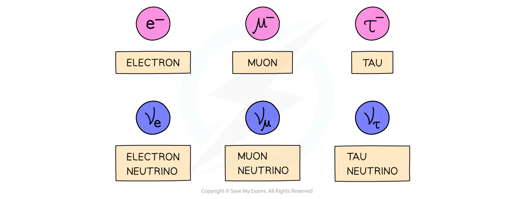

# Fundamental Particles

## Fundamental Particles: Quarks

> **Spec point** — `spcpt_dThCMkMgKjqg2bvF`

## Fundamental particles: quarks

- Quarks are** fundamental particles **that make up other subatomic particles such as **protons and neutrons**
- Protons and neutrons are in a category of particles called **hadrons**

  - Hadrons are defined as **any particle made up of quarks**
- **Fundamental** means that the particles are not made up of any other particles
- Quarks have never been observed on their own, they are either in pairs or groups of three
- There are six flavours (types) of quarks that exist:

  - up
  - down
  - charm
  - strange
  - top
  - bottom

#### The six flavours of quarks

***The six flavours of quarks are up, down, charm, strange, top and bottom***

## Fundamental Particles: Leptons

> **Spec point** — `spcpt_JVXyyR7549WKjmyV`

## Fundamental particles: leptons

- **Leptons **are also a group of **fundamental** (elementary) particles
- This means they are not made up of any other particles (no quarks)
- There are six leptons altogether:

  - electron
  - electron neutrino
  - muon
  - muon neutrino
  - tau
  - tau neutrino

#### The six leptons

***The six leptons are all fundamental particles***

- The muon and tau particle are very similar to the electron but with slightly larger mass
- Electrons, muon and tau particles** all **have a charge of -1e
- There are three **flavours **(types) of neutrinos** (electron, muon, tau)**
- Neutrinos are the most abundant leptons in the universe

  - They have** no charge **and** negligible **mass (almost 0)
- **Leptons **interact with the **weak interaction**, **electromagnetic **and **gravitational **forces
- However, they do** not **interact with the **strong force**
- Although quarks are fundamental particles too, they are **not **classed as leptons
- Leptons do **not** interact with the strong force, whilst quarks do

> **Worked Example**
> State all the anti-leptons in the following decay equation.
> 
> $π^{+}\rightarrowμ^{+}+v_{μ}$
> 
> **Answer:**
> 
> - The pion (π+) is a meson (a type of hadron) and is made up of quarks
> 
>   - Therefore it is not a fundamental particle and hence not a lepton
> - The anti-muon (μ+) is the anti-particle of the muon
> 
>   - Therefore it is an anti-lepton
> - The muon neutrino is a lepton, not an anti-lepton
> 
>   - The anti-lepton would be the anti-muon neutrino
> - Therefore, the only anti-lepton is an **anti-muon** (μ+)
