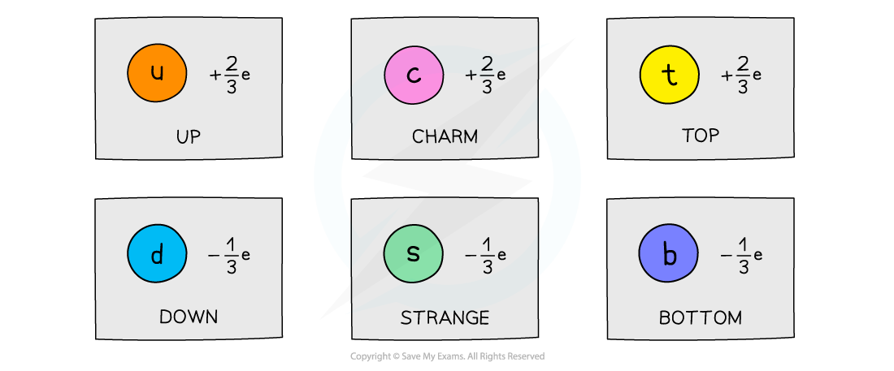
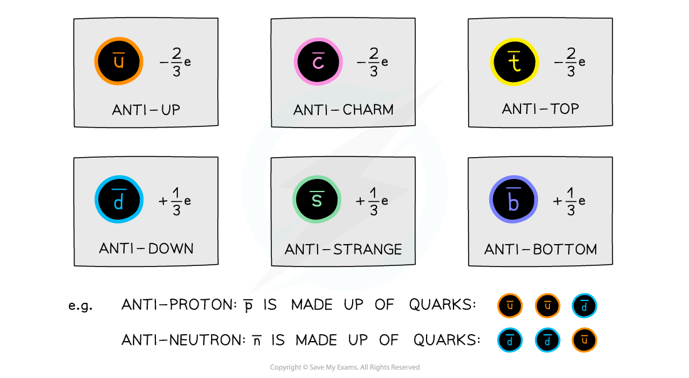

# Properties of Quarks

## Properties of Quarks

> **Spec point** — `spcpt_YmydrVnY8qSq7dcW`

## Properties of quarks

- The charge of a **hadron **is determined by the **sum **of the charges of its **quarks**
- Each flavour of quark has a certain relative charge:

#### Relative charge of quarks

***Each flavour of quark has a charge of either +⅔e or -⅓e***

- For example, a proton is made up of two up quarks and a down quark. Adding up their charges gives the charge of a proton:

$\mathrm{uud}=p$

$+\frac{2}{3}+\frac{2}{3}-\frac{1}{3}=+1e$

- The equivalent **antiparticle **of the quark is the **anti-quark**
- These are identical to quarks except with opposite relative charges

#### Anti-quarks

***Each flavour of anti-quark has a charge of either -⅔e or +⅓e. The quark composition of anti-protons and anti-neutrons changes to anti-quarks***

> **Worked Example**
> Particles are made up of a combination of three quarks or two quarks. Which quark combination would **not** give a particle a charge of -1 or 0?
> 
> **A. **up, strange, strange
> 
> **B.** charm, charm, down
> 
> **C. **top, anti-up
> 
> **D.** anti-up, anti-up, anti-strange
> 
> **Answer: B**
> 
> - Add up the charge of the individual quarks
> 
>   - Charm, charm, down = $\frac{2}{3}+\frac{2}{3}-\frac{1}{3}=+1$
> - The other quark combinations add up to either 0 or −1
> 
>   - A: Up, strange, strange = $\frac{2}{3}-\frac{1}{3}-\frac{1}{3}=0$
>   - C: Top, anti-up = $+\frac{2}{3}-\frac{2}{3}=0$
>   - D: Anti-up, anti-up, anti-strange $-\frac{2}{3}-\frac{2}{3}+\frac{1}{3}=-1$
>   
>     - Remember that anti-particles have the opposite signs

> **Exam Hint**
> You will be expected to remember the charge of each quark. However, instead of memorising the charges of anti-quarks too, just remember they are identical but with opposite signs.
