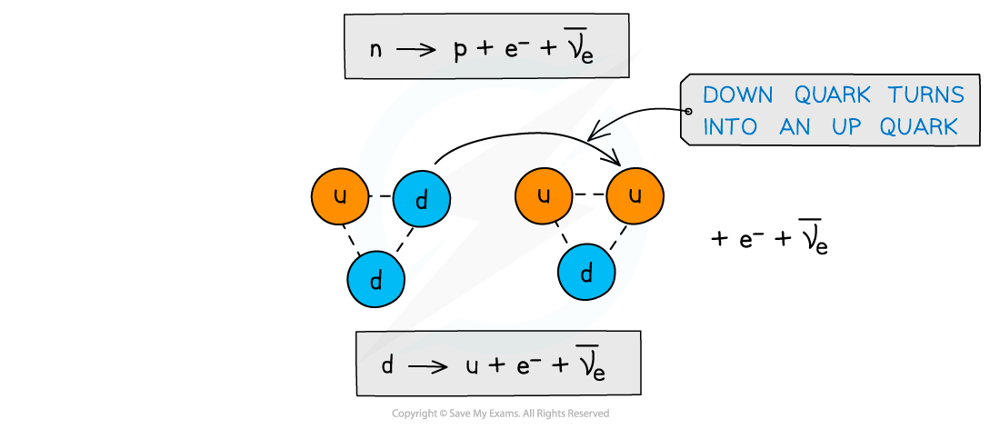
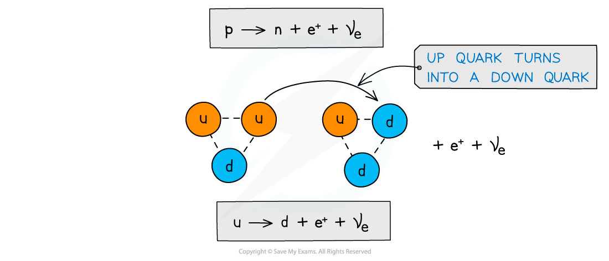

# The Quark Model of Beta Decay

## Quark Composition: β– & β+ decay

> **Spec point** — `spcpt_wDvbGbb8SyMrMqjY`

## Quark composition: β– & β+ decay

- Beta decay happens via the **weak interaction**

  - This is one of the four fundamental forces and it’s responsible for radioactive decays

### Quark composition: β- decay

- Recall that **β****-**** decay is when a neutron turns into a proton emitting an electron and anti-electron neutrino**
- More specifically, a neutron turns into a proton because a **down quark turns into an up quark**

#### Beta minus decay

***Beta minus decay is when a down quark turns into an up quark***

### Quark composition: β+ decay

- Recall that **β****+**** decay is when a proton turns into a neutron emitting an positron and an electron neutrino**
- More specifically, a proton turns into a neutron because an **up quark turns into a down quark**

#### Beta plus decay

***Beta minus decay is when an up quark turns into a down quark***

> **Worked Example**
> The equation for β– decay is
> 
> $n\rightarrowp+e^{-}+\overline{v_{e}}$
> 
> Using the quark model of beta decay, prove that the charge is conserved in this equation.
> 
> **Answer:**
> 
> **Step 1: Recall the process of beta minus decay**
> 
> - β− decay is when a down quark changes to an up quark
> 
>   - This changes a neutron into a proton
> 
> **Step 2: Determine the charge on the left hand side of the equation**
> 
> - The quark composition of a neutron is $\mathrm{udd}$
> - Adding the quark charges gives:
> 
> $+\frac{2}{3}-\frac{1}{3}-\frac{1}{3}=+0$
> 
> - The left side of the equation has a charge of 0
> 
> **Step 3: Determine the charge on the right hand side of the equation**
> 
> - The quark composition of a proton is $\mathrm{uud}$
> - Adding up the quark charges gives:
> 
> $+\frac{2}{3}+\frac{2}{3}-\frac{1}{3}=+1$
> 
> - The electron has a charge of −1
> - The anti-neutrino has a charge of 0
> 
>   - Therefore, the right hand side of the equation has a charge of:
> 
> $+1-1+0=0$
> 
> **Step 4: Prove that the charge is conserved**
> 
> - Since charge is equal on both sides, charge is conserved in the beta decay equation
