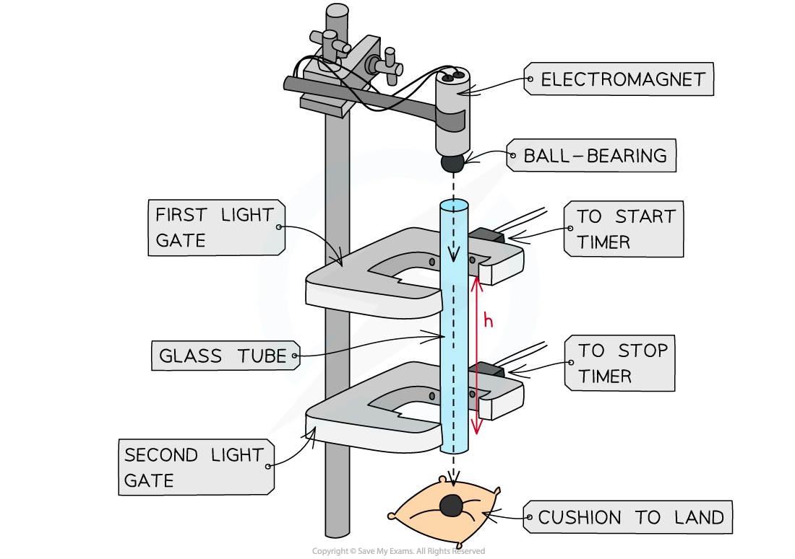
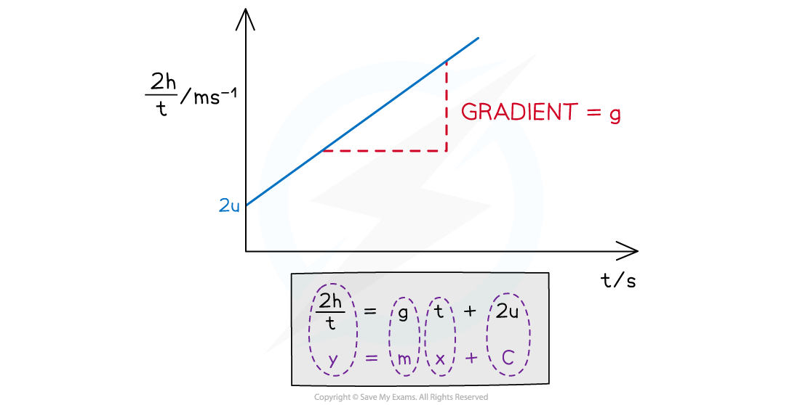

# Acceleration of Free Fall Experiment

## Acceleration of Free Fall Experiment

> **Spec point** — `spcpt_bMDSB3XgRFnNv9dv`

## Acceleration of free fall experiment

### Aims of the experiment

- The overall aim of the experiment is to calculate the value of the acceleration due to gravity, *g*
- This is done by measuring the time it takes for a ball-bearing to fall a certain distance. The acceleration is then calculated using an equation of motion

### Variables

- ***Independent variable*** = height, *h*
- ***Dependent variable*** = time, *t*
- Control variables:

  - Same steel ball–bearing
  - Same electromagnet
  - Distance between ball-bearing and top of the glass tube

### Equipment list

#### Equipment and use

| **Equipment** | **Purpose** |
|---|---|
| Metre ruler | To measure the distance between the light gates |
| Steel ball-bearing | To measure the distance and time taken to drop the ball. The ball must be made from a magnetic material |
| Electromagnet | To drop the ball-bearing through the glass tube at a specific height every time |
| Two light gates | To determine the time taken to drop a certain distance |
| Timer | To measure the time taken for the ball to drop between the light-gates. The timer must be activated to start when the ball passes the first light gate and stop when it passes the second |
| Tall clamp stand (retort stand) | To hold the glass tube and electromagnet in line with each other |
| Glass tube | To guide the ball-bearing vertically downwards |
| Cushion | To stop the ball-bearing from being damaged or damaging the surface when landing |

- ***Resolution*** of measuring equipment:

  - Metre ruler = 1 mm
  - Timer = 0.01 s

### Method

#### Apparatus setup

***Apparatus setup to measure the distance and time for the ball bearing to drop***

This method is an example of the procedure for varying the height the ball-bearing falls and determining the time taken – this is just one possible relationship that can be tested

1. Set up the apparatus by attaching the electromagnet to the top of a tall clamp stand. Do not switch on the current till everything is set up
2. Place the glass tube directly underneath the electromagnet, leaving space for the ball-bearing. Make sure it faces directly downwards and not at an angle
3. Attach both light gates around the glass tube at a starting distance of around 10 cm
4. Measure this distance between the two light gates as the height, *h* with a metre ruler
5. Place the cushion directly underneath the end of the glass tube to catch the ball-bearing when it falls through
6. Switch the current on the electromagnet and place the ball-bearing directly underneath so it is attracted to it
7. Turn the current to the electromagnet off. The ball should drop
8. When the ball drops through the first light gate, the timer starts
9. When the ball drops through the second light gate, the timer stops
10. Read the time on the timer and record this as time, *t*
11. Increase *h* (eg. by 5 cm) and repeat the experiment. At least 5 – 10 values for *h* should be used
12. Repeat this method at least 3 times for each value of *h* and calculate an average *t* for each

- An example of a table with some possible heights would look like this:

#### Example table of results

### Analysis of results

- The acceleration is found by using one of the SUVAT equations
- The known quantities are

  - Displacement *s = h*
  - Time taken = *t*
  - Initial velocity *u* = *u*
  - Acceleration *a = g*
- The following SUVAT equation can be rearranged:

$s=ut+\frac{1}{2}at^{2}$

$2s=2ut+at^{2}$

$\frac{2s}{t}=2u+at$

- Substituting the values and rearranging it as a straight-line equation gives:

$\frac{2h}{t}=gt+2u$

- Comparing this to the equation of a straight line: y = mx + c

  - *y* =  $\frac{2h}{t}$ (m s-1)
  - *x* = *t*
  - Gradient, m = a = *g* (m s–2)
  - *y*-intercept = 2*u*

1. Plot a graph of the $\frac{2h}{t}$ against *t*
2. Draw a line of best fit
3. Calculate the gradient - this is the acceleration due to gravity *g*
4. Assess the uncertainties in the measurements of *h* and *t*. Carry out any calculations needed to determine the uncertainty in *g* due to these

#### Graph of results

***The graph of ***$\frac{2h}{t}$*** against t produces a straight-line graph where the acceleration is the gradient***

### Evaluating the experiment

***Systematic Errors:***

- Residue magnetism after the electromagnet is switched off may cause *t* to be recorded as longer than it should be

***Random Errors:***

- Large uncertainty in *h* from using a metre rule with a precision of 1 mm
- Parallax error from reading *h*
- The ball may not fall accurately down the centre of each light gate
- Random errors are reduced through repeating the experiment for each value of *h* at least 3-5 times and finding an average time, *t*

### Safety considerations

- The electromagnetic requires current

  - Care must be taken to not have any water near it
  - To reduce the risk of electrocution, only switch on the current to the electromagnet once everything is set up
- A cushion or a soft surface must be used to catch the ball-bearing so it doesn’t roll off / damage the surface
- The tall clamp stand needs to be attached to a surface with a G clamp so it stays rigid

> **Worked Example**
> A student investigates the relationship between the height that a ball-bearing is dropped between two light gates and the time taken for it to drop.
> 
> | **Height *****h***** / m** | **Time *****t*****1**** / s** | **Time *****t*****2**** / s** | ** Time *****t*****3**** / s** | **Average time *****t***** / s** |
> |---|---|---|---|---|
> | 0.10 | 0.14 | 0.15 | 0.14 |   |
> | 0.20 | 0.18 | 0.20 | 0.21 |   |
> | 0.30 | 0.25 | 0.25 | 0.26 |   |
> | 0.40 | 0.29 | 0.28 | 0.30 |   |
> | 0.50 | 0.32 | 0.31 | 0.32 |   |
> | 0.60 | 0.34 | 0.35 | 0.34 |   |
> 
> Calculate the value of g from the table.
> 
> **Answer:**
> 
> **Step 1: Complete the table**
> 
> - Calculate the average time for each height
> - Add an extra column $\frac{2h}{t}$
> 
> | **Height *****h***** / m** | **Time *****t*****1**** / s** | **Time *****t*****2**** / s** | ** Time *****t*****3**** / s** | **Average time *****t***** / s** | $\frac{2h}{t}$** / m s****–1** |
> |---|---|---|---|---|---|
> | 0.10 | 0.14 | 0.15 | 0.14 | **Final answer:** **0.14** | **Final answer:** **1.43** |
> | 0.20 | 0.18 | 0.20 | 0.21 | **Final answer:** **0.20** | **Final answer:** **2.00** |
> | 0.30 | 0.25 | 0.25 | 0.26 | **Final answer:** **0.25** | **Final answer:** **2.40** |
> | 0.40 | 0.29 | 0.28 | 0.30 | **Final answer:** **0.29** | **Final answer:** **2.76** |
> | 0.50 | 0.32 | 0.31 | 0.32 | **Final answer:** **0.32** | **Final answer:** **3.13** |
> | 0.60 | 0.34 | 0.35 | 0.34 | **Final answer:** **0.34** | **Final answer:** **3.53** |
> 
> **Step 2: Draw graph of **$\frac{2h}{t}$** against time***** t***
> 
> 
> 
> - Make sure the axes are properly labelled and the line of best fit is drawn with a ruler
> 
> **Step 3: Calculate the gradient of the graph **
> 
> 
> 
> - The gradient is calculated by:
> 
> $g=\frac{3.50-0.125}{0.36-0}=9.375=9.38ms^{-2}$
