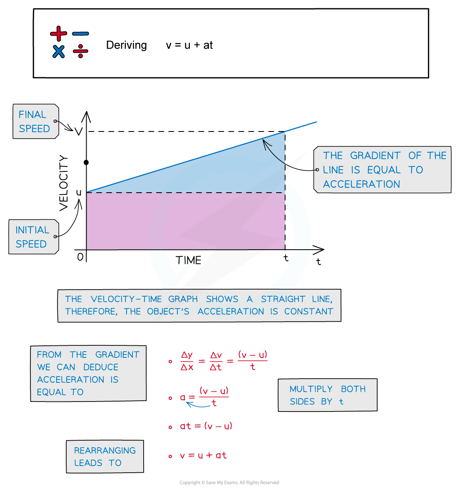
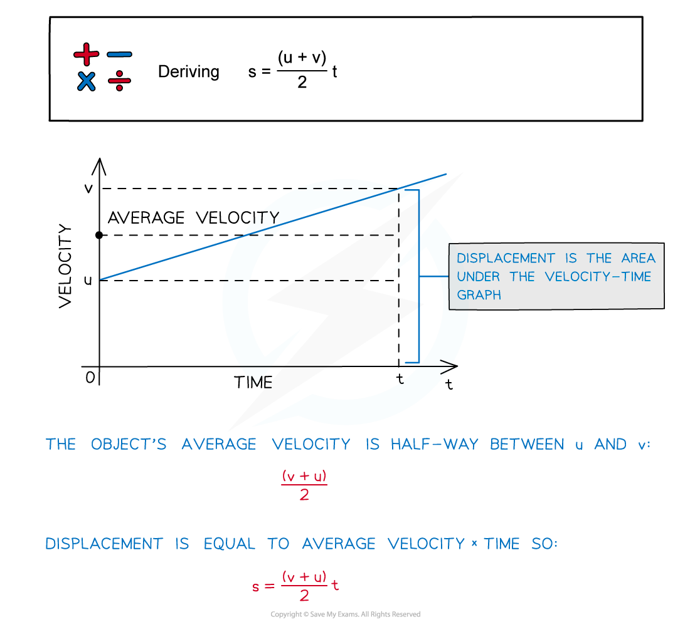
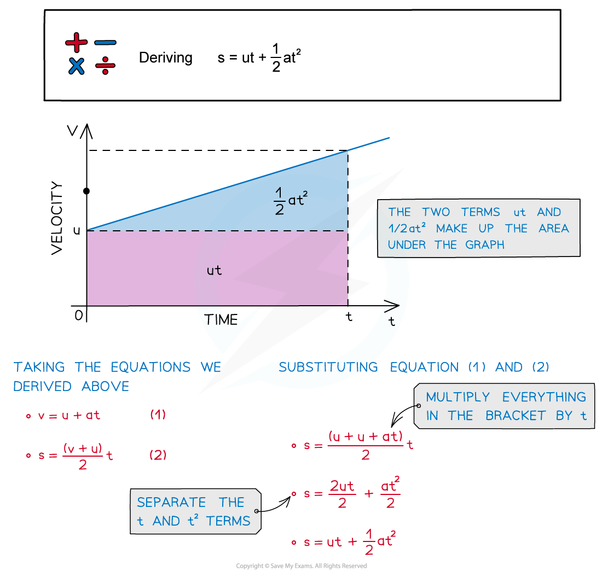
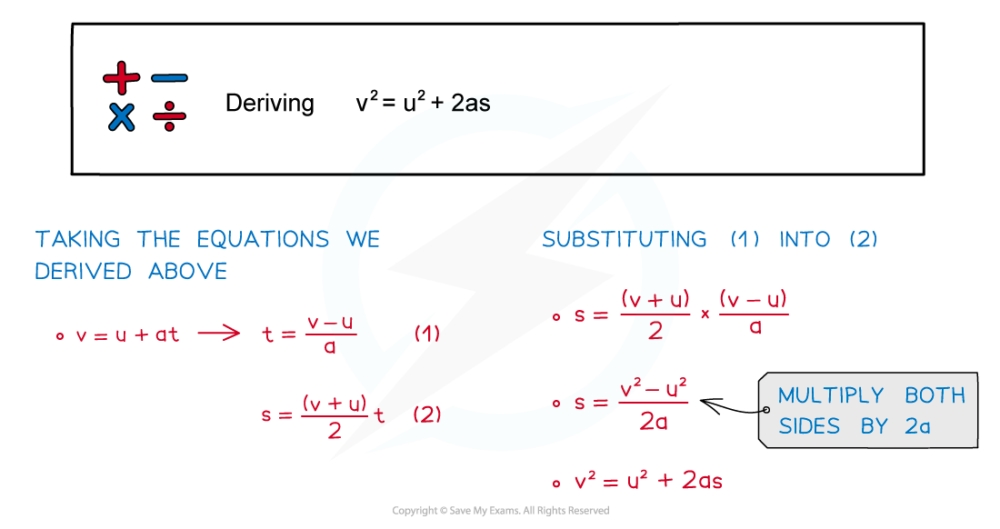
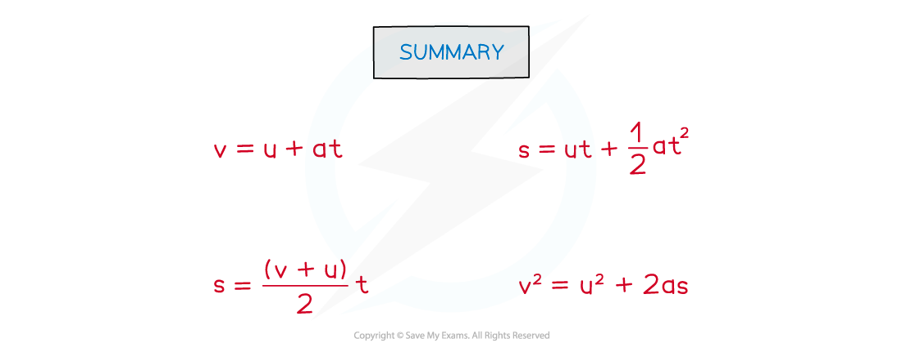

# Deriving Kinematic Equations

## Deriving Kinematic Equations of Motion

> **Spec point** — `spcpt_VQbrcqSMndgSwnWZ`

## Deriving kinematic equations of motion

- The kinematic equations of motion are a set of four equations which can describe any object moving with **constant** acceleration
- They relate the five variables:

  - *s* = **displacement**
  - *u* = **initial velocity**
  - *v* = **final velocity**
  - *a* = **acceleration**
  - *t* = **time interval**
- It’s important to know where these equations come from and how they are derived:

### Deriving v = u + at

***A graph showing how the velocity of an object varies with time***

### Deriving s = $\frac{1}{2}$(u + v)t

***The average velocity is halfway between u and v***

### Deriving s = ut + $\frac{1}{2}$at2

***The two terms ut and ½at******2****** make up the area under the graph***

### Deriving v2 = u2 + 2as

***This final equation can be derived from two of the others***

#### Summary of the equations of motion

***Summary of the four equations of uniformly accelerated motion***

> **Exam Hint**
> Only $s=ut+\frac{1}{2}at^{2}$ and $v^{2}=u^{2}+2as$ are given on your data sheet for your exam - make sure you remember **all** the equations of motions and their derivations.
