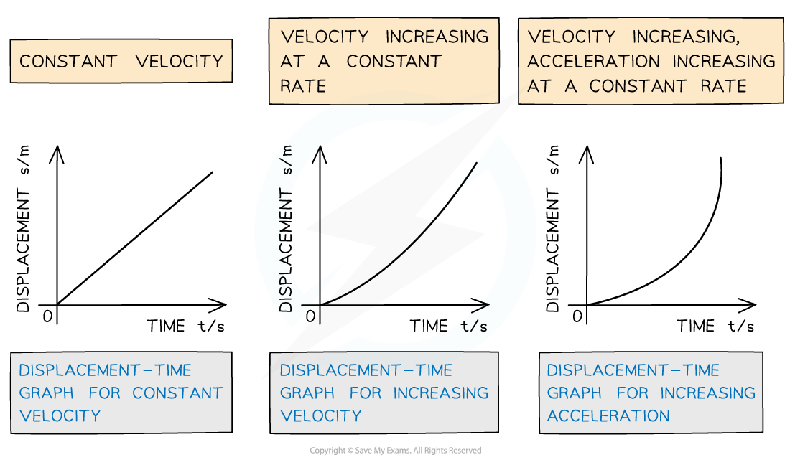
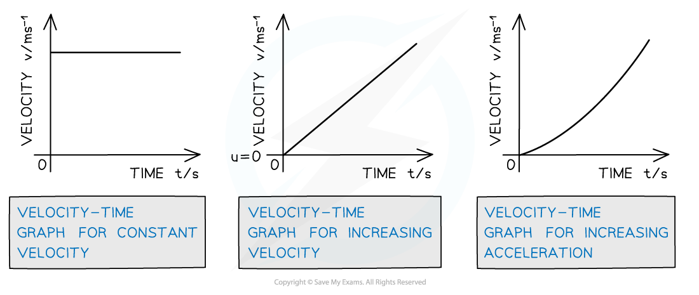
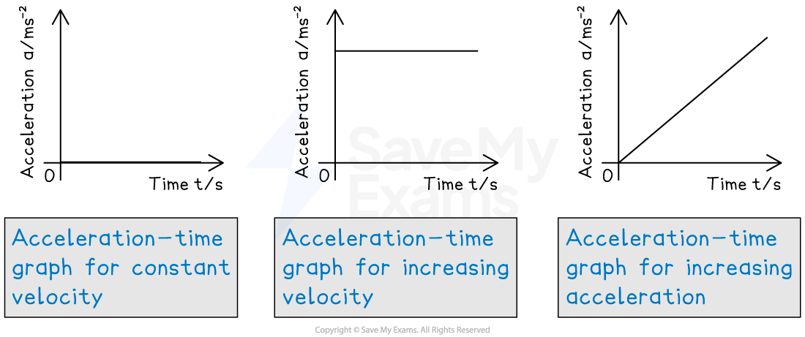

# Motion Graphs

## Motion Graphs

> **Spec point** — `spcpt_gTzrwyCSt8q6ShbB`

## Motion graphs

- There are five types of graph that can represent motion

### Distance-time graphs

- On a **distance-time graph…**

  - **slope** equals **speed**
  - the** y-intercept** equals the **initial position**
  - a **straight **(diagonal) line represents a **constant** speed
  - a **curved** line represents an **acceleration**
  - the slope is always **zero **or **positive **because distance is a** scalar quantity**
  - a **zero** slope (horizontal line) represents a state of **rest**
  - the area under the curve is meaningless

### Displacement-time graphs

- On a **displacement-time graph…**

  - **slope** equals **velocity**
  - the** y-intercept** equals the **initial position**
  - a **straight **(diagonal) line represents a **constant** velocity
  - a **curved** line represents an **acceleration**
  - a **positive** **slope** represents motion in the **positive** **direction**
  - a **negative** **slope** represents motion in the **negative** **direction**
  - a **zero** slope (horizontal line) represents a state of **rest**
  - the area under the curve is meaningless

#### Displacement-time graphs for different scenarios

***The displacement-time graph for constant velocity is a straight diagonal line, and for acceleration is a curve***

### Speed-time graphs

- On a **speed-time graph…**

  - **slope** equals **acceleration**
  - the **y-intercept** equals the **initial speed**
  - a **straight** line represents **uniform** acceleration
  - a **curved** line represents **non-uniform acceleration**
  - a **positive** slope represents an **increase** in **speed **
  - a **negative** slope represents a **decrease **in **speed **
  - a **zero** slope (horizontal line) represents motion with **constant** **speed**
  - the **area** under the curve equals the** distance **travelled

### Velocity-time graphs

- On a **velocity-time graph…**

  - **slope** equals **acceleration**
  - the **y-intercept** equals the **initial velocity**
  - a **straight** line represents **uniform** acceleration
  - a **curved** line represents **non-uniform acceleration**
  - a **positive** slope represents an **increase** in **velocity** in the **positive** **direction**
  - a **negative** slope represents an **increase** in **velocity** in the **negative** **direction**
  - a **zero** slope (horizontal line) represents motion with **constant** **velocity**
  - the **area** under the curve equals the **displacement **

#### Velocity-time graphs for different scenarios

***The velocity-time graph for constant velocity is a straight horizontal line, for acceleration is a straight diagonal line and for increasing acceleration is a curve***

### Acceleration-time graphs

- On an **acceleration-time graph…**

  - slope is meaningless
  - the y-intercept equals the initial acceleration
  - a zero slope (horizontal line) represents an object undergoing constant acceleration
  - the area under the curve equals the change in velocity

#### Acceleration-time graph for different scenarios

***The acceleration-time graph for constant velocity is blank, for increasing velocity is a straight horizontal line and for increasing acceleration is a straight diagonal line***

> **Exam Hint**
> Always check the axes when dealing with graphs. The differences between distance-time graphs and displacement-time graphs, and speed-time graphs and velocity-time graphs are subtle but important. Make sure you know what you are looking at before answering any graph questions in the exam.
