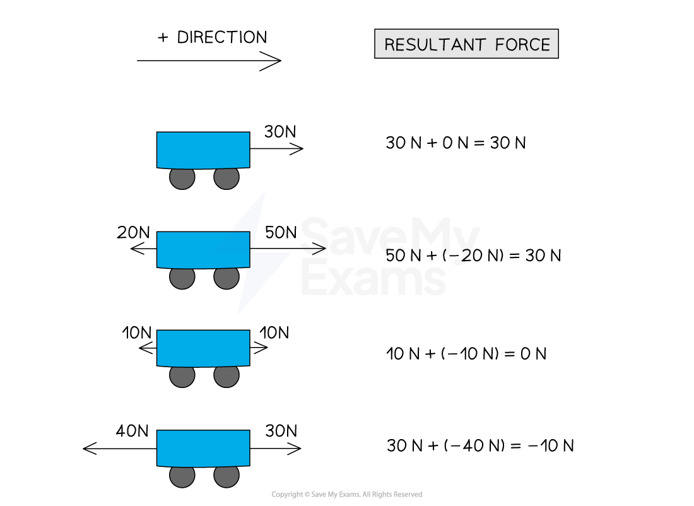

# Force & Acceleration

## Force & Acceleration

> **Spec point** — `spcpt_hSJBJS2BwzqkNWJH`

## Force & acceleration

- **Newton's second law of motion** tells us that objects will accelerate if there is a **resultant force** acting upon them
- This **acceleration** will be in the **same direction** as this** resultant force**

$F=ma$

- Where:

  - *F* = force in newtons (N)
  - *m* = mass in kilograms (kg)
  - *a* = acceleration in metres per second squared (m s-2)

### Resultant force

- Since force is a **vector**, every force on a body has a **magnitude **and **direction**
- The **resultant force** is therefore the **vector sum** of all the forces acting on the body
- The **direction **of the force is indicated as either **positive **or **negative **

#### Resultant forces on a body

***Resultant forces on a body are indicated by a positive or negative value***

- The resultant force could also be at an **angle**, in which case **vector addition** is used to find the magnitude and direction of the resultant force.

  - More details on vector addition can be found in [Scalars & Vectors](https://www.savemyexams.com/a-level/physics/cie/25/revision-notes/1-physical-quantities-and-units/1-4-scalars-and-vectors/scalars-and-vectors/)

### Acceleration

- Newton’s second law can be used to find the acceleration of an object of a known mass
- Since **acceleration **is also a **vector**, it can be either positive or negative depending on the **direction **of the **resultant force**
- An object will speed up (**positive **acceleration) if the resultant force acts in the **same **direction as the **direction of motion**
- An object will slow down (**negative **acceleration) if the resultant force acts in the **opposite **direction to the **direction of** **motion **
- The **acceleration** will always be in the **same **direction as the **resultant force**

> **Worked Example**
> A rocket produces an upward thrust of 15 MN and has a weight of 8 MN.
> 
> (a) When in flight, the force due to air resistance is 500 kN.
> 
> Calculate the resultant force on the rocket.
> 
> (b) The mass of the rocket is 0.8 × 105 kg.
> 
> Calculate the acceleration of the rocket and state the direction of the acceleration.
> 
> **Answer:**
> 
> **(a)**
> 
> **Step 1: Sketch a diagram of the forces acting on the rocket**
> 
> 
> 
> **Step 2: Convert all the forces into SI units (newtons)**
> 
> - Upward acting force (positive direction):
> 
>   - Thrust = 15 MN = $15\times10^{6}N$
> - Downward acting forces (negative direction):
> 
>   - Weight = 8 MN = $8\times10^{6}N$
>   - Air resistance = 500 kN = $500\times10^{3}N$
> 
> **Step 3: Calculate the resultant force acting on the rocket**
> 
> $F = ( 15 \times 10^{6} ) - ( 8 \times 10^{6} ) - ( 500 \times 10^{3} )$
> 
> $F=6.5\times10^{6}N\mathrm{upwards}$
> 
> **(b)**
> 
> **Step 1: List the known quantities**
> 
> - Force, *F* = 6.5×106 N
> - Mass, *m* = 0.8 × 105 kg
> 
> **Step 2: State the equation for Newton's Second Law of motion**
> 
> $F=ma$
> 
> **Step 3: Rearrange to make acceleration the subject**
> 
> $a=\frac{F}{m}$
> 
> **Step 4: Substitute in the known values and calculate the acceleration**
> 
> $a=\frac{6.5\times10^{6}}{0.8\times10^{5}}$
> 
> $a=81ms^{-2}$
> 
> **Step 5: State the direction of the acceleration**
> 
> $a=81ms^{-2}\mathrm{Upwards}$
> 
> - Remember that acceleration is always in the same direction as the resultant force

> **Exam Hint**
> You can choose which direction is positive as long as you are consistent throughout your calculation. However, the general convention is for the direction of motion to be the positive direction.
