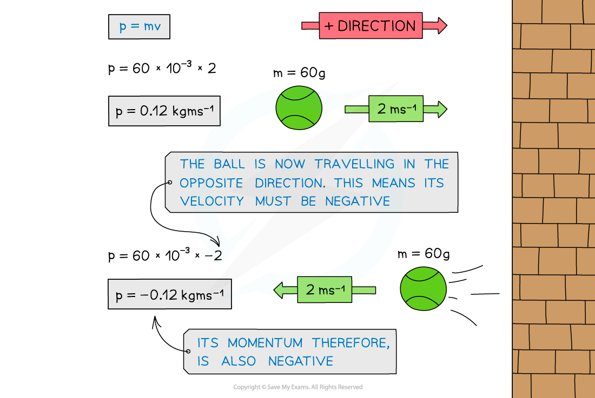

# Linear Momentum

## Linear Momentum

> **Spec point** — `spcpt_fMKzSSSggxxcP3m3`

## Linear momentum

- **Linear momentum**, *p,* is defined as the **product **of **mass** and **velocity**

$p=mv$

- Where:

  - *p* = linear momentum in kilogram metres per second (kg m s-1)
  - *m* = mass in kilograms (kg)
  - *v* = velocity in metres per second (m s-1)

- Momentum is a **vector **quantity; it has both **magnitude **and **direction**
- It can have a positive or negative value which describes its direction in a one dimensional plane

  - If an object travelling to the right has positive momentum, an object travelling to the left (in the opposite direction) has a negative momentum

#### Momentum of a ball hitting a wall

***When the ball is travelling in the opposite direction, its velocity is negative. Since momentum = mass × velocity, its momentum is also negative***

> **Worked Example**
> A tennis ball of mass, *m* = 60 g travels at a velocity, *v* = 75 m s-1. A brick of mass, *m* = 3 kg travels at a velocity, *v* = 1.5 m s-1.
> 
> Determine which object has the most momentum.
> 
> 
> 
> **Answer: **
> 
> **Step 1: List the known quantities and convert to SI units**
> 
> - Mass of tennis ball, $m_{T}=0.06\mathrm{kg}$
> - Velocity of tennis ball, $v_{T}=75ms^{-1}$
> - Mass of brick, $m_{B}=3\mathrm{kg}$
> - Velocity of brick, $v_{B}=1.5ms^{-1}$
> 
> **Step 2: Determine the momentum of the tennis ball**
> 
> $p_{T}=m_{T}\timesv_{T}$
> 
> $p_{T}=0.06\times75$
> 
> $p_{T}=4.5\mathrm{kg}ms^{-1}$
> 
> **Step 3: Determine the momentum of the brick**
> 
> $p_{B}=m_{B}\timesv_{B}$
> 
> $p_{B}=3\times1.5$
> 
> $p_{B}=4.5\mathrm{kg}ms^{-1}$
> 
> **Step 4: State which object has the most momentum**
> 
> - Both objects have the same momentum
> 
>   - Even though the brick has a greater mass, it has a much lower velocity than the tennis ball

> **Exam Hint**
> Remember to convert the values given into SI units. It is good practice to do this before the calculation.
> 
> - If the mass is given in grams, convert to kg by dividing the value by 1000
> - If the velocity is given in km s−1, convert to m s−1 by multiplying the value by 1000
> 
> Like with [Force and Acceleration](https://www.savemyexams.com/a-level/physics/cie/25/revision-notes/3-dynamics/3-1-momentum-and-newtons-laws-of-motion/force-and-acceleration/), the direction you consider positive is your choice, as long you are consistent throughout the calculation.
