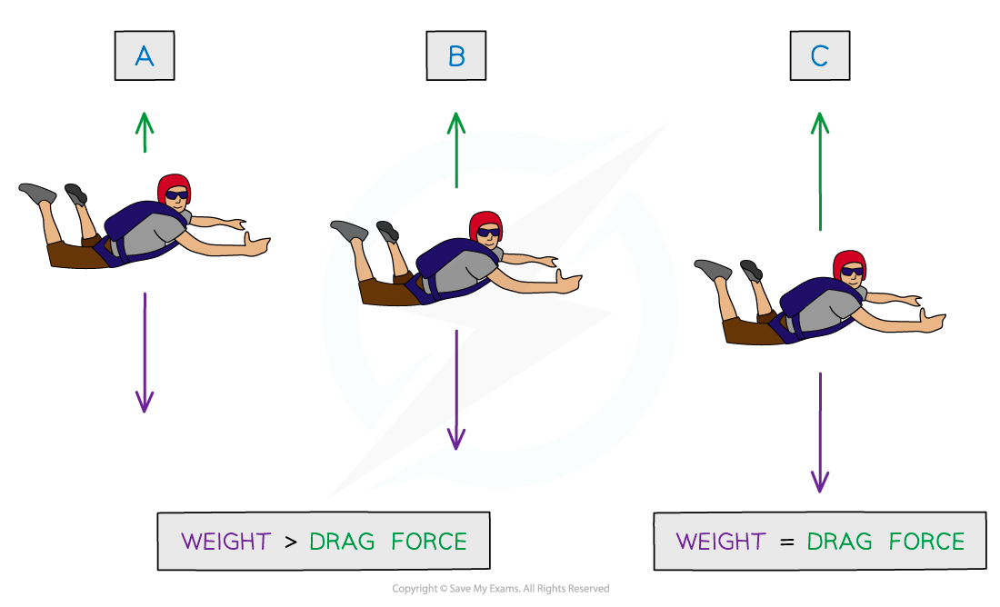
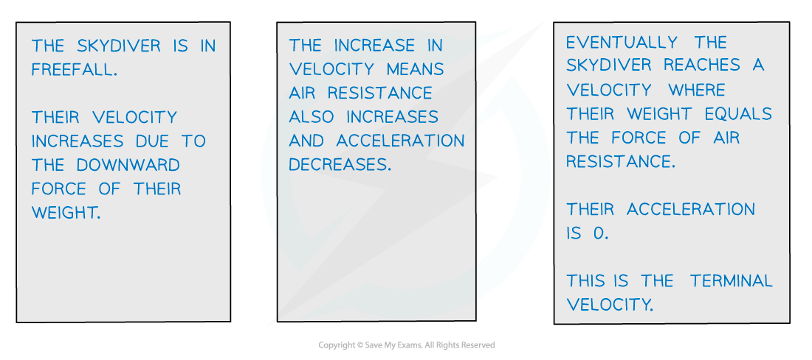
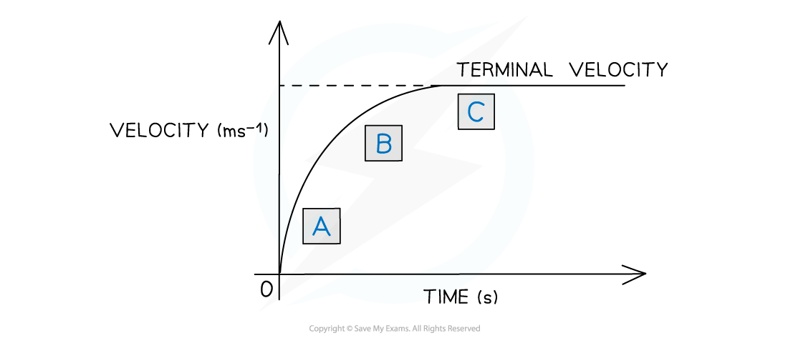

# Terminal Velocity

## Terminal Velocity

> **Spec point** — `spcpt_xXMznwSNsjv3zqJ9`

## Terminal velocity

- For a body in **free fall** with **no effects of air resistance **(for example, on the moon), the **only **force acting on it is **weight**

  - The **resultant force** is equal to weight
  - Therefore, the body accelerates at *g, ***acceleration of free fall**

- For a body in **free fall**, when **air resistance** is a factor (for example on Earth):

  - **Weight **is **greater **than **air resistance**, so the **resultant force** is in the **direction of motion**
  - The body **accelerates **according to Newton's second law, ***F = ma***
  - As the **velocity increases**, the **drag force** **increases**
  - The **resultant force decreases**, therefore the **acceleration decreases**
  - When the drag force **equals **weight, the resultant force is **zero **
  - The body falls at a **constant **velocity called **terminal velocity**
  - Terminal velocity is the **maximum velocity** the body can reach

#### The stages of a skydiver reaching terminal velocity

***As the velocity of the skydiver increases, the drag force due to air resistance also increases, until the skydiver can no longer accelerate and a maximum, terminal velocity is reached***

#### Graph of the stages of the skydiver reaching terminal velocity

***The gradient decreases with time, showing that acceleration decreases with time until terminal velocity is reached and acceleration reaches zero***

- The graph shows how the **velocity **of the skydiver varies with **time**
- Since the **acceleration **is equal to the **gradient **of a velocity-time graph, the acceleration **decreases **and eventually becomes **zero **when **terminal velocity** is reached

> **Worked Example**
> Skydivers A and B jump out of a plane at intervals of a few seconds. The mass of Skydiver A is greater than the mass of Skydiver B. Skydivers A and B want to join up as they fall.
> 
> Explain who should jump first, in order for them to meet up as they fall.
> 
> 
> 
> **Answer: **
> 
> **Step 1: Determine which skydiver will have the greatest terminal velocity**
> 
> - Skydiver A has a greater **mass**
> - Because ***F = ma***, Skydiver A also has a **greater **force of **weight **acting on them
> - Since **terminal velocity** is reached when **air resistance equals weight**, Skydiver A will have a **greater **terminal velocity
> 
> **Step 2: Determine who should jump first**
> 
> - Skydiver A has a greater terminal velocity and will therefore fall at a **greater **speed
> - In order for Skydiver B to catch up to Skydiver A during the fall, **Skydiver B needs to jump first**

> **Exam Hint**
> - Exam questions about terminal velocity tend to involve the motion of skydivers as they fall
> - A common misconception is that skydivers move upwards when their parachutes are deployed - however, this is not the case, they are in fact **decelerating** to a lower terminal velocity
