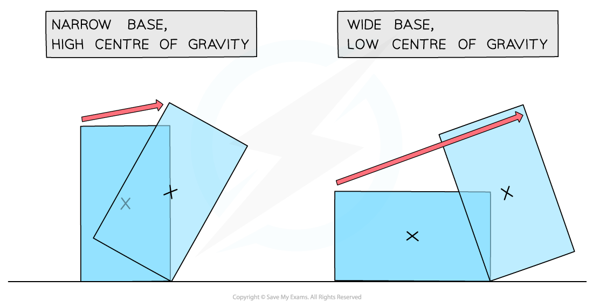
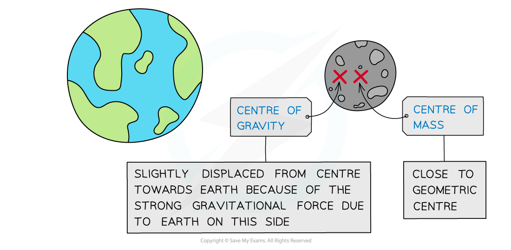

# Centre of Gravity

## Centre of Gravity

> **Spec point** — `spcpt_wBjdRrcZ3R7tGjdm`

## Centre of gravity

- The centre of gravity of an object is defined as: **The point at which the weight of the object may be considered to act**
- For example, for a person standing upright, their centre of gravity is roughly in the middle of the body behind the navel, and for a sphere, it is at the centre
- For symmetrical objects with uniform density, the centre of gravity is located at the **point of symmetry**

#### The centre of gravity of different shapes

***The centre of gravity of a shape can be found by symmetry***

### Stability

- The position of the centre of gravity of an object affects the object's **stability**
- An object is **stable **when its centre of gravity lies **above its base**

#### Centre of gravity of stable and unstable objects

***The object on the right will topple, as its centre of gravity is no longer over its base***

- The **wider **the base of an object

  - The **lower** its centre of gravity
  - The **more stable **the object is
- The **narrower** the base of an object

  - The **higher** its centre of gravity
  - The **less stable** the object is

#### Centre of gravity of narrow and wide based objects

***The most stable objects have wide bases and low centres of gravity ***

### Centre of gravity versus centre of mass

- In a **uniform **gravitational field, the centre of **gravity **is identical to the centre of **mass**
- The centre of **mass **does **not** depend on the gravitational field

- Since **weight **is the product of mass and the acceleration due to gravity, ***W = mg***, the centre of gravity **does** depend on the gravitational field

- When an object is in **space**:

  - Its centre of **gravity **will be closer to the object with **larger gravitational field**
  - Its centre of **mass** will be close to its geometric centre

#### Centre of gravity and centre of mass of the moon

***The Earth’s stronger gravitational field pushes the Moons centre of gravity closer to Earth***

> **Exam Hint**
> Since the centre of **gravity **is a hypothetical point, it can lie **inside **or **outside **of a body.
> 
> The centre of **gravity **can also move, depending on the shape or the orientation of the object being considered.
> 
> For example, a human body’s centre of gravity is lower when leaning forwards than when standing upright. And you will notice your own centre of gravity shift backwards when you pick up your heavy school bag and put it on your back. This is why you instinctively lean forwards to carry it.
