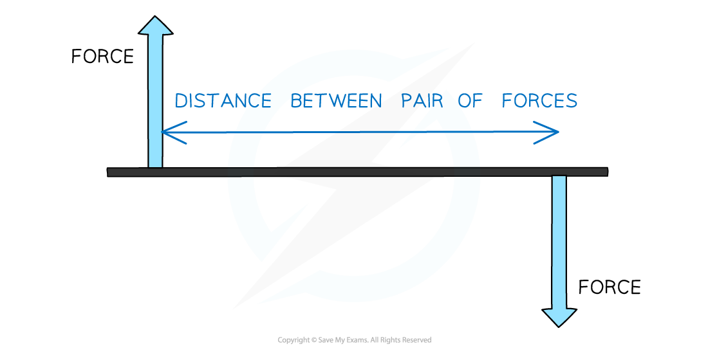

# Turning Effects of Forces

## Couples

> **Spec point** — `spcpt_tdR4BFt9BGNykp8J`

## Couples

- A **couple **is a **pair** **of forces** that acts to produce **rotation **only
- The moment of a **single force** depends on the perpendicular distance **to the pivot**
- However, the moment of a **couple **depends on the perpendicular distance **between the two forces**

- A **couple **consists of a pair of forces that are:

  - **Equal **in magnitude
  - **Opposite **in direction
  - **Perpendicular **to the distance between them

#### A pair of forces, or couple

***The moment of a couple depends on the perpendicular distance between the two forces***

- Couples produce a resultant force of **zero**
- Therefore, due to Newton’s second law of motion, ***F ****= ****ma***, the object does **not** accelerate

> **Worked Example**
> Which pair of forces acts as a couple on the circular object?
> 
> ![Options A–D, each showing a circle with different pairs of forces acting. 
> A: Two forces of magnitude F act at the edge of the circle on opposite sides, one acting upward and the other acting downward.
> B: Two forces of magnitude 2F and F act at the edge of the circle on opposite sides, both acting upward.
> C: Two forces of magnitude 2F and half F act at the edge of the circle on opposite sides, one acting to the left and the other acting to the right.
> D: Two forces of magnitude F act at the edge of the circle, one acting to the right and the other acting downward.](assets/5d462cfe8126-43531-we-couples-question-image-new.png)
> 
> **Answer: A**
> 
> - In diagram **A**, the forces are:
> 
>   - Equal in size
>   - In opposite directions
>   - Perpendicular to the distance between them
> - **B** is incorrect as the forces are in the same direction
> - **C** is incorrect as the forces are different in size
> - **D** is incorrect as the distance between the forces is not perpendicular

> **Exam Hint**
> The forces that make up a couple cannot share the same **line of action**. The line of action is a **line through the point at which the force is applied**.
> 
> 

## Torque

> **Spec point** — `spcpt_h6NbBGYsyXWxvvYf`

## Torque

- The **moment **of a **couple **is known as a **torque**
- You can calculate the torque of a couple with the following equation:

$τ=Fd$

- Where:

  - $τ$ (Greek letter tau) = torque in newton metres (N m)
  - *F* = one of the forces in the couple in newtons (N)
  - *d* = perpendicular distance between the forces

> **Worked Example**
> A steering wheel has a diameter of 40 cm, and the force of the couple needed to turn it is 10 N.
> 
> Calculate the torque on the steering wheel.
> 
> **Answer:**
> 
> **Step 1: List the known quantities converting to SI units**
> 
> - Force, *F* = 10 N
> - Perpendicular distance between forces, *d* = 0.4 m
> 
> **Step 2: Sketch a diagram of the scenario**
> 
> 
> 
> **Step 3: State the torque equation**
> 
> $τ=Fd$
> 
> **Step 4: Substitute in the known values to calculate**
> 
> $τ=10\times0.4$
> 
> τ = 4 N m

> **Worked Example**
> A ruler of length 0.3 m is pivoted at its centre. Equal and opposite forces of magnitude 4.0 N are applied to the ends of the ruler, creating a couple.
> 
> Determine the magnitude of the torque of the couple on the ruler at the position shown in the diagram.
> 
> 
> 
> **Answer:**
> 
> **Step 1: List the known quantities**
> 
> - Forces applied = 4 N at 30°
> - Perpendicular distance between forces, *d* = 0.3 m
> 
> **Step 2: State the equation for torque**
> 
> $τ=Fd$
> 
> **Step 3: Determine the component of the force that is perpendicular to the distance between the forces**
> 
> 
> 
> $F = 4 \times \sin ( 30 )$
> 
> or
> 
> $F = 4 \times \cos ( 60 )$
> 
> **Step 4: Substitute in the known values to calculate**
> 
> $\\tau = 4 \sin ( 30 ) \times 0.3$
> 
> $τ=0.6Nm$

> **Exam Hint**
> The forces given in a question might not always be perpendicular to the distance between them. In this case, remember to find the **component **of the force vector that **is **perpendicular.
> 
> You can recap how to do this in [Scalars & Vectors](https://www.savemyexams.com/a-level/physics/cie/25/revision-notes/1-physical-quantities-and-units/1-4-scalars-and-vectors/scalars-and-vectors/).
