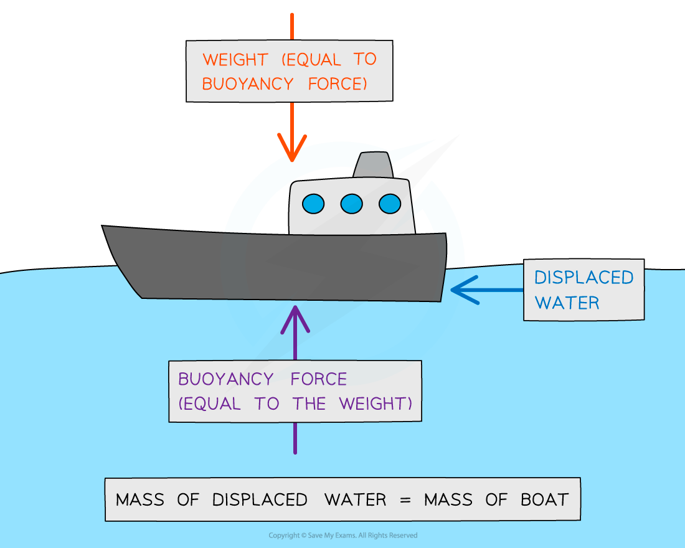

# Archimedes' Principle

## Archimedes' Principle

> **Spec point** — `spcpt_FQKTBk8wpPGDymtq`

## Archimedes' principle

- **Archimedes’ principle** states that: **An object submerged in a fluid at rest has an upward buoyancy force (upthrust) equal to the weight of the fluid displaced by the object**
- The object sinks until the weight of the fluid displaced is equal to its own weight

  - Therefore, the object floats when the magnitude of the **upthrust equals the weight** of the object

- The magnitude of **upthrust **can be calculated by:

$F=ρgV$

- Where:

  - *F* = force in newtons (N)
  - *ρ* (Greek letter rho) = density in kilograms per metre cubed (kg m-3)
  - *g* = gravitational field strength in newtons per kg (N kg-1)
  - *V* = volume in metres cubed (m3)

- Since *m* = *ρV*, upthrust is equal to *F* = *mg* which is the weight of the fluid displaced by the object
- Archimedes’ Principle explains how ships float:

#### Upthrust on a boat

***Boats float because they displace an amount of water that is equal to their weight***

> **Worked Example**
> Icebergs typically float with a large volume of ice beneath the water. Ice has a density of 917 kg m-3 and a volume of *V*i.
> 
> The density of seawater is 1020 kg m-3.
> 
> What fraction of the iceberg is submerged below the water?
> 
> **A. **0.10 Vi
> 
> **B.** 0.90 Vi
> 
> **C.** 0.97 Vi
> 
> **D.** 0.20 Vi
> 
> **Answer:**
> 
> **Step 1: List the known quantities**
> 
> - Density of ice, *ρ*i = of 917 kg m-3
> - Volume of ice = *V*i
> - Density of seawater, *ρ*w = 1020 kg m-3
> - Volume of seawater = *V*w
> 
> **Step 2: Consider Archimedes' Principle**
> 
> - According to Archimedes' Principle the force of upthrust is equal to the weight of the seawater displaced by the iceberg
> 
> $W_{i}=m_{i}g$
> 
> - Buoyancy force is the weight of the displaced water
> 
> $W_{w}=m_{w}g$
> 
> **Step 3: Equate the forces of weight and upthrust**
> 
> - Since the iceberg is floating, its weight is exactly equal to the buoyancy force
> 
> $W_{i}=W_{w}$
> 
> $m_{i}g=m_{w}g$
> 
> **Step 4: State the density equation and rearrange for mass**
> 
> $ρ=\frac{m}{V}$
> 
> $m=ρV$
> 
> **Step 5: Substitute *****ρV***** for mass in the *****mg***** equivalence**
> 
> $ρ_{i}V_{i}g=ρ_{w}V_{w}g$
> 
> **Step 6: Determine the ratio of densities**
> 
> - Cancelling *g:*
> 
> $\rho_{i} V_{i} \cancel{g} = \rho_{w} V_{w} \cancel{g}$
> 
> - Dividing by $p_{w}V_{i}$
> 
> $\frac{ρ_{i}}{ρ_{w}}=\frac{V_{w}}{V_{i}}$
> 
> **Step 7: Solve for the volume of ice submerged underwater**
> 
> $V_{w}=\frac{ρ_{i}V_{i}}{ρ_{w}}$
> 
> $V_{w}=\frac{917V_{i}}{1020}=0.9V_{i}$
> 
> - This means that 90% of the iceberg's volume is submerged underwater
> - The correct answer is **B**

> **Exam Hint**
> Don't get confused by the two step process to find upthrust.
> 
> - Step 1: You need the volume of the submerged object, but **only **because you want to know **how much fluid was displaced**
> - Step 2: What you **really **want to know is the **weight of the displaced fluid**.
> 
> A couple of familiar equations will help;
> 
> - ***m = ρV ***to get mass
> 
> then
> 
> - ***W = mg*** to get weight
> 
> If you are feeling particularly mathematical, you can combine your equations, so that ***W = ρVg***
