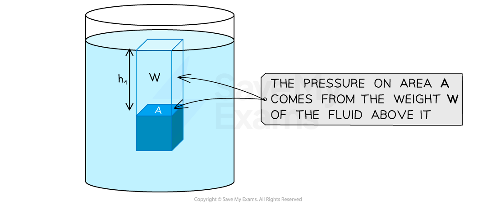
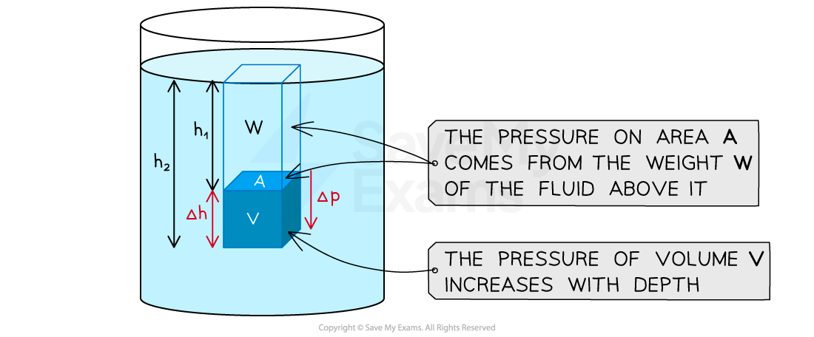

# Derivation of  ∆p = ρg∆h

## Derivation of ∆p = ρg∆h

> **Spec point** — `spcpt_SjsgPDdk3wZyc7ZZ`

## Derivation of ∆p = ρg∆h

- **Hydrostatic pressure** is the pressure at any given point within a **fluid**, that is exerted by the **weight **of the fluid above that point
- If the fluid is at **rest**, then all the points within the fluid are in **equilibrium**
- Therefore, the **pressure **acts in **all directions** at each point

#### Pressure on a point in a fluid

***The hydrostatic pressure on area A is due to the weight, W, of the volume of fluid above it***

- The weight, *W,* of the fluid above area *A* is given by:

$W=mg$

- Using the density equation, mass can be given as:

$ρ=\frac{m}{V}$

$m=ρV=ρAh$

- Substituting this expression for mass into the weight equation gives:

$W=ρAhg$

- Therefore, the pressure exerted on area *A* can be given as:

$p=\frac{F}{A}=\frac{W}{A}=\frac{ρAhg}{A}=ρhg$

- Within the volume of the cube *V,* there is a change in pressure between the top and bottom surfaces

#### Change in pressure through a volume of fluid

***The pressure at the bottom of the cube with volume V is greater than the area A at the top of the cube, because there is an increasing amount of fluid above, which increases the force of weight W acting upon it***

- The change in pressure can be found by considering the change in height of the volume of fluid above the lower surface
- This gives the equation for hydrostatic pressure:

$\Deltap=ρ\Deltahg$

- Where:

  - ∆*p* = change in pressure in pascals (Pa)
  - *ρ* (Greek letter rho) = density of fluid in kilograms per metre cubed (kg m-3)
  - ∆*h* = change in height in metres (m)
  - *g* = gravitational field strength in newtons per kg (N kg-1)

> **Exam Hint**
> You will be expected to remember all the steps for this derivation for an exam question.
> 
> You can recap the equations used in this derivations in the topics [Density](https://www.savemyexams.com/a-level/physics/cie/25/revision-notes/4-forces-density-and-pressure/4-3-density-and-pressure/density/) and [Pressure](https://www.savemyexams.com/a-level/physics/cie/25/revision-notes/4-forces-density-and-pressure/4-3-density-and-pressure/pressure/)

## Using the Equation for Hydrostatic Pressure

> **Spec point** — `spcpt_nJYct34mC6K2dDD4`

## Using the equation for hydrostatic pressure

- When an object is immersed in a liquid, the liquid will exert a pressure which acts in all directions, squeezing the object
- The size of this pressure depends upon:

  - The density, ***ρ,*** of the liquid
  - The depth, ***h,*** of the object
  - The gravitational field strength, ***g***

- The **total pressure** acting on the object considers both the weight of the **fluid **above the object, and the weight of the **air **above the object
- When asked about the **total pressure**, the atmospheric pressure must also be included

Total pressure = Hydrostatic pressure + Atmospheric pressure

- Standard atmospheric pressure is about **1.0 × 10****5**** Pa** (101 325 Pa); use the value given in the question

### U-tube manometer

- A manometer is an instrument to measure pressure and density of two liquids

#### A U-tube manometer

***A U-tube manometer shows changes in pressure as the liquid moves in the tube***

- In Figure 1: The level of liquid is equal because the atmospheric pressure (Patm) is the same
- In Figure 2: If the pressure on one side rises, the liquid will be forced down making the liquid in the other limb rise. The difference between the two levels gives the pressure difference between the two ends of the tube
- In Figure 3: The U-tube now has two different liquids. The density of the blue one is greater than that of the orange one. The pressure at each point is due to the atmospheric pressure plus the weight of the liquid above it

> **Worked Example**
> Atmospheric pressure at sea level has a value of 100 kPa. The density of sea water is 1020 kg m-3.
> 
> At what depth in the sea would the total pressure be 250 kPa?
> 
> **A. **20 m
> 
> **B.** 9.5 m
> 
> **C.** 18 m
> 
> **D.** 15 m
> 
> **Answer: **
> 
> **Step 1: List the known quantities and convert to SI units:**
> 
> - Atmospheric pressure = 100 × 103 Pa
> - Total pressure = 250 × 103 Pa
> - Density of sea water, *ρ* = 1020 kg m-3
> - Gravitational field strength, *g* = 9.81 N kg-1
> 
> **Step 2: Recall the equation for total pressure**
> 
> total pressure = hydrostatic pressure + atmospheric pressure
> 
> **Step 3: Substitute in the hydrostatic pressure equation**
> 
> total pressure = $ρhg$ + atmospheric pressure
> 
> **Step 4: Rearrange for change in height **
> 
> $h=\frac{\mathrm{total} \mathrm{pressure}-\mathrm{atmospheric} \mathrm{pressure}}{ρg}$
> 
> **Step 5: Substitute in the known values to calculate**
> 
> $h = \frac{( 250 \times 10^{3} ) - ( 100 \times 10^{3} )}{1020 \times 9.81}$
> 
> $h=15m$

> **Exam Hint**
> The values for pressure given in exam questions can vary widely and depend on metric prefixes such as kPa or MPa.
> 
> It is always safest to convert all the pressure values to SI units (Pa) before you begin the calculation, to minimise the chance of making a mistake.
