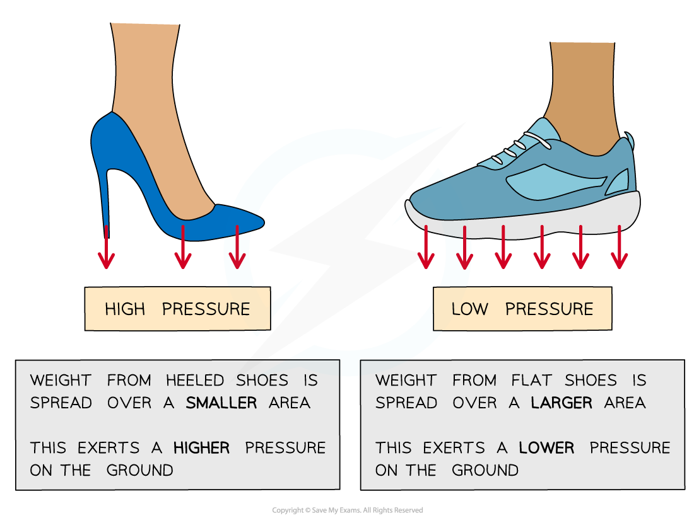

# Pressure

## Pressure

> **Spec point** — `spcpt_rh44rqfKpHb6wrFc`

## Pressure

- **Pressure **tells us how concentrated a force is
- Pressure is defined as: **The** **force per unit area**
- Pressure is calculated using the following equation:

$p=\frac{F}{A}$

- Where:

  - *p* = pressure in pascals (Pa)
  
    - 1 Pa = 1 N m-2
  - *F* = force in newtons (N)
  - *A* = area in metres squared (m2)

- Pressure, unlike force, is a **scalar**
- Therefore pressure does not have a specific direction

- If a **force **is spread over a **large area** it will result in a **small pressure**
- If a **force **is spread over a **small area** it will result in a **large pressure**

#### Pressure of different styles of shoes

***High-heeled shoes exert a greater pressure than flat shoes because the same force (weight) is spread over a smaller area***

> **Worked Example**
> A cylinder is placed on a horizontal surface as shown below.
> 
> 
> 
> The mass of the cylinder is 4.7 kg and the diameter is 8.4 cm.
> 
> Calculate the pressure produced by the cylinder on the horizontal surface.
> 
> **Answer:**
> 
> **Step 1: List the known quantities and convert to SI units**
> 
> - Mass, *m* = 4.7 kg
> - Diameter of cylinder, *d* = 0.084 m
> 
> **Step 2: State the pressure equation**
> 
> $p=\frac{F}{A}$
> 
> **Step 3: Calculate the force exerted by the cylinder**
> 
> - The force is the weight acting on the cylinder
> - Acceleration of free fall, *g* = 9.81 m s-2
> 
> $F=W=mg$
> 
> $W=4.7\times9.81$
> 
> $W=46.1N$
> 
> **Step 4: Calculate the area **
> 
> - Only the base of the cylinder is in contact with the surface
> 
> $\mathrm{area} \mathrm{of} \mathrm{circle}=πr^{2}$
> 
> $A = \mathrm{\pi } ( \frac{d}{2} )^{2}$
> 
> $A = \mathrm{\pi } ( \frac{0.084}{2} )^{2}$
> 
> $A=5.5\times10^{-3}m^{2}$
> 
> **Step 5: Substitute the known values into the pressure equation to calculate**
> 
> $p=\frac{46.1}{5.5\times10^{-3}}$
> 
> $p = 8400 \text{Pa} ( 2 \mathrm{s} . \mathrm{f} . )$

> **Exam Hint**
> The area referred to is the ‘cross-sectional’ area of a 3D object. This is the area of the base that the force is applied on. For a cylinder, this will be a circle.
