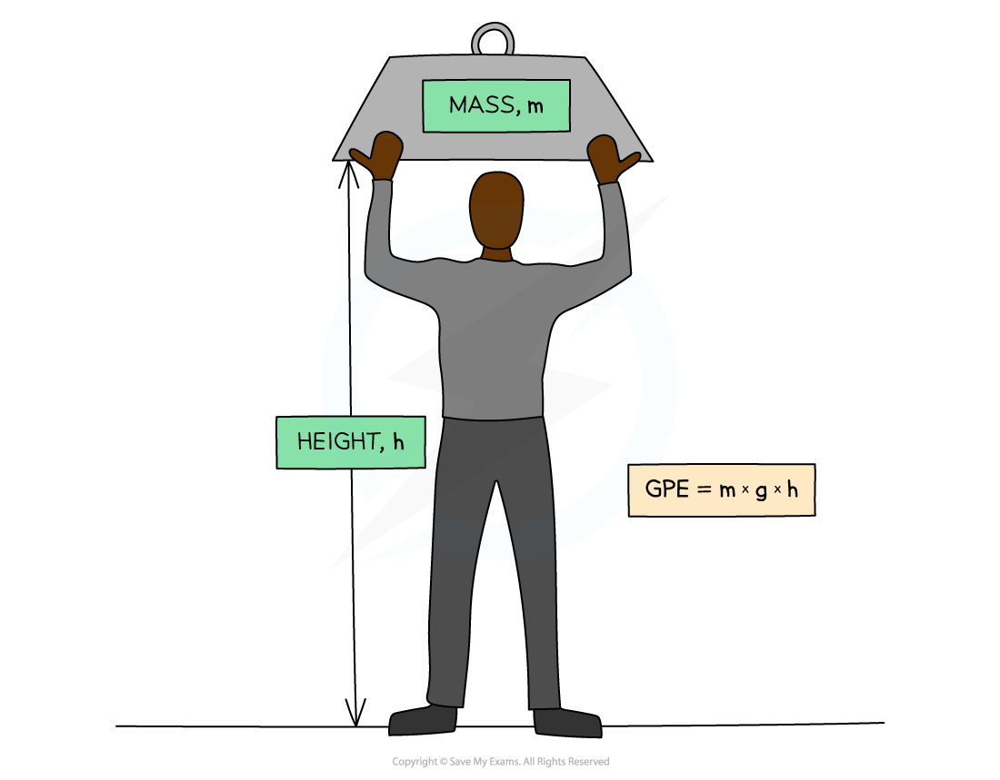
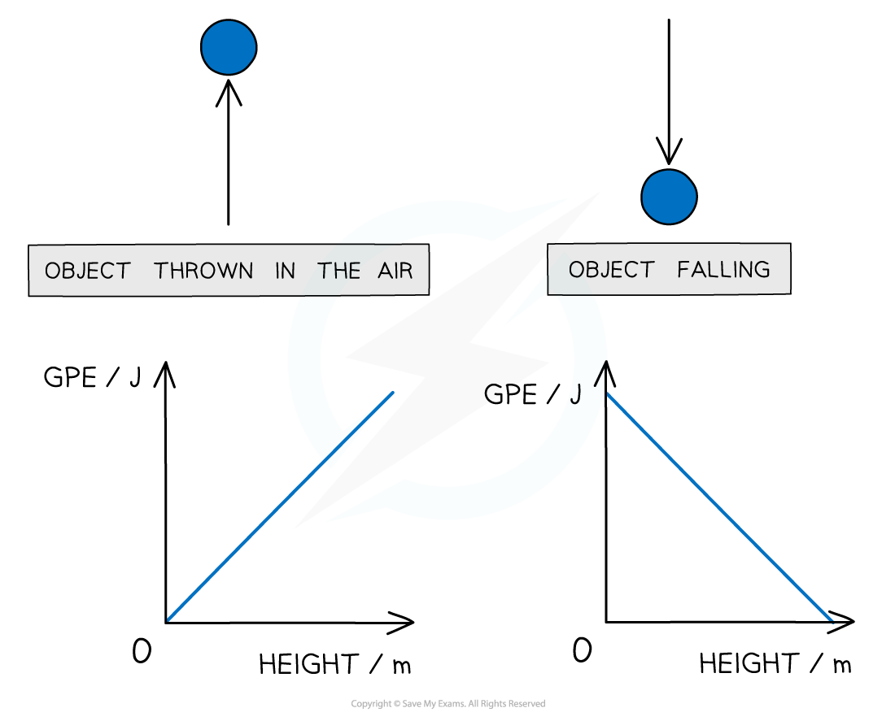

# Gravitational Potential Energy

## Derivation of GPE = mgh

> **Spec point** — `spcpt_YnJrmwQfzW9VS7cq`

## Derivation of GPE = mgh

- Gravitational potential energy is energy stored in a mass due to its position in a** uniform gravitational field**
- When a heavy object is lifted, work is done since the object is provided with an upward force against the downward force of gravity

  - Therefore **energy is transferred to the object**
- This equation can therefore be derived from the work done

$W=Fs$

- Consider a mass, *m*, lifted through a displacement equal to height, *h*

- The weight of the mass is *mg*

$W=mgs=mg\Deltah$

- Since the mass, *m*, has been lifted, it is now able to do extra work due to its new position
- The amount of extra work it can do is equal to *mg*Δ*h*

$\DeltaE_{p}=mg\Deltah$

- The amount of extra work it can do is equal to its change in gravitational potential energy

## Gravitational Potential Energy

> **Spec point** — `spcpt_MB58W8fSnpXjxC7h`

## Gravitational potential energy

- Gravitational potential energy is energy stored in a mass due to its position in a gravitational field

  - If a mass is **lifted** up, it will **gain** gravitational potential energy
  - If a mass **falls**, it will **lose **gravitational potential energy
- The equation for gravitational potential energy for energy changes in a **uniform gravitational field** is:

$\DeltaE_{p}=mg\Deltah$

- Where:

  - *E*p = Gravitational potential energy in joules (J)
  - *m* = mass in kilograms (kg)
  - *g* = gravitational field strength in newtons per kg (N kg-1)
  - Δ*h* = change in height in metres (m)

#### Gravitational potential energy

***Gravitational potential energy: The energy an object has when lifted up***

- The potential energy on the Earth’s surface at ground level is taken to be equal to 0
- This equation is only relevant for energy changes in a **uniform gravitational field** (such as near the Earth’s surface)

#### GPE v height graphs

- The two graphs below show how GPE changes with height for a ball being thrown up in the air and when falling down

#### Graphs of gravitational potential energy against height

***Graphs showing the linear relationship between GPE and height***

*** ***

- Since the graphs are straight lines, GPE and height are said to have a **linear** relationship
- These graphs would be identical for GPE against time instead of height

> **Worked Example**
> To get to his apartment a man has to climb five flights of stairs.
> 
> The height of each flight is 3.7 m and the man has a mass of 74 kg.
> 
> What is the approximate gain in the man's gravitational potential energy during the climb?
> 
> **A.** 13 000 J              ** **
> 
> **B.** 2700 J
> 
> **C.** 1500 J
> 
> **D.** 12 500 J
> 
> **Answer: A**
> 
> **Step 1: List the known quantities**
> 
> - Height of each flight of stairs = 3.7 m
> - Mass, *m* = 74 kg
> - Gravitational field strength, *g* = 9.81 N kg-1
> 
> **Step 2: State the gravitational potential energy equation and rearrange for height**
> 
> $\DeltaE_{p}=mg\Deltah$
> 
> **Step 3: Find the change in height**
> 
> $\Deltah=5\times3.7=18.5m$
> 
> **Step 4: Substitute in the known values to calculate**
> 
> $\DeltaE_{p}=74\times9.81\times18.5$
> 
> $\DeltaE_{p}=13000J$

> **Exam Hint**
> This equation only works for objects close to the Earth’s surface where we can consider the gravitational field to be uniform. Later in the course, you will consider examples where the gravitational field is not uniform such as in space, where this equation for GPE will not be relevant.
