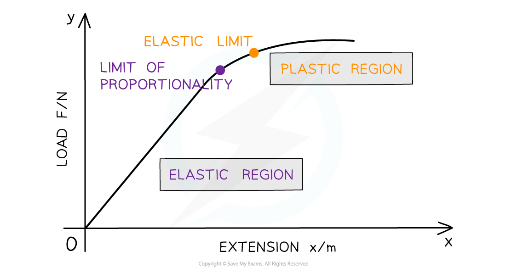
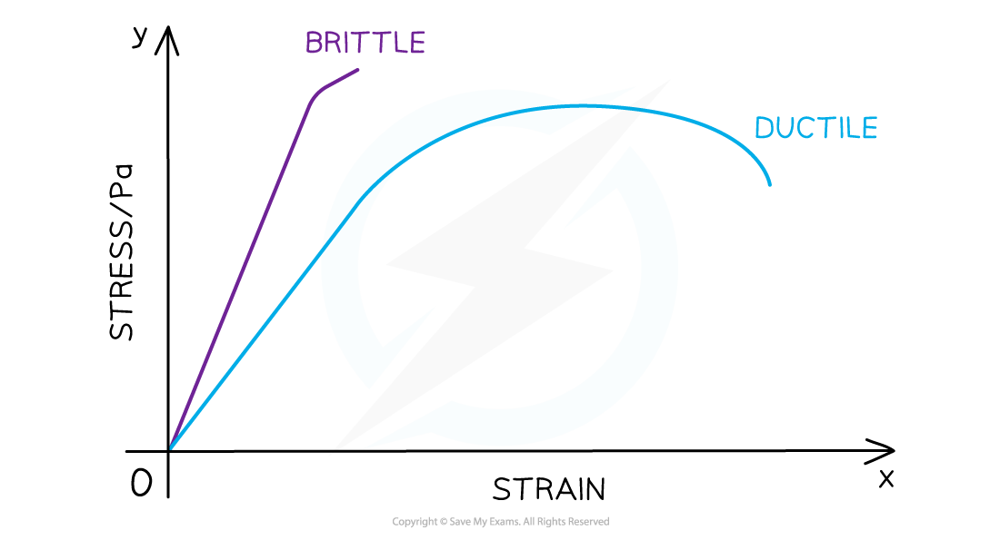

# Elastic & Plastic Behaviour

## Elastic & Plastic Deformation

> **Spec point** — `spcpt_rtFYFkd5yRQkG4wt`

## Elastic & plastic deformation

### Types of deformation

- **Elastic deformation:** when the load is removed, the object **will** return to its original natural length
- **Plastic deformation: **when the load is removed, the object **will** **not** return to its original length
- **Elastic limit:** the point beyond which the object does **not return to its original length** when the load is removed

  - Plastic deformation is beyond the elastic limit
- These regions can be obtained from a force-extension graph:

#### Graph showing the elastic limit

***Below the elastic limit, the material exhibits elastic behaviour and returns to its original shape. Above the elastic limit, the material exhibits plastic behaviour***

- The **linear **portion of the graph represents the loads at which the force and extension are directly **proportional**

  - The **limit of proportionality** marks the upper end of this proportional relationship

### Brittle and ductile materials

- **Brittle** materials have very little to **no plastic deformation**

  - Glass and concrete are examples of brittle materials
  - A brittle material breaks with little elastic and insignificant plastic deformation
- **Ductile** materials have a **larger plastic region**

  - Rubber and copper are examples of ductile materials
  - Ductile material stretches into a new shape before breaking

#### Brittle and ductile materials stress-strain graph

*** Stress-strain curve for a brittle and ductile material***

- Brittle and ductile materials can be identified on a stress-strain or force-extension graph:

  - A **brittle **material is represented by a **straight line through the origin** with no or **negligible curved region**
  - A **ductile** material is represented with a **straight line through the origin** then **curving** towards the x-axis

> **Worked Example**
> A sample of metal is subjected to a force which increases to a maximum value and then fractures. A force-extension graph for the sample is shown.
> 
> 
> 
> What is the behaviour of the metal at point X?
> 
> **A.** both elastic and plastic
> 
> **B.** not elastic and not plastic
> 
> **C.** plastic but not elastic
> 
> **D.** elastic but not plastic
> 
> **Answer: D**
> 
> - The graph is a straight line at point X
> - Therefore, the force and extension are directly proportional
> - Point X is not beyond the elastic limit
> - So the metal is behaving elastically

> **Exam Hint**
> Although similar definitions, the elastic limit and limit of proportionality are not the same point on the graph. The limit of proportionality is the point beyond which the material is no longer defined by Hooke’s law. The elastic limit is the furthest point a material can be stretched whilst still able to return to its previous shape. This is at a slightly higher extension than the limit of proportionality. Be sure not to confuse them.
