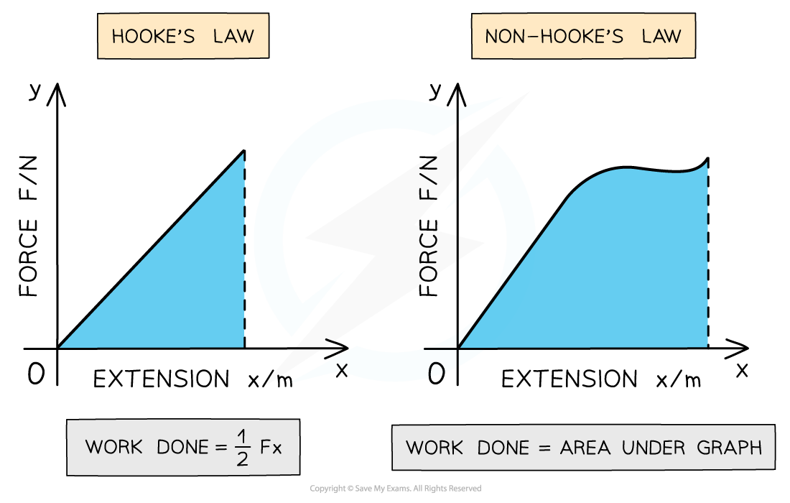

# Elastic Potential Energy

## Area under a Force-Extension Graph

> **Spec point** — `spcpt_7TppPh7zy5C2NV9h`

## Area under a force-extension graph

- The **work done** in stretching a material is equal to the **force applied** multiplied by the **extension created**
- Therefore, the **area under a force-extension graph is equal to the work done **to stretch the material

#### Area under force-extension graphs

***Work done is the area under the force - extension graph. This is true for graphs that obey Hooke's law and those which don't. ***

- For a region where a material demonstrates elastic behaviour and **obeys Hooke’s law** the work done is the **area of the right angled triangle** under the graph
- For a region where a material **doesn’t obey Hooke’s law**, the total area is the **sum of the areas** of the separate sections under the graph

> **Worked Example**
> The graph shows the behaviour of a sample of a metal when it is stretched until it starts to undergo plastic deformation.
> 
> 
> 
> What is the total work done in stretching the sample from zero to an extension of 13.5 mm?
> 
> Simplify the calculation by treating the curve XY as a straight line.
> 
> **Answer:**
> 
> **Step 1: Recall how to determine work done from the graph:**
> 
> - Work done is the area underneath the force-extension graph
> 
> **Step 2: Calculate the area under the graph up to point X:**
> 
> - To point X, the area under the graph, *A**X** ,* is a triangle
> 
> $A_{X}=\frac{1}{2}\times\mathrm{base}\times\mathrm{height}$
> 
> - Calculate *A**X *, remembering to convert length to metres
> 
> $A_{X} = 1 \frac{1}{2} \times ( 11.0 \times 10^{- 3} ) \times 450 = 2.475 \mathrm{J}$
> 
> **Step 3: Calculate the area between X and Y:**
> 
> - Assuming the line XY is a straight line, the area under this region of the graph forms a trapezium
> - Recall the equation for a trapezium of width *h*  and side lengths *a * and *b* $A_{XY} = ( \frac{a + b}{2} ) h$
> 
>   - Here, *h* is the change in extension from X to Y, 2.5 mm
>   - *a*  is the load at point X and *b * is the load at point Y
> 
> $A_{XY} = ( \frac{450 + 600}{2} ) \times ( 2.5 \times 10^{- 3} ) = 1.313 \mathrm{J}$
> 
> **Step 4: Calculate total area:**
> 
> - The total area, the total work done, is just the sum of these two areas
> 
> $\mathrm{work} \mathrm{done}=2.475+1.313=3.79J$
> 
> - The answer is given to 3 significant figures, as the data has been given to this number of significant figures

> **Exam Hint**
> Make sure to be familiar with the formula for the area of common 2D shapes such as a right angled triangle, trapezium, square and rectangles. If you do forget the equation for a trapezium's area, however, just split the shape up into rectangles and triangles.

## Elastic Potential Energy

> **Spec point** — `spcpt_8vkBykvqzQYsxdV3`

## Elastic potential energy

- Elastic potential energy is defined as the **energy stored **within a material (e.g. in a spring) when it is stretched or compressed
- Elastic potential energy for a material deformed **within its limit of proportionality** is found from the** area under the force-extension graph**

  - So, the work done is also equal to the **elastic potential energy** stored in the material when it demonstrates elastic behaviour up to the limit of proportionality

> **Worked Example**
> A spring is extended with varying forces; the graph below shows the results.
> 
> 
> 
> What is the energy stored in the spring when the extension is 40 mm?
> 
> **Answer:**
> 
> **Step 1: Recall how to determine energy sto**
> 
> - Energy stored in the spring is equal to area under the graph, *A*
> - This is a triangle, so can be calculated using
> 
> $A=\frac{1}{2}\times\mathrm{base}\times\mathrm{height}$
> 
> **Step 2: Find the area under the graph**
> 
> - At 40 mm, the load is approximately 8.3 N
> - Converting length into metres gives an area of
> 
> $A = 1 \frac{1}{2} \times ( 40 \times 10^{- 3} ) \times 8.3 = 0.166 \mathrm{J}$
> 
> - This is equal to the energy stored in the spring, which should be given to 2 significant figures
> 
> $\mathrm{energy} \mathrm{stored}=0.17J$

> **Exam Hint**
> In your exam, a range of values will be allowed for the load at 40 mm. Any value from 8.1 N to 8.5 N will gain a mark. If you are struggling, draw horizontal lines on the graph to show the positions of 9.0 N and 8.5 N.

## Calculating Elastic Potential Energy

> **Spec point** — `spcpt_xqjsjjmJBXKGz6pt`

## Calculating elastic potential energy

- Recall that for a material obeying Hooke’s Law, within its limit of proportionality, **elastic potential energy** and work done can be calculated using the following equation:

$\mathrm{Work} \mathrm{Done}=\mathrm{EPE}=\frac{1}{2}Fx$

- Recall the equation for **Hooke's law**:

$F=kx$

- Combining these two equations gives an equation for elastic potential energy in terms of **spring constant**, *k*:

$\mathrm{EPE}=\frac{1}{2}kx^{2}$

- Where:

  - *k* is the **spring constant (N m****-1****)**
  - *x* is the **extension (m)**

> **Exam Hint**
> The formula for EPE = $\frac{1}{2}kx^{2}$ is only the area under the force-extension graph when it is a straight line i.e. when the material obeys Hooke’s law and is within its elastic limit.
