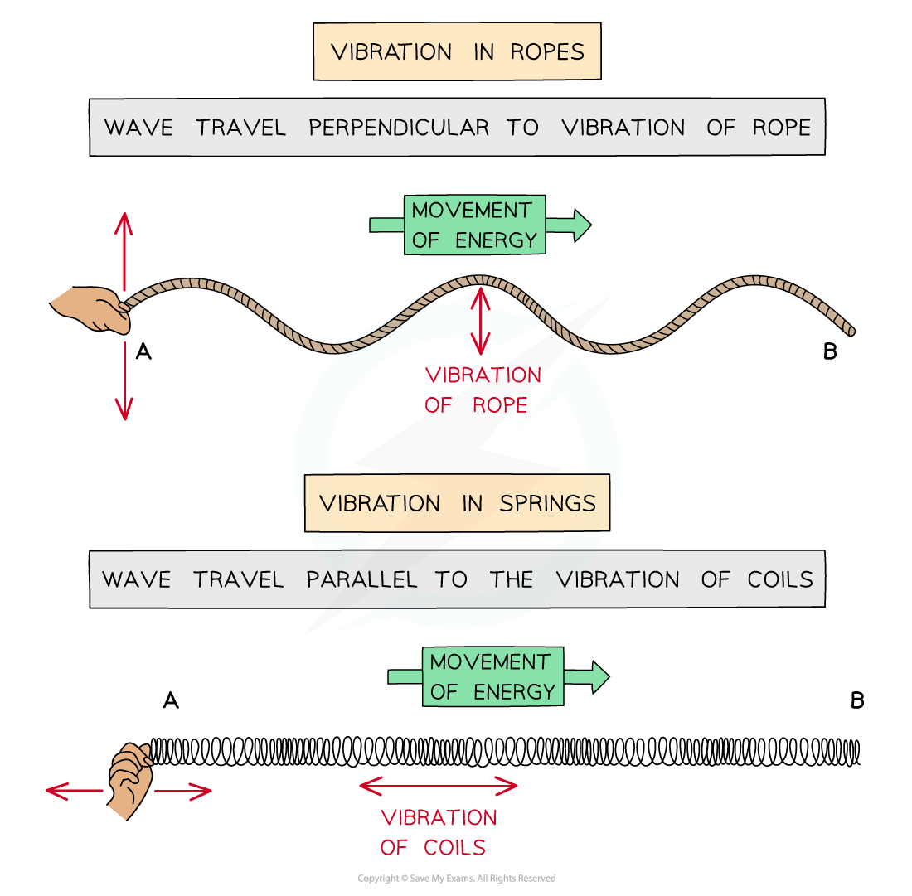
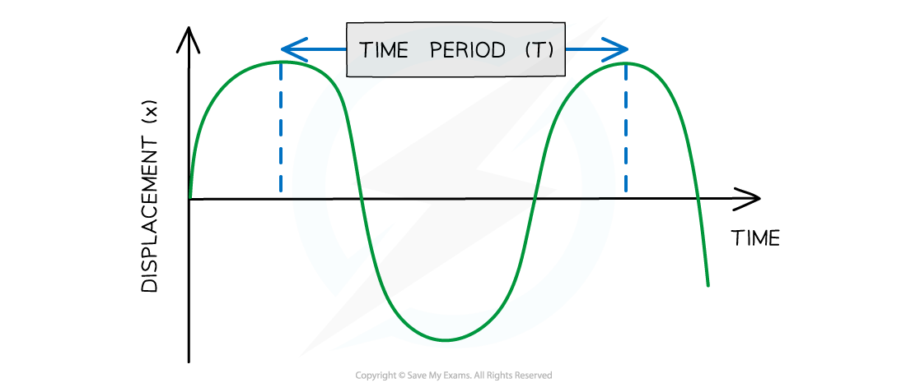
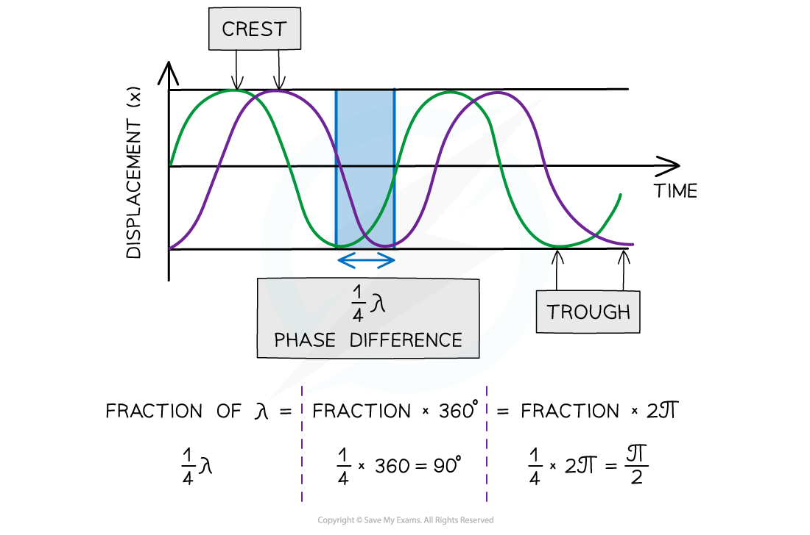

# Progressive Waves

## Wave Motion

> **Spec point** — `spcpt_THr5p3J68VZ5dHwP`

## Wave motion

- **Progressive waves** transfer energy without transferring matter; they **move **through a medium or the vacuum of space
- This is opposed to standing waves which have **no** net energy transfer and oscillate with **fixed** nodes and antinodes
- Energy is transferred through moving **oscillations** or **vibrations**.

  - These can be seen in vibrations of ropes or springs

#### Vibrations of ropes or springs

***Waves can be shown through vibrations in ropes or springs***

- The oscillations / vibrations can be perpendicular or parallel to the direction of wave travel:

  - When they are **perpendicular**, they are **transverse** waves
  - When they are **parallel**, they are **longitudinal** waves

### Ripple tanks

- Ripple tanks may be used to demonstrate the wave properties of reflection, refraction and diffraction.

  - The paddle produces a combination of transverse and longitudinal waves

#### A ripple tank

***Wave effects can be demonstrated using a ripple tank - the taller regions of water block more light, allowing the wavefronts to be seen using shadows ***

## General Wave Properties

> **Spec point** — `spcpt_jdZ8RV8Y8Jh7Zxf2`

## General wave properties

- **Displacement (*****x*****)** of a wave is the distance from its equilibrium position. It is a vector quantity; it can be positive or negative
- **Amplitude (A)** is the maximum displacement of a particle in the wave from its equilibrium position
- **Wavelength (*****λ*****)** is the distance between points on successive oscillations of the wave that are in phase

  - These are all measured in **metres (m)**

#### Graph showing displacement of a wave against distance

***Wavelength is the distance between two identical points on the wave and amplitude is maximum displacement from equilibrium position***

- **Period (*****T*****)** or time period, is the time taken for one complete oscillation or cycle of the wave

  - Measured in** seconds (s)**

#### Graph showing displacement of a wave against time

***When the x axis is time, the separation between two identical points on the wave is the period of the wave, not the wavelength. Look out for the quantity on the x axis.***

- **Frequency *****f*** is the number of complete oscillations per unit time

  - Measured in **Hertz** (**Hz) **or** s****-1**

$f=\frac{1}{T}$

- Where *T* is the time period of the oscillation, measured in seconds (s)
- **Speed *****v*** is the distance travelled by the wave per unit time

  - Measured in **metres per second** **(m s****-1****)**

### Phase difference

- The phase difference tells us** how much a point or a wave is in front or behind another**

  - When the crests or troughs are aligned, the waves are **in phase**
  - When the crest of one wave aligns with the trough of another, they are in **antiphase**
  - This can be found from the relative positions of the crests or troughs of two different waves of the same frequency
- The diagram below shows that

  - the green wave **leads** the purple wave by ¼ λ
  - the purple wave is said to **lag** behind the green wave by ¼ λ

#### Displacement time graph shows phase difference

***Two waves ¼ λ out of phase***

- Phase difference is measured in **fractions of a wavelength, degrees** or **radians**
- The phase difference between two points is:

  - **In phase** is **360****o** or 2π radians
  - **In anti-phase** is **180****o** or π radians

> **Worked Example**
> Plane waves on the surface of water at a particular instant are represented by the diagram below.
> 
> 
> 
> The waves have a frequency of 2.5 Hz.
> 
> Determine:
> 
> (a) the amplitude
> 
> (b) the wavelength
> 
> (c) the phase difference between points **A** and **B **
> 
> **Answer:**
> 
> **(a) Determine the amplitude:**
> 
> - Amplitude is the maximum displacement from equilibrium position:
> 
> $A=\frac{7.50}{2}=3.75\mathrm{mm}$
> 
> **(b) Determine the wavelength:**
> 
> - Recall that a wavelength is the distance between two **identical **points in a wave
> - From the diagram, 25 cm covers 3 full wavelengths and three quarters of the next wavelength
> 
> $λ=\frac{25}{3.75}=6.7\mathrm{cm}$
> 
> **(c) Find the phase difference between A and B:**
> 
> - The distance between points **A **and **B** is half a wavelength
> - One wavelength is a phase difference of 360°
> - Half a wavelength is a** phase difference of 180°**

> **Exam Hint**
> When labelling the wavelength and time period on a diagram, make sure that your arrows go from the **very top** of a wave to the very top of the next one. If your arrow is too short or just near to the crest, you will lose marks. The same goes for labelling amplitude.

## Wave Energy

> **Spec point** — `spcpt_YgstjQsHj29ZDHdD`

## Wave energy

- Waves that transfer **energy** are known as **progressive** waves
- Progressive waves transfer energy between points, without transferring matter
- When a progressive wave travels between two points, no matter actually travels with it

  - The points on the wave simply vibrate back and forth about fixed positions
- Waves that do not transfer energy are known as **stationary** waves
