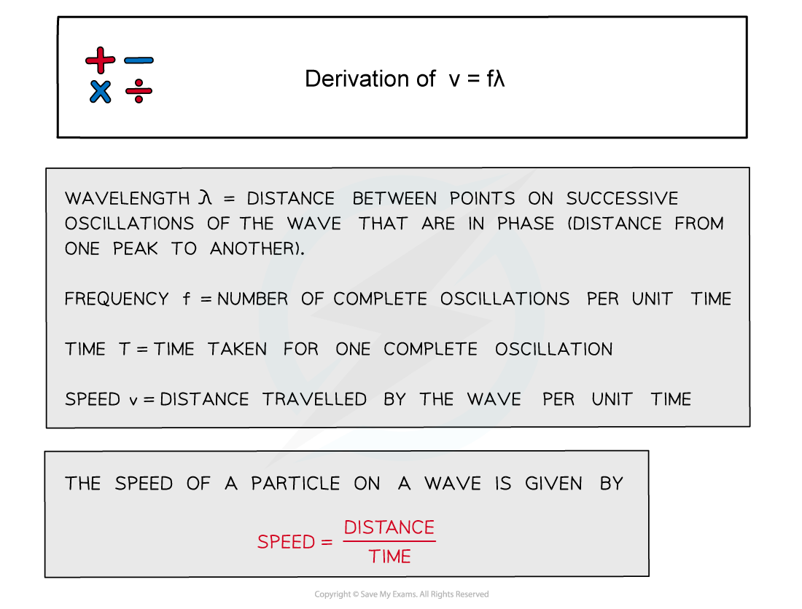
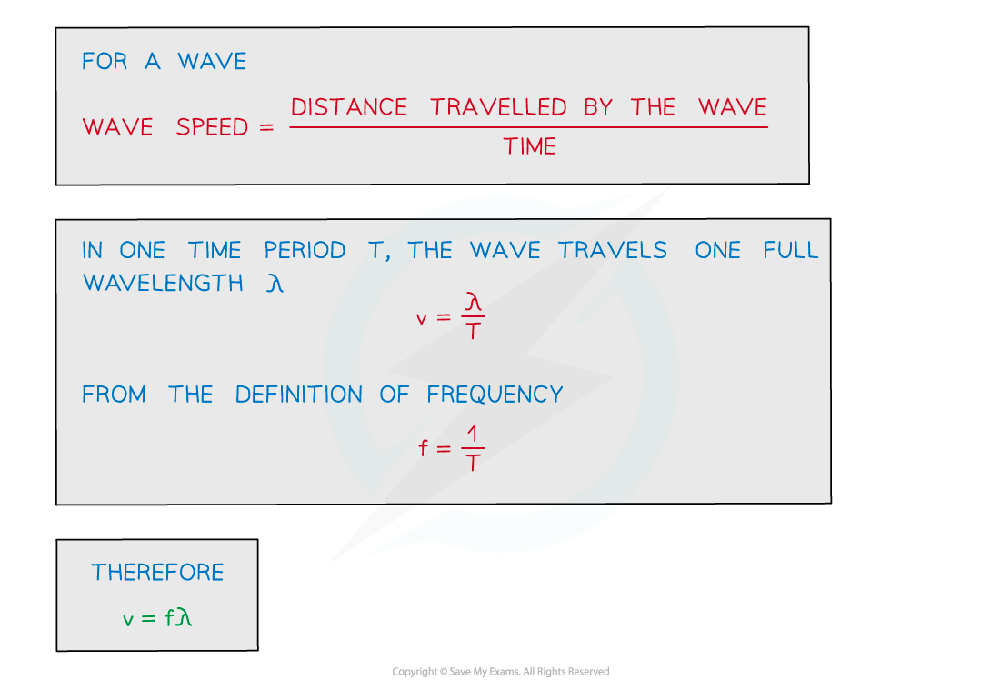
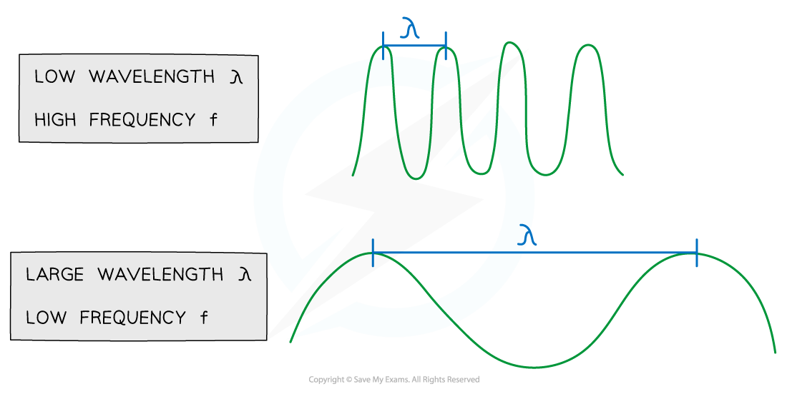

# The Wave Equation

## Derivation of v = f λ

> **Spec point** — `spcpt_XHrPRQktRxshGd9J`

## Derivation of v = f λ

- Using the definitions of speed, frequency and wavelength, the wave equation *v* = *fλ* can be derived
- This is an important relationship between three key properties of a wave
- The derivation for this is shown below

***Derivation of v = fλ***

> **Exam Hint**
> You will be expected to remember all the steps for this derivation (but do not need to write the full definition for each variable). If you are unsure as to where speed = distance/time comes from, make sure to revisit chapter “2. Kinematics”.

## The Wave Equation

> **Spec point** — `spcpt_K8NQGqcVPZW9Kjny`

## The wave equation

- The wave equation links the speed, frequency and wavelength of a wave
- This is relevant for both transverse and longitudinal waves

$v=fλ$

- Where

  - *v* is wave speed in m s−1
  - *f* is frequency in Hz
  - *λ* is wavelength in m

- The wave equation tells us that for a wave at constant speed:

  - As the wavelength **increases, **the frequency **decreases**
  - As the wavelength **decreases, **the frequency **increases**
- So **wavelength** and **frequency** are **inversely proportional** to each other

#### Wavelength and frequency are inversely proportional

***The relationship between frequency and wavelength of a wave***

> **Worked Example**
> The wave in the diagram below has a speed of 340 m s–1.
> 
> 
> 
> What is the wavelength of the wave?
> 
> **Answer:**
> 
> **Step 1: Determine the frequency of the wave:**
> 
> - Convert the period *T* into seconds and substitute into the frequency equation
> 
> $f=\frac{1}{0.28\times10^{-3}}=3571\mathrm{Hz}$
> 
> **Step 2: Determine wavelength:**
> 
> - Rearrange the wavelength equation and substitute speed and frequency
> 
> $λ=\frac{v}{f}=\frac{340}{3571}=0.095m$

> **Exam Hint**
> You may also see the wave equation be written as *c* = *fλ* where *c* is the wave speed. However, *c* is often used to represent the speed of light (3 x 108 ms-1). Only electromagnetic waves travel at this speed, therefore it’s best practice to use *v * for any speed that isn’t the speed of light instead.
