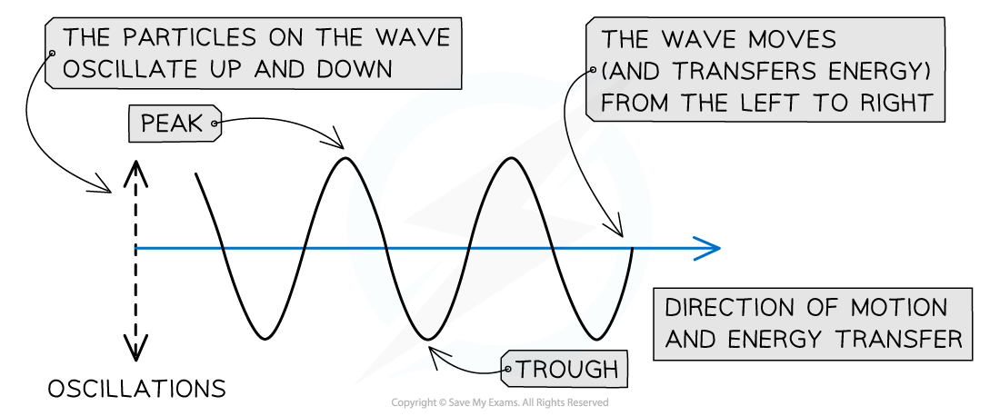
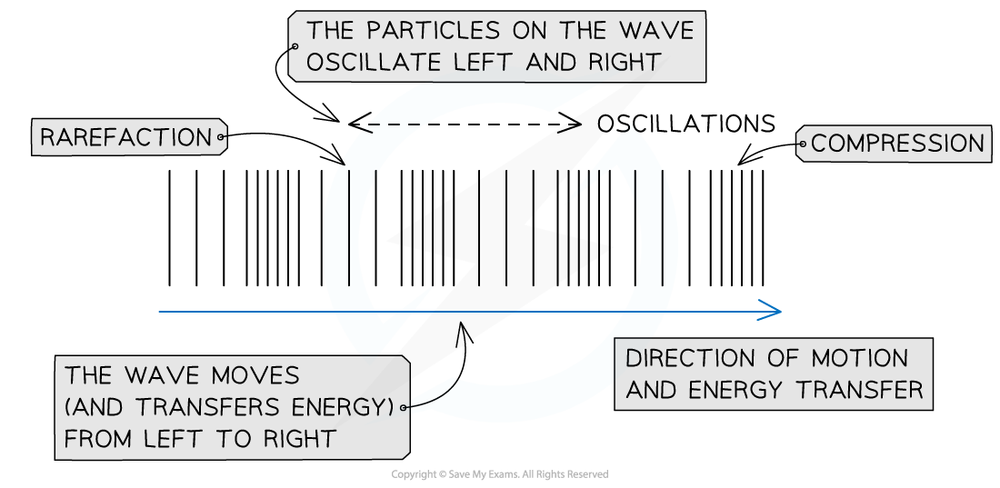
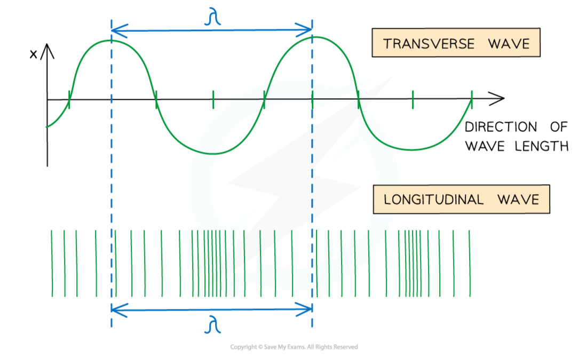
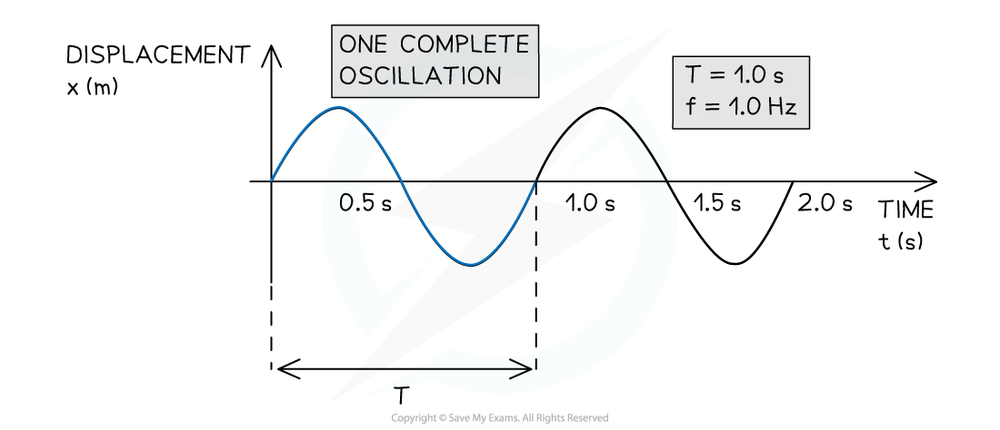

# Transverse & Longitudinal Waves

## Properties of Transverse & Longitudinal Waves

> **Spec point** — `spcpt_6GDf9qQyHvqtdZMB`

## Properties of transverse & longitudinal waves

- In mechanical waves, particles oscillate about fixed points
- There are two types of mechanical wave:

  - transverse
  - longitudinal

- The type of wave can be determined by the direction of the oscillations in relation to the direction the wave is travelling

### Transverse waves

- Transverse waves are defined as follows: **A wave in which the particles oscillate perpendicular to the direction of motion and energy transfer **

***A transverse wave travelling from left to right***

- Transverse waves show areas of **peaks **and **troughs**
- Examples of transverse waves include:

  - Electromagnetic waves e.g. radio, visible light, UV
  - Vibrations on a guitar string
- Transverse waves do not need particles to propagate, and so they **can travel through a vacuum **
- Transverse waves **can** be [polarised](https://www.savemyexams.com/a-level/physics/cie/25/revision-notes/7-waves/7-5-polarisation/polarisation/)

### Longitudinal waves

- Longitudinal waves are defined as follows: **A wave in which the particles oscillate parallel to the direction of motion and energy transfer **

***A longitudinal wave travelling from left to right***

- As a longitudinal wave propagates, areas of low and high pressure can be observed:

  - A **rarefaction** is an area of low pressure, with the particles being further apart from each other
  - A **compression** is an area of high pressure, with the particles being closer to each other
- **Sound waves** are an example of longitudinal waves
- Longitudinal waves need particles to propagate, and so they **cannot travel through a vacuum **
- Longitudinal waves **cannot** be [polarised](https://www.savemyexams.com/a-level/physics/cie/25/revision-notes/7-waves/7-5-polarisation/polarisation/)

- The diagram below shows the equivalent of a wavelength on a longitudinal wave

#### Comparing wavelengths of longitudinal and transverse waves

***Wavelength shown on a longitudinal wave***

> **Exam Hint**
> The definitions of transverse and longitudinal waves are often asked as exam questions, make sure to remember these by heart!
> 
> The properties of waves you learned about in [General Wave Properties](https://www.savemyexams.com/a-level/physics/cie/25/revision-notes/7-waves/7-1-progressive-waves/progressive-waves/), such as amplitude and wavelength, all apply to transverse and longitudinal waves

## Graphical Representations of Transverse & Longitudinal Waves

> **Spec point** — `spcpt_g2ynzxbvrxByhZ2j`

## Graphical representations of transverse & longitudinal waves

- Transverse and longitudinal waves can be represented graphically in the same way
- The main difference is the meaning of 'displacement' on the y-axis

  - Alternatively, displacement could be exchanged for velocity or acceleration

- For a transverse wave:

  - Displacement is **perpendicular **to the direction of propagation (energy transfer)

- For a longitudinal wave:

  - Displacement is **parallel **to the direction of propagation (energy transfer)

#### Graphical representation of a progressive wave

***The wave has a period of 1.0 s, a frequency of 1.0 Hz and could be either transverse or longitudinal.***

> **Worked Example**
> The graph shows how the displacement of a particle in a wave varies with time.
> 
> 
> 
> Which statement is correct?
> 
> **A.** The wave has an amplitude of 2 cm and could be either transverse or longitudinal.
> 
> **B.** The wave has an amplitude of 2 cm and a period of 6 s.
> 
> **C.** The wave has an amplitude of 4 cm and a period of 4 s.
> 
> **D.** The wave has an amplitude of 4 cm and must be transverse.
> 
> **Answer: A**
> 
> **Step 1: Determine amplitude from the graph:**
> 
> - Each peak and trough is 2 cm away from the equilibrium position on the graph
> - So, the amplitude is 2 cm
> 
> **Step 2: Determine the time period:**
> 
> - 4 seconds pass before the wave repeats its pattern again, so the period is 4 s
> - The amplitude of 2 cm and period of 4 s rules out options **B**, **C** and **D**
> 
> **Step 3: Discuss whether the wave is transverse or longitudinal:**
> 
> - The x-axis of this graph is time, so all that can be inferred is that the particle is displaced periodically
> - This occurs if a transverse wave or a longitudinal wave is causing its oscillations, as it is not mentioned how it is oscillating relative to the direction of wave travel
> - Therefore the wave could be **either **transverse or longitudinal

> **Exam Hint**
> Both transverse and longitudinal waves can look like transverse waves when plotted on a graph - make sure you read the question and look for whether the wave travels **parallel** (longitudinal) or **perpendicular **(transverse) to the direction of travel to confirm which type of wave it is.
