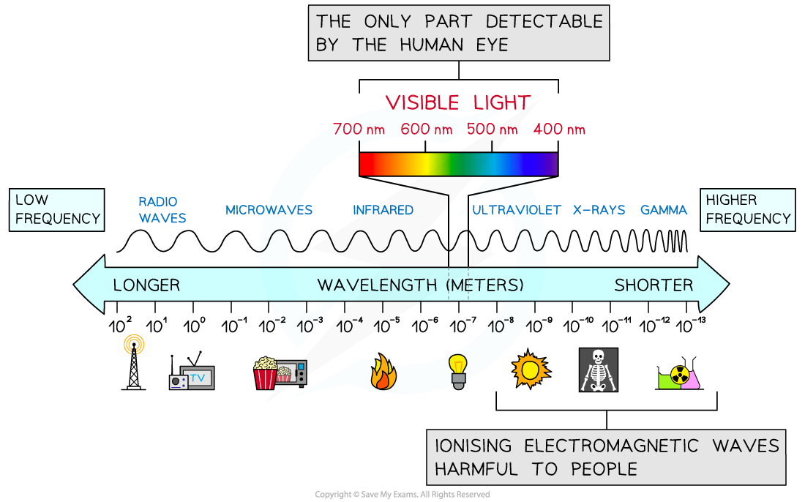

# Electromagnetic Spectrum

## Properties of Electromagnetic Waves

> **Spec point** — `spcpt_MZ2VMVghHJ4prn34`

## Properties of electromagnetic waves

- All electromagnetic waves have the following properties in common:

  - They are all **transverse **waves
  - They can all travel in a **vacuum**
  - They all travel at the **same speed** in a vacuum
- A vacuum is also known as free space where the speed of light is** 3 × 10****8**** ms****-1**

  - The speed of light in **air** is **approximately** the same as that in a **vacuum**
- Since electromagnetic waves are** transverse**, they can be reflected, refracted, diffracted, polarised and produce interference patterns
- There are seven principal regions of the electromagnetic spectrum, which all together form a **continuous spectrum**

## Wavelengths of Electromagnetic Waves

> **Spec point** — `spcpt_JkmKvs9X3TBRdnRn`

## Wavelengths of electromagnetic waves

- The principal regions of the electromagnetic spectrum are arranged in a specific order based on their wavelengths or frequencies
- This order is shown in the diagram below from longest wavelength (lowest frequency) to shortest wavelength (highest frequency)

#### Wavelengths across the EM spectrum

***Energy, wavelength and frequency for each part of the electromagnetic spectrum***

- The higher the **frequency**, the higher the **energy** of the radiation
- Radiation with **higher energy** is

  - **highly ionising**
  - Harmful to cells and tissues causing cancer (e.g. UV, X-rays, Gamma rays)

- Radiation with **lower energy** is:

  - Useful for **communications**
  - Less harmful to humans

- The approximate wavelengths in a vacuum of each radiation is listed in the table below:

#### EM spectrum wavelengths and frequencies

| **Radiation** | **Wavelength range / m** |
|---|---|
| Radio | > 0.1 |
| Microwaves | 0.1 to 1 × 10−3 |
| Infrared | 1 × 10−3 to 7 × 10−7 |
| Visible | 7 × 10−7 to 4 × 10−7 |
| Ultraviolet | 4 × 10−7 to 1 × 10−8 |
| X Rays | 1 × 10−8 to 4 × 10−13 |
| Gamma Rays | 4 × 10−13 to 10−16 |

- To alternatively find the range of frequencies, convert the wavelengths using the wave equation: ***c***** = *****fλ***

  - Where *c* is the speed of light: **3.0 × 10****8 ****m s****−1**

> **Worked Example**
> **A** is a source emitting microwaves and **B** is a source emitting X-rays. The table suggests the frequencies for **A** and **B**.
> 
> Which row is correct?
> 
> |   | **Frequency emitted by A / Hz** | **Frequency emitted by B / Hz** |
> |---|---|---|
> | **A** | 3 × 109 to 3 × 1011 | > 1019 |
> | **B** | 1 × 1012 to 1 × 1013 | 3 × 1016 to 7.5 × 1020 |
> | **C** | 3 × 109 to 3 × 1011 | 3 × 1016 to 7.5 × 1020 |
> | **D** | 4 × 1014 to 8 × 1014 | 5 × 1013 to 7 × 1015 |
> 
> **Answer: C**
> 
> **Step 1: Recall the wavelength ranges of microwaves and X rays:**
> 
> - The wavelength range of microwaves is 0.1 m to 1 × 10−3 m
> - The wavelength range of X rays is 1 × 10−8 m to 4 × 10−13 m
> 
> **Step 2: Apply the wave equation to find frequency ranges:**
> 
> - The speed of electromagnetic radiation is *c* , so to calculate frequency *f* use
> 
> $f=\frac{c}{λ}$
> 
> - The frequency range of microwaves is
> 
> $f_{low}=\frac{3.0\times10^{8}}{0.1}=3.0\times10^{9}\mathrm{Hz}$
> 
> $f_{high}=\frac{3.0\times10^{8}}{1\times10^{-3}}=3.0\times10^{11}\mathrm{Hz}$
> 
> - This eliminates **B** and **D** because source **A** emits microwaves
> - The frequency range of X rays is
> 
> $f_{low}=\frac{3.0\times10^{8}}{1\times10^{-8}}=3.0\times10^{16}\mathrm{Hz}$
> 
> $f_{high}=\frac{3.0\times10^{8}}{4\times10^{-13}}=7.5\times10^{20}\mathrm{Hz}$
> 
> - Both frequency ranges match option **C**

> **Exam Hint**
> You will be expected to memorise the range of wavelengths for each type of radiation, however you don’t need to learn the frequency ranges by heart. Since all EM waves travel at the speed of light, you can convert between frequency and wavelength using the wave equation in an exam question.

## Visible Light

> **Spec point** — `spcpt_dRVGB6f6RGsF4xJd`

## Visible light

- **Visible light** is the only part of the spectrum **detectable** by the **human eye**
- Visible light has wavelengths in the range 400 - 700 nm

  - In the natural world, many animals, such as birds, bees and certain fish, are able to perceive beyond visible light and can see infra-red and UV wavelengths of light
