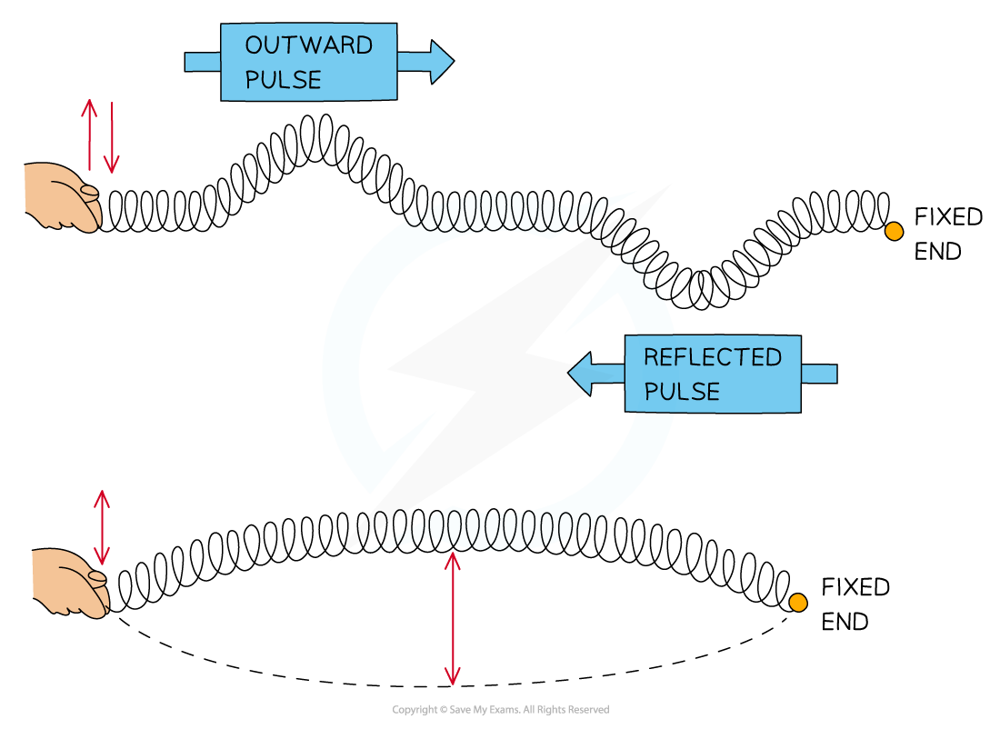
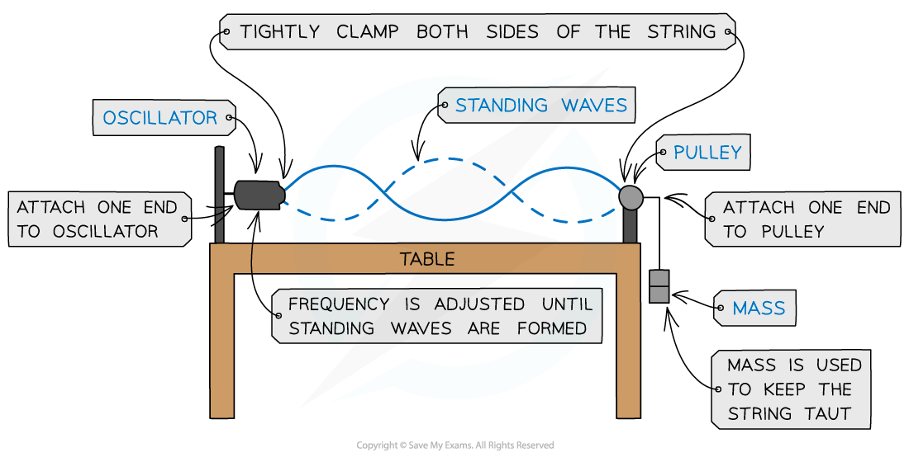
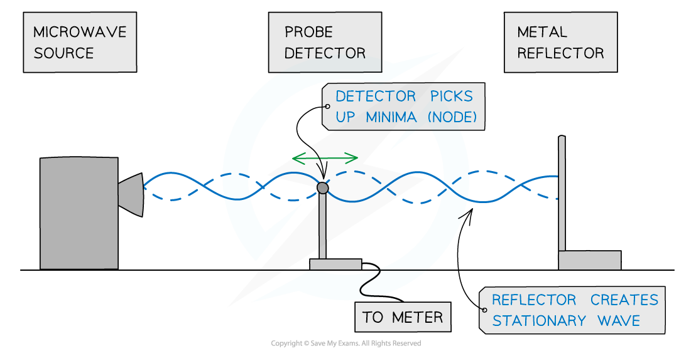
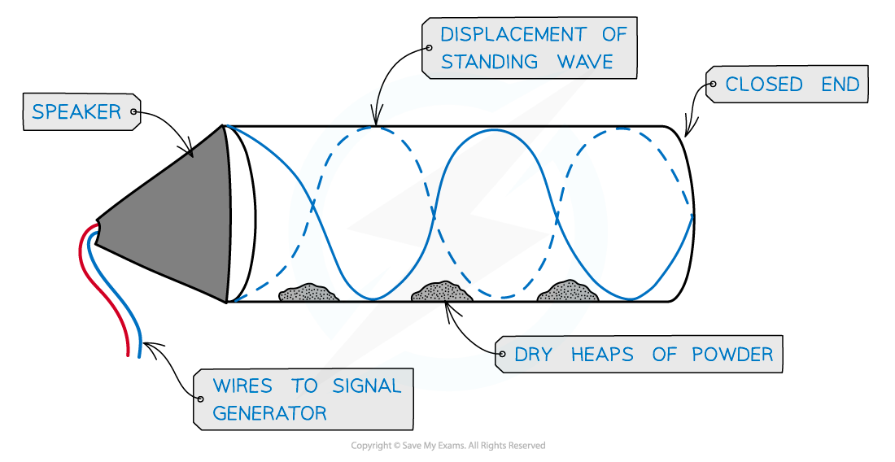
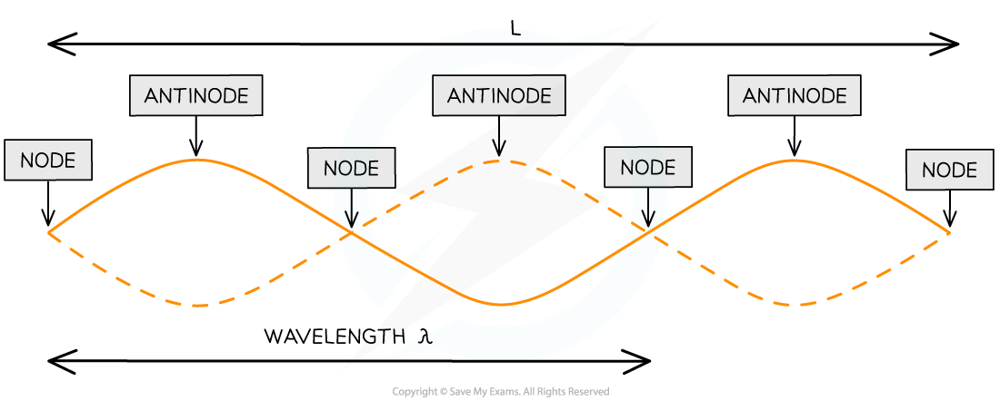
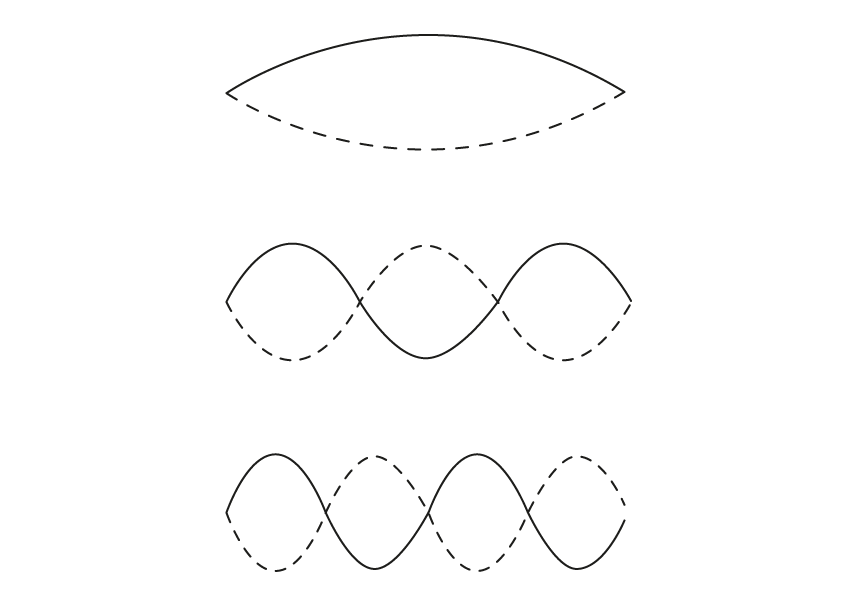

# Stationary Waves

## Stationary Waves

> **Spec point** — `spcpt_9wQytBQMPS4tCnfg`

## Stationary waves

- **Stationary waves**, or standing waves, are produced by the** superposition of two waves** of the same frequency and amplitude travelling in** opposite directions**
- This is usually achieved by a *travelling wave* and its **reflection**. The superposition produces a wave pattern where the peaks and troughs do not move

#### Formation of a stationary wave

***Formation of a stationary wave on a stretched spring fixed at one end***

### Stretched strings

- Vibrations caused by stationary waves on a stretched string produce sound

  - This is how stringed instruments, such as guitars or violins, work
- This can be demonstrated by a** length of string under tension** fixed at one end and forced to vibrate due to an oscillator:

#### Standing wave experiment

***Stationary wave on a stretched string kept taut by a mass and pulley system***

*** ***

- As the **frequency** of the oscillator changes, standing waves with **different numbers of minima** (nodes) **and maxima** (antinodes) form

### Microwaves

- A microwave source is placed in line with a reflecting plate and a small detector between the two
- The reflector can be moved to and from the source to vary the stationary wave pattern formed
- By moving the detector, it can pick up the minima (nodes) and maxima (antinodes) of the stationary wave pattern

#### Stationary microwaves

***Using microwaves to demonstrate stationary waves***

### Air columns

- The formation of stationary waves inside an air column can be produced by sound waves

  - This is how musical instruments, such as clarinets and organs, work
- This can be demonstrated by placing a** loudspeaker **at the **open end** of an **air column** with fine powder inside
- At certain frequencies, the powder forms evenly spaced heaps along the tube, showing where there is zero disturbance as a result of the nodes of the stationary wave

#### Stationary waves in an air column

***Stationary waves can be seen in air columns using dry powder***

- In order to produce a **stationary wave**, there must be a **minima** (node) at **one end** and a **maxima** (antinode) at the end with the **loudspeaker**

> **Exam Hint**
> Always refer back to the experiment or scenario in an exam question e.g. the wave produced by a **loudspeaker** reflects at the end of a **tube**. This reflected wave, with the same frequency, overlaps the initial wave to create a stationary wave.

## Formation of Stationary Waves

> **Spec point** — `spcpt_Gd4zWNXbrngcrJvh`

## Formation of stationary waves

- A stationary wave is made up of **nodes** and **antinodes**

  - **Nodes** are where there is no vibration
  - **Antinodes** are where the vibrations are at their maximum amplitude
- The nodes and antinodes **do not** move along the string

  - **Nodes are fixed** and antinodes only move in the vertical direction
- Between nodes, all points on the stationary wave are in phase
- The image below shows the nodes and antinodes on a snapshot of a stationary wave at a point in time

#### Nodes and antinodes on a stationary wave

* ****Nodes are points of zero amplitude, anti-nodes are points of maximum amplitude***

- *L* is the length of the string

  - 1 wavelength *λ* is only a portion of the length of the string
- **Changing the frequency** of the stationary wave produced will **change the number of nodes** and antinodes produced and consequently the wavelength

***Stationary waves are produced at varying frequencies***

> **Worked Example**
> A stretched string is used to demonstrate a stationary wave, as shown in the diagram.
> 
> 
> 
> Which row in the table correctly describes the length of L and the name of **X** and **Y**?
> 
> |   | **Length L** | **Point X** | **Point Y** |
> |---|---|---|---|
> | **A** | 5 wavelengths | Node | Antinode |
> | **B** | 2 $\frac{1}{2}$ wavelengths | Antinode | Node |
> | **C** | 2 $\frac{1}{2}$ wavelengths | Node | Antinode |
> | **D** | 5 wavelengths | Antinode | Node |
> 
> **Answer:**** ****C**
> 
> **Step 1: Determine the number of wavelengths in the length of the string**
> 
> - The string has 2 $\frac{1}{2}$ wavelengths
> 
>   - This rules out A and D
> 
> **Step 2: Determine points X and Y **
> 
> - X has zero amplitude – a node
> - Y has maximum amplitude – an antinode
> 
>   - Therefore, the correct row is C

> **Exam Hint**
> The lengths of the strings will only be in terms of whole or ½ wavelengths. For example, a wavelength could be made up of 3 nodes and 2 antinodes or 2 nodes and 3 antinodes.
