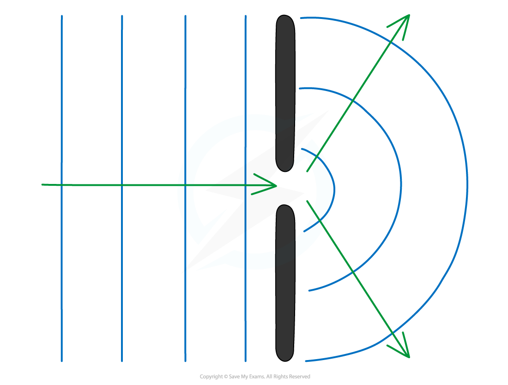
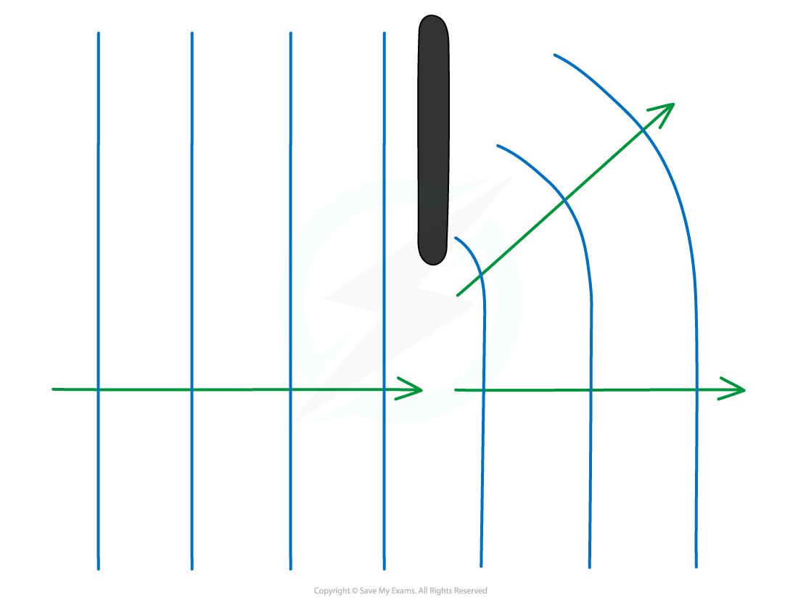
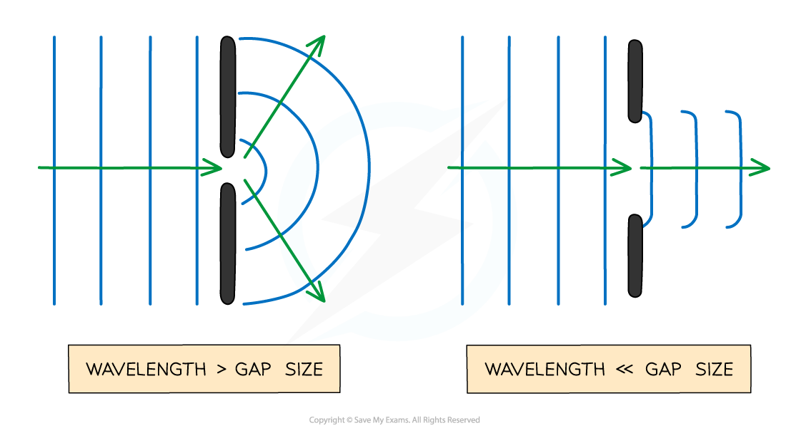
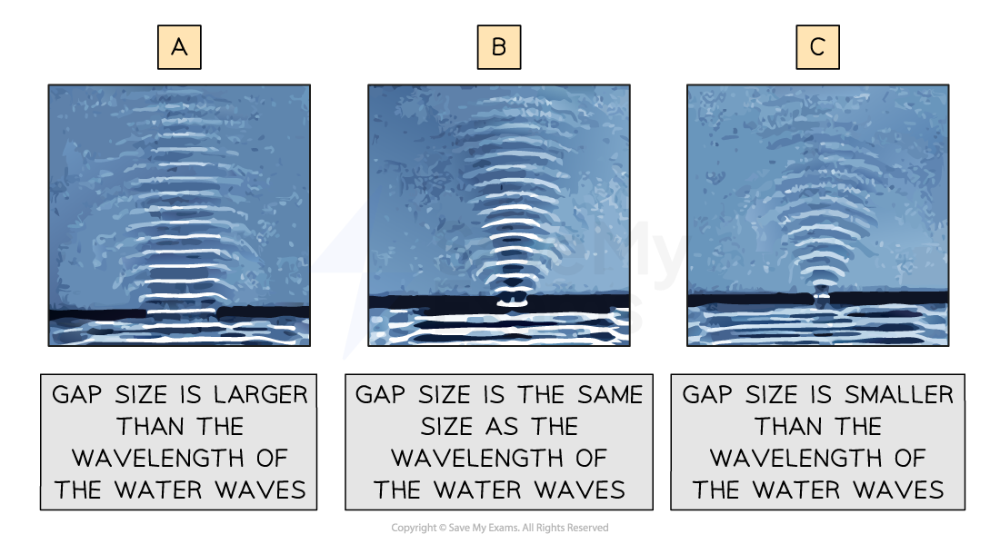

# Diffraction

## What is Diffraction?

> **Spec point** — `spcpt_pBSg9mht2kW4tsK5`

## What is diffraction?

- Diffraction is the **spreading out **of waves when they pass an obstruction

  - This obstruction is typically a narrow slit (an aperture)
- The extent of diffraction depends on the width of the gap compared with the wavelength of the waves

  - Diffraction is the most prominent when the width of the slit is approximately equal to the wavelength

#### Diffraction through a gap

***Diffraction: when a wave passes through a narrow gap, it spreads out***

*** ***

- Diffraction is usually represented by a wavefront as shown by the vertical lines in the diagram above
- The only property of a wave that changes when its diffracted is its **amplitude**

  - This is because some energy is dissipated when a wave is diffracted through a gap
- Diffraction can also occur when waves curve around an edge:

#### Diffraction by a barrier

***When a wave goes past the edge of a barrier, the waves can curve around it***

- Any type of wave can be diffracted i.e. sound, light, water

> **Worked Example**
> When a wave is travelling through air, which scenario best demonstrates diffraction?
> 
> **A.** UV radiation through a gate post
> 
> **B.** Sound waves passing a steel rod
> 
> **C.** Radio waves passing between human hair
> 
> **D. ** X-rays passing through atoms in a crystalline solid
> 
> **Answer: D**
> 
> - Diffraction is most prominent when the wavelength is close to the aperture size
> - UV waves have a wavelength between 4 × 10-7 – 1 × 10-8 m so won’t be diffracted by a gate post
> - Sound waves have a wavelength of 1.72 × 10-2 – 17 m so would not be diffracted by the diffraction grating
> - Radio waves have a wavelength of 0.1 – 106 m so would not be diffracted by human hair
> - X-rays have a wavelength of 1 × 10-8 – 4 × 10-13 m which is roughly the gap between atoms in a crystalline solid
> 
>   - Therefore, the correct answer is **D**

> **Exam Hint**
> When drawing diffracted waves, take care to keep the wavelength constant. It is only the amplitude of the wave that changes when diffracted.

## Diffraction Experiments

> **Spec point** — `spcpt_rSZ9X5wyPynJwXyR`

## Diffraction experiments

- The extent of diffraction depends on the **width** of the gap compared to the **wavelength** of the waves
- Diffraction is most pronounced when the **wavelength **of the wave and the **width of the gap** are similar in size

  - For gaps **much smaller** than the wavelength, the wave **spreads out significantly** after passing through
  - For gaps **much bigger** than the wavelength, the wave passes through with **little diffraction**

#### Size of the gap and diffraction

***The size of the gap (compared to the wavelength) affects how much the waves spread out***

- Examples of diffraction include:

  - Radio waves moving in between or around buildings
  - Water waves moving through a gap into a harbour

### Ripple tanks

- Ripple tanks are a common experiment used to demonstrate diffraction of water waves

  - Through a gap
  - Around a barrier
- The amount of diffraction that occurs can be changed by changing the wavelength of the waves compared to the gap size

#### Changing the gap size for diffraction in a ripple tank

***When the gap size is bigger than the wavelength less diffraction occurs and the waves spread out less after passing through***

> **Exam Hint**
> Familiarising yourself with the wavelength of electromagnetic waves is essential for identifying which wave will cause the greatest diffraction effect for a given gap width.
