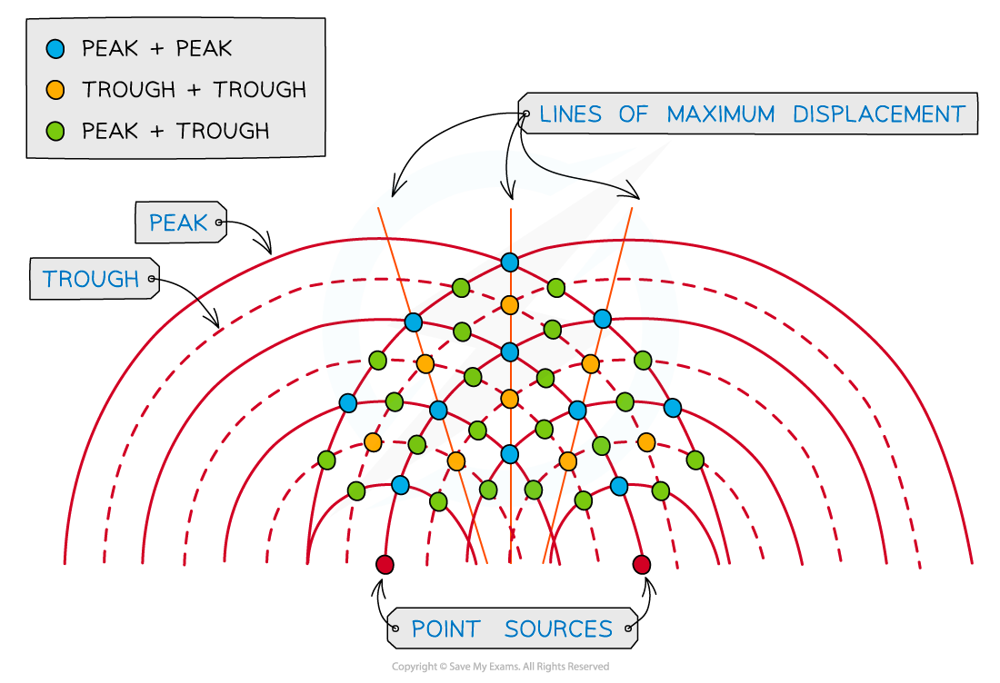
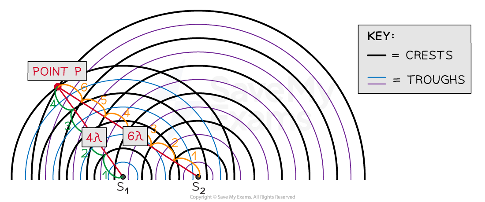
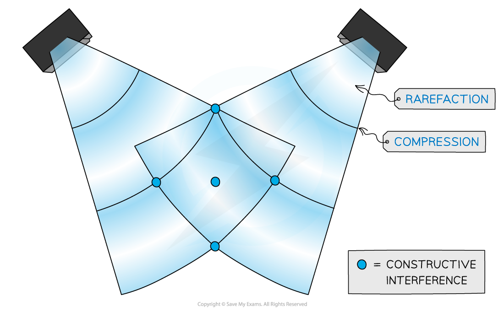
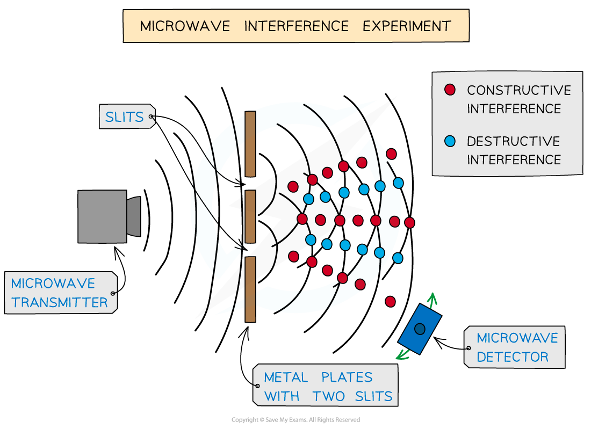
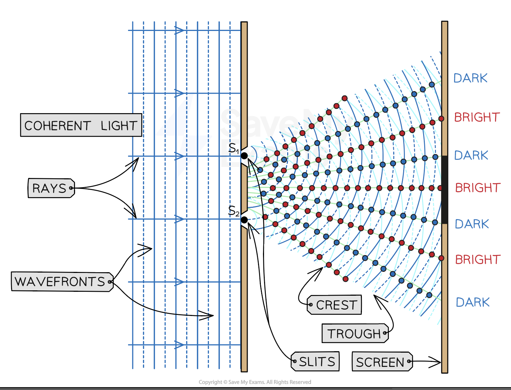
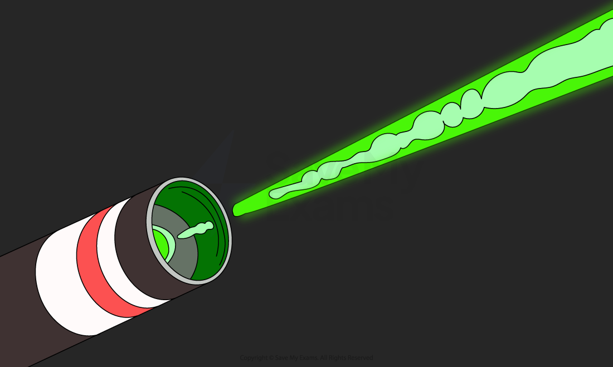
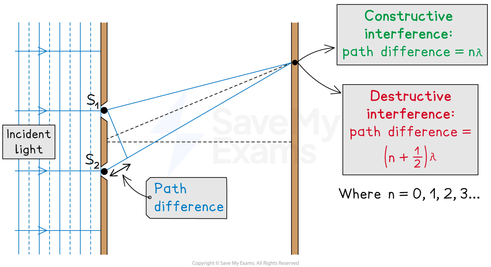
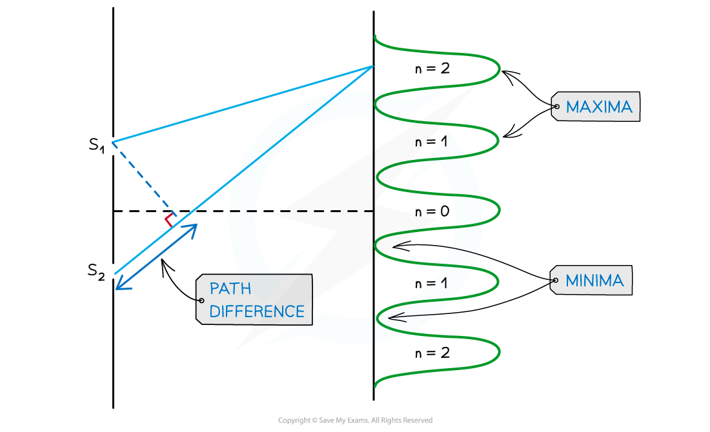

# Two Source Interference

## Demonstrating Two Source Interference

> **Spec point** — `spcpt_r9yyrTRvxs8TWQ9s`

## Demonstrating two source interference

- Two source interference can be demonstrated using

  - water waves in a ripple tank
  - sound
  - light
  - microwaves

### Using water waves

- Two-source interference in can be demonstrated in water using ripple tanks
- A curved line represents each **wavefront** (peak or trough)
- The diagram below shows the wavefronts from two point sources e.g. dropping two pebbles near to each other in a pond

#### Wavefront interference

***At the blue dot where the peak of two waves meet, constructive interference occurs. At the yellow dot where two troughs meet, constructive interference also occurs. Constructive interference occurs along the lines of maximum displacement. At the green dot, where a peak and a trough meet, destructive interference occurs***

- The lines of **maximum displacement** occur when all the **peaks and troughs line up** with those on another wave

- On a wavefront diagram, it is possible to **count** the number of wavelengths to determine whether constructive or destructive interference occurs at a certain point

***At point P the waves from S******1****** and S******2****** have a path difference of a whole number of wavelengths, resulting in constructive interference***

- At point **P**, the number of **crests** from:

  - Source S1 = 4λ
  - Source S2 = 6λ
- So the path difference at **P** is 6λ – 4λ = **2λ**
- This is a whole number of wavelengths, hence, constructive interference occurs at point **P**

### Using sound waves

- Two-source interference can be demonstrated with two speakers emitting a **coherent sound**

#### Sound wave interference

***Sound wave interference from two speakers***

- Sound waves are longitudinal waves made up of **compressions** and **rarefactions**

  - **Constructive interference** occurs when the **compressions** and rarefactions from each wave **line up** and the **sound appears louder**
  - **Destructive interference** occurs when a compression from one wave lines up with a rarefaction from the other and vice versa. The two waves cancel each other out, so **zero sound **is** **heard.
  - This is the technology used in noise-cancelling headphones

### Using microwaves

- Two-source interference for microwaves (and other electromagnetic waves) can be detected with a moveable microwave detector

#### Microwave interference experiment

***Microwave interference experiment***

- The detector picks up a **maximum amplitude** or intensity in regions of **constructive interference **
- The detector picks up a **minimum** or zero **amplitude**, so no signal in regions of **destructive interference**

### Using light waves

- Lasers are the ideal piece of equipment to **analyse** diffraction and intensity patterns
- The diffraction pattern produced by a laser on a screen is made up of:

  - Areas of **constructive interference** - the **bright** strips or** fringes**
  - Areas of **destructive interference** - the **dark fringes** ** **

***The constructive and destructive interference of laser light through a double slit creates bright and dark strips called fringes on a screen placed far away***

## Two Source Interference Fringes

> **Spec point** — `spcpt_2prhhMcRfSvdcNF3`

## Two source interference fringes

- For two-source interference fringes to be observed, the sources of the wave must be:

  - **Coherent** (constant phase difference)
  - **Monochromatic** (single wavelength)

- A **laser** is an example of a **coherent monochromatic** light source

  - Other sources of light, such as a filament bulb or a sodium lamp, are **non-coherent**, so they produce **white light**

#### A laser beam

***A laser produces a beam of coherent monochromatic light***

- When two waves interfere, the resultant wave depends on the **phase difference** between the two waves
- Phase difference is proportional to the **path difference** between the waves which can be written in terms of the wavelength *λ* of the wave
- As seen from the diagram below, the wave from slit S2 has to travel slightly further than that from S1 to reach the same point on the screen.

  - The difference in distance is the path difference

#### Path difference for constructive and destructive interference

***Path difference for constructive and destructive interference is determined by wavelength***

*** ***

- Remember, the conditions for [Constructive and destructive interference](https://www.savemyexams.com/a-level/physics/cie/25/revision-notes/8-superposition/8-3-interference/interference-and-coherence/):

  - For **constructive** interference (or maxima), the difference in wavelengths will be an **integer number of whole wavelengths**
  - For **destructive** interference (or minima) it will be an** integer number of whole wavelengths plus a half wavelength**
- An example of the orders of maxima is shown below:

  - *n* is the order of the maxima/minima since there is usually more than one of these produced by the interference pattern

#### Double slit interference pattern

***Interference pattern of light waves shown with orders of maxima***

- *** ****n *= 0 is taken from the middle,* n* = 1 is one either side and so on

> **Worked Example**
> Two coherent sources of sound waves S1 and S2 are situated 65 cm apart in air as shown below.
> 
> 
> 
> The two sources vibrate in phase but have different amplitudes of vibration. A microphone M is situated 150 cm from S1 along the line normal to S1 and S2.
> 
> The microphone detects maxima and minima of the intensity of the sound. The wavelength of the sound from S1 to S2 is decreased by increasing the frequency.
> 
> Determine which orders of maxima are detected at M as the wavelength is increased from 3.5 cm to 12.5 cm.
> 
> **Answer:**
> 
> **Step 1: Calculate the path difference**
> 
> - Using Pythagoras' theorem, the distance from source S2 to the microphone is:
> 
> $\sqrt{65^{2}+150^{2}}=163$
> 
> - Therefore, the path difference between the sources and the microphone is:
> 
> Path difference = $163-150=13\mathrm{cm}$
> 
> **Step 2: State the path difference for constructive interference**
> 
> - Path difference = *nλ*
> 
>   - *n* = 0, 1, 2, 3...
> 
> **Step 3: Determine the wavelength**
> 
> - Path difference = *nλ* = 13 cm
> 
> $n=0\Rightarrowλ=0\,n=1\Rightarrowλ=\frac{13}{1}=13\mathrm{cm}\,n=2\Rightarrowλ=\frac{13}{2}=6.5\mathrm{cm}\,n=3\Rightarrowλ=\frac{13}{3}=4.3\mathrm{cm}\,n=4\Rightarrowλ=\frac{13}{4}=3.3\mathrm{cm}$
> 
> - Only orders n = 2 and n = 3 are within the wavelength range of 3.5 cm to 12.5 cm
> 
>   - Therefore, n = 2 and n = 3 are the orders where the maxima are detected

> **Exam Hint**
> The path difference is more specifically how much longer, or shorter, one path is than the other. In other words, the **difference** in the distances. Make sure not to confuse this with the distance between the two paths.
