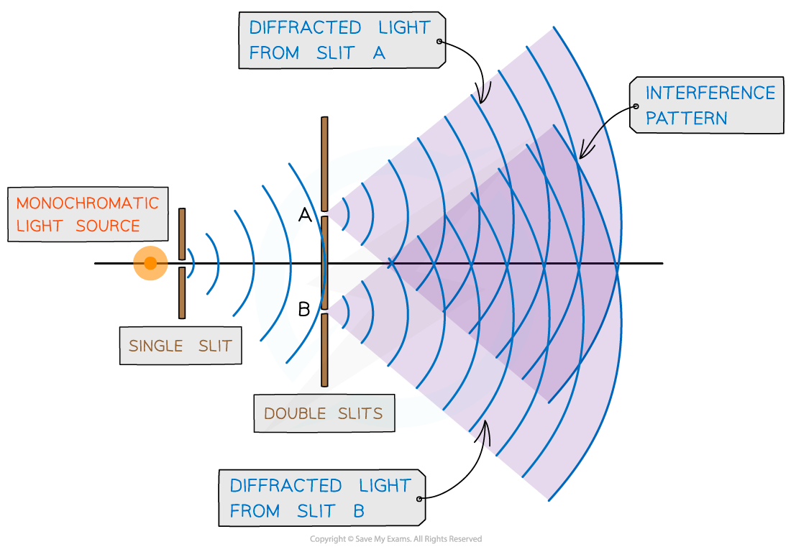
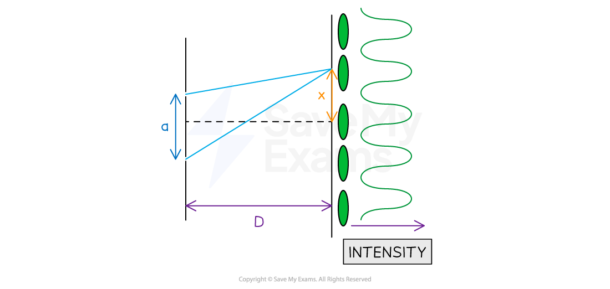

# Young's Double Slit Experiment

## Double Slit Interference

> **Spec point** — `spcpt_ZYzwNTYWTGjhD4Z8`

## Double slit interference

- Young's double-slit experiment produces a **diffraction **and an **interference pattern** using either:

  - The interference of two **coherent** wave sources
  - A single wave source passing through a **double slit**

- In this typical set-up for Young's double slit experiment:

  - The laser light source is placed behind the **single slit**
  - So the light is diffracted, producing two light sources at slits **A **and **B**
  - The light from the double slits is then diffracted, producing a **diffraction pattern** made up of bright and dark fringes on a screen

#### Young's double slit experiment

***Young’s double-slit experiment arrangement creates an interference pattern when light is passed through slits A and B***

- Calculations can be made for the double slit interference of light using the equation:

$λ=\frac{ax}{D}$

- Where:

  - *λ *= wavelength of source (m)
  - *a* = distance between the centres of the slits (m)
  - *x* = fringe width (distance between successive bright fringes) (m)
  - *D* = distance between the slits and the screen (m)

#### Quantities for double slit interference equation

***Double slit interference equation with a, x and D represented on a diagram***

- In this experiment:

  - $D$* *is much bigger than any other dimension, normally several metres long
  - $a$* *is the separation between the two slits and is often the smallest dimension, normally in mm
  - $x$* *is the distance between the fringes on the screen, often in cm. This can be obtained by measuring the distance between the centre of each consecutive bright spot.

- The above equation shows that the separation $x$ between the fringes will **increase** if:

  - the **wavelength** $λ$of the incident light **increases**
  - the **distance **$D$ between the screen and the slits **increases**
  - the **separation** $a$ between the slits **decreases**

> **Worked Example**
> A laser is placed in front of a double-slit as shown in the diagram below.
> 
> 
> 
> The laser emits light of frequency 750 THz. The separation of the maxima P and Q observed on the screen is 15 mm. The distance between the double slit and the screen is 4.5 m.
> 
> Calculate the separation of the two slits.
> 
> **Answer:**
> 
> **Step 1: Calculate the wavelength of the light**
> 
> $c=fλ$
> 
> **Step 2: Rearrange for *****λ***** and substitute in values**
> 
> $λ=\frac{c}{f}=\frac{3\times10^{8}}{750\times10^{12}}=4\times10^{-7}=400\mathrm{nm}$
> 
> **Step 3: State the double slit equation**
> 
> $λ=\frac{ax}{D}$
> 
> **Step 4: Determine the distance between fringes**
> 
> - From the diagram, there are **9** bright fringes between maxima P and Q
> - Since the distance between P and Q is 15 mm, the distance between each fringe is:
> 
> $x=\frac{15\times10^{-3}}{9}=1.667\times10^{-3}m$
> 
> **Step 5: Rearrange the equation and substitute in the known values to calculate**
> 
> $a = \frac{ \\lambda D}{x} = \frac{( 4 \times 10^{- 7} ) \times 4.5 }{1.667 \times 10^{- 3} } = 1.08 \times 10^{- 3} = 1.1 \text{mm} ( 2 \mathrm{s} . \mathrm{f} )$

> **Exam Hint**
> Since *a*, *x* and *D* are all distances, it's easy to mix up which they refer to. Labelling the double slit diagram in the way given in the notes above will help to remember the order i.e. *a* and *x* in the numerator and *D* underneath in the denominator.
