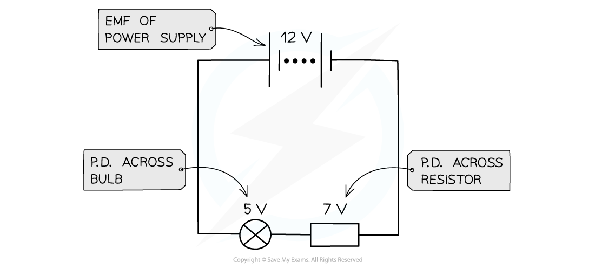

# Potential Difference

## Defining Potential Difference

> **Spec point** — `spcpt_fPkN43MmdtfFGv8r`

## Defining potential difference

- A cell makes one end of the circuit positive and the other negative. This sets up a **potential difference** (p.d.) across the circuit
- The potential difference across a component in a circuit is defined as: **The** **energy transferred per unit charge** **flowing from one point to another**
- Potential difference (sometimes called voltage) is measured in **volts (V)**. One volt is the same as one **joule per coulomb (J C****-1****)**

  - If a bulb has a potential difference of 3 V, every coulomb of charge passing through the bulb will transfer 3 J of energy to the bulb
- The potential difference of a power supply connected in **series **is always **shared **between the components in the circuit

#### Potential difference in a series circuit

***The potential difference is the voltage across each component in a circuit***

- Potential difference is measured using a **voltmeter**
- A **voltmeter **is always set up in **parallel **so that it can measure the difference in electrical potential on each side of the component

  - This is a measure of how much energy has been transferred to the component

#### Potential difference in a parallel circuit

***Potential difference can be measured by connecting a voltmeter in parallel between two points in a circuit.***

## Calculating Potential Difference

> **Spec point** — `spcpt_HF9Sn3fSM6bjDpMh`

## Calculating potential difference

- The potential difference is defined as the **energy transferred per unit charge**
- Another measure of energy transfer is **work done**
- Therefore, potential difference can also be defined as the **work done per unit charge** $V=\frac{W}{Q}$

  - *V* = potential difference (V)
  - *W* = work done (J)
  - *Q* = charge (C)

> **Worked Example**
> A lamp is connected to a 240 V mains supply and another to a 12 V car battery. Both lamps have the same current, yet the 240 V lamp glows more brightly.
> 
> 
> 
> Explain in terms of energy transfer why the 240 V lamp is brighter than the 12 V lamp.
> 
> **Answer:**
> 
> - Both lamps have the same current, which means charge flows at the same rate in both
> - The 240 V lamp has a potential difference 20 times greater than the 12 V lamp
> - Potential difference is the energy transferred (work done) per unit charge
> - This means the energy transferred by each coulomb of charge to the 240 V lamp is 20 times greater than for the 12 V lamp
> - This makes the 240 V lamp shine much brighter than the 12 V lamp

> **Exam Hint**
> Think of potential difference as being the **energy per coulomb **of charge transferred between two points in a circuit
