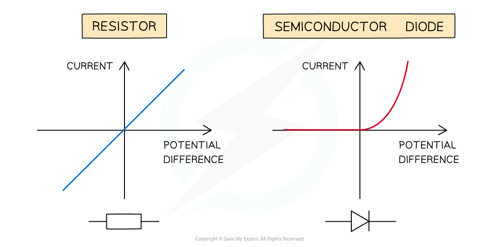
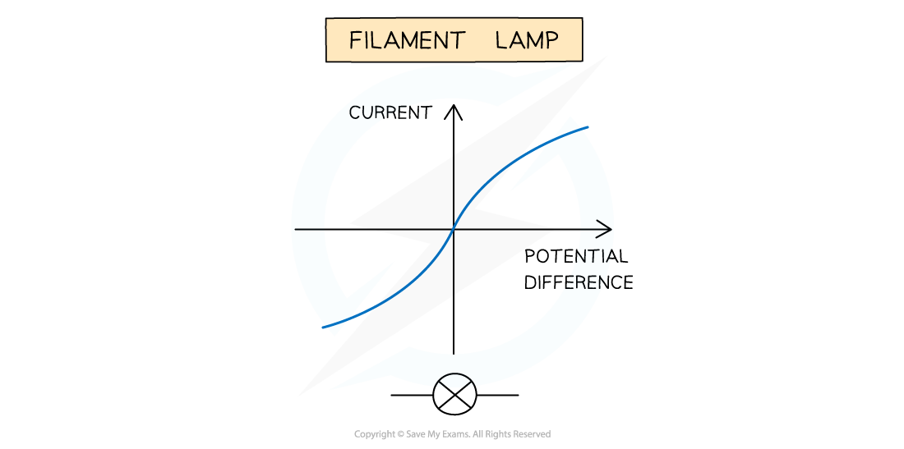

# I-V Characteristics

## I–V Characteristics

> **Spec point** — `spcpt_gKyTMyB6KHDK5YDg`

## I–V characteristics

- As the potential difference (voltage) across a component is increased, the current also increases (in accordance with Ohm’s law)
- The precise relationship between potential difference and current is different for different components and can be shown on an *I-V* graph:

#### I-V Characteristics of different components

***I-V characteristics for metallic conductor (e.g. resistor) and semiconductor diode***

- The *I-V* graph for a metallic conductor at constant temperature e.g. a resistor, is very simple:

  - The current is **directly proportional** to the potential difference
  - This is demonstrated by the **straight** **line** graph through the origin
- The *I-V* graph for a semiconductor diode is slightly different. A diode is used in a circuit to allow current to flow only in a specific direction:

  - When the current is in the direction of the arrowhead symbol, this is **forward bias. **This is shown by the sharp increase in potential difference and current on the right side of the graph
  - When the diode is switched around, it does not conduct and is called **reverse bias. **This is shown by a zero reading of current or potential difference on the left side of the graph

> **Worked Example**
> The *I–V* characteristic of two electrical component **X** and **Y** are shown.
> 
> 
> 
> Which statement is correct?
> 
> **A.** The resistance of **X** increases as the current increases
> 
> **B.** At 2 V, the resistance of **X** is half the resistance of **Y**
> 
> **C.** **Y** is a semiconductor diode and **X** is a resistor
> 
> **D.** **X** is a resistor and **Y** is a filament lamp
> 
> **Answer: C**
> 
> - The *I-V* graph X is **linear**
> 
>   - This means the graph has a constant gradient. I/V and the resistance is therefore also constant (since gradient = 1/R)
>   - This is the *I-V* graph for a conductor at constant temperature e.g. a resistor
> - The *I-V* graph Y starts with zero gradient and then the gradient increases rapidly
> 
>   - This means it has infinite resistance at the start which then decreases rapidly
>   - This is characters of a device that only has current in one direction e.g a semiconductor diode
> - Therefore the answer is **C**

## Resistance in a Filament Lamp

> **Spec point** — `spcpt_GjGfJZqJDTfVPpnf`

## Resistance in a filament lamp

- The *I-V* graph for a filament lamp has a distinctive shape

#### I-V characteristics for a filament lamp

***A graph showing the I-V characteristics for a filament lamp.***

- This is because:

  - As the current increases, the temperature of the filament in the lamp increases
  - The higher temperature causes an increase in resistance
  - Resistance opposes current, causing the current to increase at an increasingly slower rate
- Where the graph is a straight line, the resistance is constant
- The resistance increases as the graph curves

### Resistance and temperature

- All solids are made up of vibrating atoms

  - The higher the temperature, the faster these atoms vibrate
- Electric current is the flow of free electrons through a conductor
- The electrons collide with the vibrating metal ions that make up the wire
- The vibrating ions impedes the flow of electrons (charge)
- Therefore, the current **decreases**

  - As the **temperature** increases, the **resistance **increases
  - And as the resistance increases, the **current **decreases
