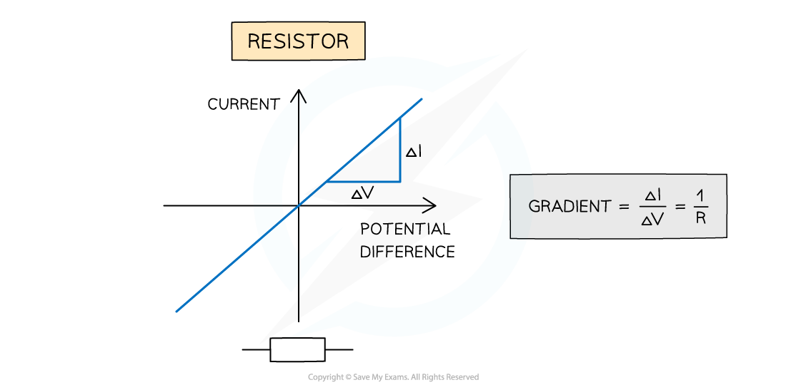

# Ohm's Law

## Ohm's Law

> **Spec point** — `spcpt_fqbr43qMqM7X86q4`

## Ohm's law

- Ohm’s law states that: **For a conductor at a constant temperature, the current through it is proportional to the potential difference across it**
- **Constant temperature** implies **constant resistance**
- This is shown the equation below: ***V = IR***

  - *V* = potential difference (V)
  - *I* = current (A)
  - *R* = resistance (Ω)

- The relationship between the potential difference across an electrical component (in this case a fixed resistor) and the current can be investigated through a circuit such as the one below

#### Investigating potential difference and current in a circuit

***Circuit for plotting graphs of current against voltage***

- By adjusting the resistance on the variable resistor, the current and potential difference will vary in the circuit
- Measuring the variation of current with potential difference through the fixed resistor will produce the straight line graph below

#### Plotting current against voltage

***Circuit for plotting graphs of current against voltage.***

- Since the gradient is constant, the resistance of the resistor can be calculated by using 1 ÷ gradient of the graph
- An electrical component obeys Ohm’s law if its graph of current against potential difference is a **straight line** through the origin

  - A resistor obeys Ohm’s law
  - A filament lamp does **not** obey Ohm’s law
- This applies to any metal wires, provided that the current isn’t large enough to increase their temperature

> **Worked Example**
> The current flowing through a component varies with the potential difference *V* across it as shown.
> 
> 
> 
> Which graph best represents how the resistance *R* varies with *V*?
> 
> 
> 
> 

> **Exam Hint**
> - In maths, the gradient is the **slope** of the graph
> - The graphs below show a summary of how the slope of the graph represents the gradient
> 
> 
> 
> ***Graphs showing varying gradients***
