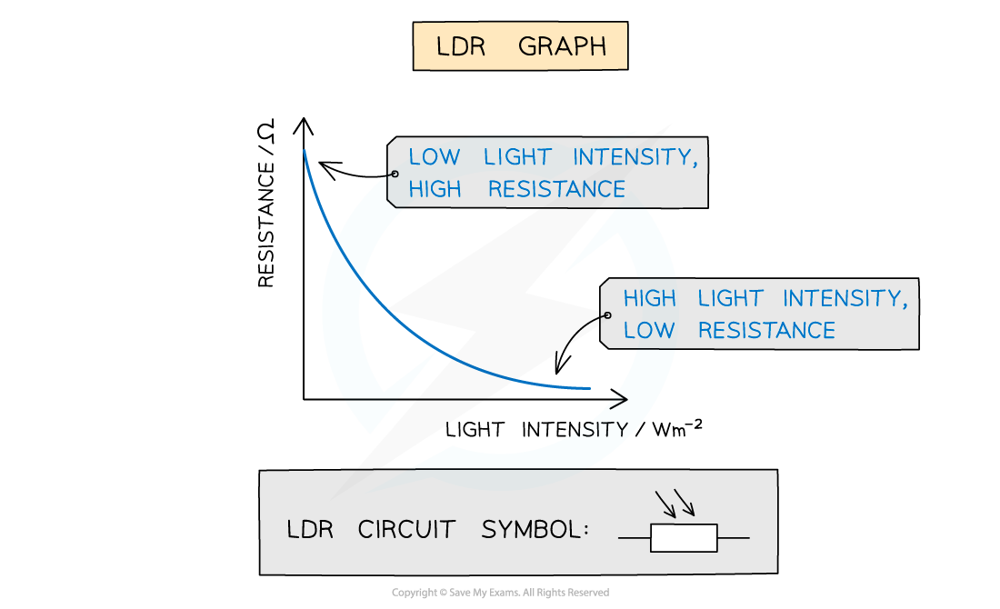
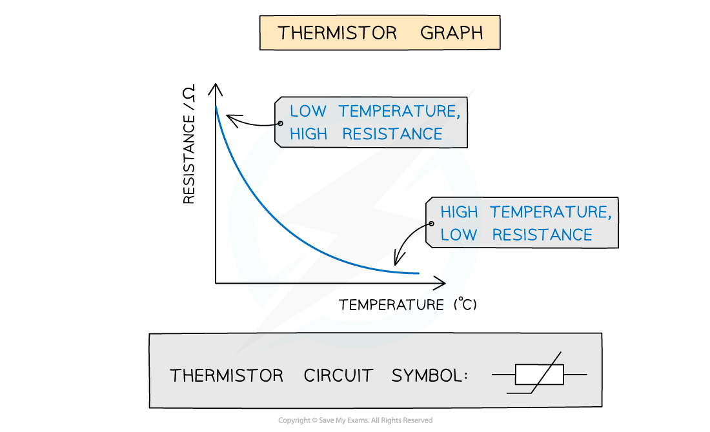
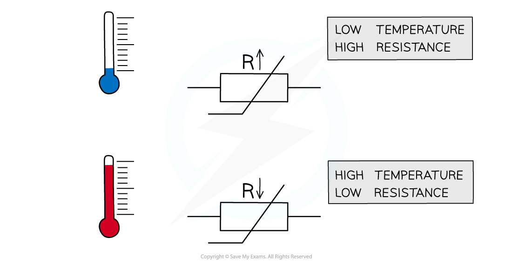

# Resistance in Sensory Resistors

## Resistance in a Light-Dependent Resistor

> **Spec point** — `spcpt_yVXK2DVnqCS7ryvz`

## Resistance in a light-dependent resistor

- A light-dependent resistor (LDR) is a non-ohmic conductor and sensory resistor
- Its **resistance **automatically **changes **depending on **light **(illumination)
- As the** light intensity increases**, the **resistance** of an LDR **decreases**
- This is shown by the following graph:

#### LDR graph

***Graph of light intensity and resistance for an LDR***

- LDRs can be used as light sensors, so, they are useful in circuits which automatically switch on lights when it gets dark, for example, street lighting and garden lights

  - In the dark, its resistance is very large (millions of ohms)
  - In bright light, its resistance is small (tens of ohms)

#### Resistance of an LDR

***Resistance of an LDR depends on the light intensity falling on it***

> **Worked Example**
> Which graph represents the variation of current $I$ with potential difference $V$ for a light-dependent resistor (LDR) in constant light intensity?
> 
> 
> 
> **Answer:  B**
> 
> - An LDR is a type of resistor whose resistance decreases as light intensity increases
> - For a given light intensity, the LDR obeys Ohm's law, i.e. it has constant resistance
> - If resistance is constant, then current $I$ and potential difference $V$ will be directly proportional, since ***V *****= *****IR***
> - The graph is therefore a straight line rather than a curve

## Resistance in a Thermistor

> **Spec point** — `spcpt_5sBYpfWW8sKYCvyh`

## Resistance in a thermistor

- A thermistor is a non-ohmic conductor and sensory resistor
- Its **resistance **changes depending on its **temperature**
- As the temperature **increases,** the resistance of a thermistor **decreases**
- This is shown by the following graph:

***Graph of temperature and resistance for a thermistor***

- Thermistors are temperature sensors and are used in circuits in ovens, fire alarms and digital thermometers

  - As the thermistor gets hotter, its resistance decreases
  - As the thermistor gets cooler, its resistance increases

#### Resistance through a thermistor

***The resistance through a thermistor is dependent on the temperature of it***

> **Worked Example**
> A NTC thermistor is connected in series with a resistor *R* and a battery.
> 
> 
> 
> The resistance of the thermistor is equal to the resistance of *R* at room temperature. When the temperature of the thermistor decreases, which statement is correct?
> 
> **A. **The p.d across the thermistor increases
> 
> **B.** The current in *R* increases
> 
> **C.** The resistance of the thermistor decreases
> 
> **D.** The p.d across *R* increases
> 
> **Answer: A**
> 
> - The resistance of the thermistor increases as the temperature decreases
> - Increasing the thermistor’s resistance increases the total resistance of the series circuit
> - This reduces the current supplied by the battery
> - The p.d. across a component  is given by Ohm’s law ***V***** = *****IR***
> - Although the total current decreases, the fraction of the p.d. across the thermistor increases because its resistance becomes larger relative to *R*
> - Therefore,  the  p.d. across the thermistor increases
> - Hence, **A** is correct
> 
> **B** is incorrect because the current decreases as the total resistance of the circuit is increased
> 
> **C** is incorrect because for a negative temperature coefficient thermistor, the resistance increases as the temperature decreases
> 
> **D** is incorrect because the p.d. decreases due to resistor R now having a smaller share of the total resistance
