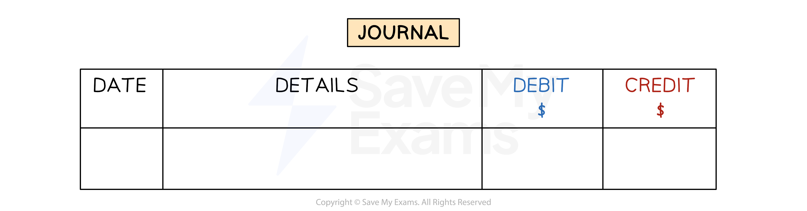

# Cash Books & The General Journal

## The cash & petty cash books

> **Spec point** — `spcpt_FNj5fhjFBtW9n9YT`

## The cash & petty cash books

### What are the cash book and the petty cash book?

- The **cash book** and **petty cash book** are books of prime entry
- They record all transactions which involve the **exchange of cash**

  - **Petty cash** is used for **small valued transactions**
- The book-keeper gets the information from:

  - Receipts
  - Cheques & cheque counterfoils
  - Paying-in slips
  - Bank statements
  - Petty cash vouchers
- The cash book and petty cash book are **also part of the double entry system**

  - This is different to the other books of prime entry

## The general journal

> **Spec point** — `spcpt_xGpzcNHqZBkPtR74`

## The general journal

### What is the general journal?

- The **general journal** is also referred to as, simply, “the journal”
- The journal is used to record all transactions that do **not go into the other books** of prime entry, such as:

  - Opening balances when a business is first created
  - Introducing capital
  - Taking drawings
  - Purchasing a non-current asset
  - Selling a non-current asset
  - Correcting errors
  - Transferring balances to the income statement

*The layout of the general journal*

### How do I make a journal entry for a transaction?

- **STEP 1**
Enter the **date**
- **STEP 2**
Enter the **name of the account(s)** that need to be **debited** in the **details column**

  - It is conventional to enter the debit accounts before the credit accounts
- **STEP 3**
Enter the **corresponding values** in the **debit column**
- **STEP 4**
Enter the **name of the account(s)** that need to be **credited** in the **details column**

  - It is conventional to leave an indent for the credit entries
- **STEP 5**
Enter the **corresponding values** in the **credit column**

  - Make sure the total debit amount is equal to the total credit amount
- **STEP 6**
Write a **narrative** for the journal entry

  - This is a brief explanation of the transaction
  - This is especially useful for non-regular transactions and for correction of errors

> **Exam Hint**
> Read the question carefully to see whether a narrative is required. If in doubt, you should include a narrative.

> **Worked Example**
> On 1 February 2024, John starts an online tutoring business. He takes out a bank loan for \$5000 and uses it to purchase a computer for \$4000. He puts the remaining money in a business bank account along with \$2000 of his own money.
> 
> Prepare the general journal entry to record the opening assets and liabilities at 1 February. A narrative is required.
> 
> **Answer**:
> 
> - Money in bank from loan
> 
> *\$5* *000 - \$4* *000 = \$1* *000*
> 
> - Total money in the bank
> 
> *\$1* *000 + \$2* *000 = \$3* *000*
> 
> - Capital is the difference between assets and liabilities
> 
> *\$4* *000 + \$3* *000 - \$5* *000 = \$2* *000*
> 
> **Journal**
> 
> | **Date** | **Details** | **Debit**  **\$** | **Credit**  **\$** |
> |---|---|---|---|
> | **Final answer:** **2024** **Feb 1** | **Final answer:** **Computer** | **Final answer:** **4 000** |   |
> |   | **Final answer:** **Bank** | **Final answer:** **3 000** |   |
> |   | **Bank loan** |   | **Final answer:** **5 000** |
> |   | **Capital** | **Final answer:** **                 ** | **Final answer:** **2 000** |
> |   |   | **Final answer:** **7 000** | **Final answer:** **7 000** |
> |   | **Final answer:** **Opening balances for assets, liabilities and capital** |   |   |
