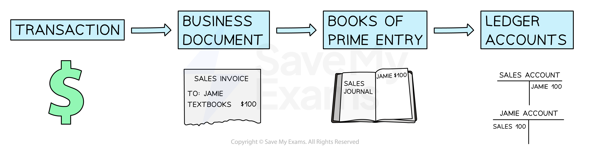

# Introduction to Books of Prime Entry

## Purpose of books of prime entry

> **Spec point** — `spcpt_dCHR4vYKKS4Y8cHm`

## Purpose of books of prime entry

### What are books of prime entry?

- **Books of prime entry** are used to **record the details** of a **transaction**

  - Older terminology for these books includes
  
    - Subsidiary books
    - Books of original entry
    - Daybooks
- Information is **taken from the business documents** and entered into the books of prime entry
- The details are **then transferred** from the books of prime entry **to the ledger accounts**
- The seven books of prime entry are:

  - Sales journal
  - Purchases journal
  - Sales returns journal
  - Purchases returns journal
  - Cash book
  - Petty cash book
  - General journal

*The accounting process*

### What are the advantages of using books of prime entry?

- **Books of prime entry **are another stage which can be used to **check for errors**

  - They can help in the **preparation of control accounts** to check the accuracy of the ledger accounts
- Each book of prime entry collects the **same type of transaction**

  - The books allow **managers** to see the** totals** for different types of transactions easily
  - Therefore, there are** fewer entries** in some of the ledger accounts
- Bigger businesses may have **multiple book-keepers**

  - Different book-keepers can be **responsible for different books** of prime entry without any risk of work being duplicated or missed

## Sales journal

> **Spec point** — `spcpt_SpRZW3wdPqKW3kFP`

## Sales journal

### What is the sales journal?

- The **sales journal** is a record of all **credit sales**

  - **Cash sales** are **not recorded** in the sales journal
  
    - They are recorded directly into the **cash book**
- It contains:

  - The dates of sales
  - The names of the credit customers
  - The amounts for each of the sales
  
    - The amounts should be **after trade discounts** have been applied to the list prices
- The book-keeper uses the **sales invoices** that were **issued **to enter the information into the sales journal
- The **totals** are transferred to the **ledger accounts** at regular intervals

  - **Credit** the **sales account** with the total
  
    - Call this entry “Sales journal”
  - **Debit** the individual **trade receivables accounts**

> **Exam Hint**
> If a sales journal is used, only one entry is made to the sales account at the end of a given period rather than separate entries for each individual sale.
> 
> If a question does not mention a sales journal, enter the individual transactions into the sales account and label them with the names of the trade receivables.

## Sales returns journal

> **Spec point** — `spcpt_QmJGQTJJf9mYXhzg`

## Sales returns journal

### What is the sales returns journal?

- The **sales returns journal** is a record of all the **returns from credit customers**
- It contains:

  - The dates of the returns
  - The names of the credit customers
  - The amounts for each of the returns
- The book-keeper uses the **credit notes** that were **issued** to enter the information into the sales returns journal
- The **totals** are transferred to the **ledger accounts** at regular intervals

  - **Debit** the **sales returns account** with the total
  
    - Call this entry “Sales returns journal”
  - **Credit** the individual **trade receivables accounts**

> **Exam Hint**
> If a sales returns journal is used, only one entry is made to the sales returns account at the end of a given period rather than separate entries for each individual return.

## Purchases journal

> **Spec point** — `spcpt_yvFgNxcwmM75q5fW`

## Purchases journal

### What is the purchases journal?

- The **purchases journal** is a record of all **credit purchases**

  - **Cash purchases** are **not recorded **in the purchases journal
  
    - They are recorded directly into the **cash book**
  - **Purchases of non-current assets** are **not recorded **in the purchases journal
  
    - They are recorded directly into the **cash book**
- It contains:

  - The dates of the purchases
  - The names of the credit suppliers
  - The amounts for each of the purchases
- The book-keeper uses the **purchases invoices** that were **received **to enter the information into the purchases journal
- The **totals** are transferred to the **ledger accounts** at regular intervals

  - **Debit** the **purchases account** with the total
  
    - Call this entry “Purchases journal”
  - **Credit** the individual **trade payables accounts**

> **Exam Hint**
> If a purchases journal is used, only one entry is made to the purchases account at the end of a given period rather than separate entries for each individual purchase.
> 
> If a question does not mention a purchases journal, enter the individual transactions into the purchases account and label them with the names of the trade payables.

## Purchases returns journal

> **Spec point** — `spcpt_9nrwHDHGY4w5TmqR`

## Purchases returns journal

### What is the purchases returns journal?

- The **purchases returns journal** is a record of all the returns to credit suppliers
- It contains:

  - The dates of the returns
  - The names of the credit suppliers
  - The amounts for each of the returns
- The book-keeper uses the **credit notes** that were **received** to enter the information into the purchases returns journal
- The **totals** are transferred to the **ledger accounts** at regular intervals

  - **Credit** the **purchases returns account **with the total
  
    - Call this entry “Purchases returns journal”
  - **Debit** the individual **trade payables accounts**

> **Exam Hint**
> If a purchases returns journal is used, only one entry is made to the purchases returns account at the end of a given period rather than separate entries for each individual return.

> **Worked Example**
> Jeff is a sole trader. In February 2024, the following transactions took place.
> 
> | Feb 1 | Bought goods on credit from Samson, \$500 |
> |---|---|
> | 3 | Bought goods on credit from Helina with a 10% trade discount, list price \$300 |
> | 6 | Returned goods to Samson, \$50 |
> | 7 | Paid \$250 to Samson by credit transfer |
> | 10 | Bought goods using cash from Jimmy, \$70 |
> | 15 | Bought goods on credit from Samson, \$400 |
> | 18 | Sold goods on credit to Jasper, \$180 |
> | 28 | Returned goods to Samson, \$100 |
> 
> Prepare the purchases journal and the purchases returns journal for February 2024. Total the journals on 29 February 2024, and indicate the ledger account to which the total would be posted.
> 
> **Answer**:
> 
> | Feb 1 | Purchases journal: \$500 Samson |
> |---|---|
> | 3 | Find the discount given by Helina  *10% × \$300 = \$30*  Find the amount Jeff owes Helina  *\$300 - \$30 = \$270*  Purchases journal: \$270 Helina |
> | 6 | Purchases returns journal: \$50 Samson |
> | 7 | Neither journal: it is a payment, not a purchase or return *This would go in the cash book* |
> | 10 | Neither journal: it is a cash purchase *This would go in the cash book* |
> | 15 | Purchases journal: \$400 Samson |
> | 18 | Neither journal: it is a credit sale *This would go in the sales journal* |
> | 28 | Purchases returns journal: \$100 Samson |
> 
> **Final answer:** **Purchases Journal**
> 
> | **Final answer:** **Date** | **Final answer:** **Details** | **Final answer:** **\$** |
> |---|---|---|
> | **Final answer:** **Feb 1** | **Final answer:** **Samson** | **Final answer:** **500** |
> | **Final answer:** **Feb 3** | **Final answer:** **Helina** | **Final answer:** **270** |
> | **Final answer:** **Feb 15** | **Final answer:** **Samson** | **Final answer:** **400** |
> | **Final answer:** **Feb 29** | **Final answer:** **Transfer to purchases account** | **Final answer:** **1 170** |
> 
> **Final answer:** **Purchases Returns Journal**
> 
> | **Final answer:** **Date** | **Final answer:** **Details** | **Final answer:** **\$** |
> |---|---|---|
> | **Final answer:** **Feb 6** | **Final answer:** **Samson** | **Final answer:** **50** |
> | **Final answer:** **Feb 28** | **Final answer:** **Samson** | **Final answer:** **100** |
> | **Final answer:** **Feb 29** | **Final answer:** **Transfer to purchases returns account** | **Final answer:** **150** |
