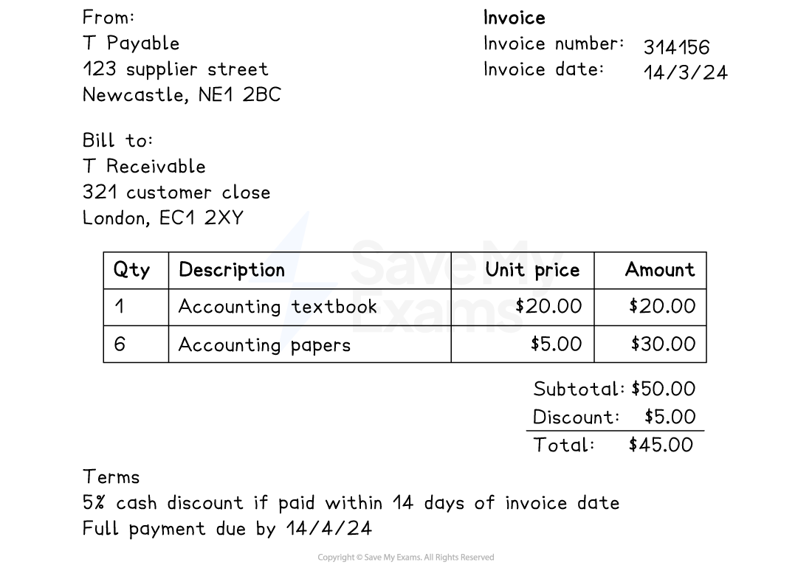

# Business Documents for Credit Transactions

## Invoices

> **Spec point** — `spcpt_bf8TynHzPZVrrTqt`

## Invoices

### What is an invoice?

- An **invoice** is used as a **record** of a **credit sale** or **credit purchase**
- The **supplier issues** an invoice to the** credit customer**

  - The **customer** might refer to this as a **purchases invoice**
  - The **supplier** will keep a copy
  
    - They might refer to it as a **sales invoice**
- An entry is made in the **books of prime** **entry** when an invoice is issued or received for goods or services

  - The** customer** enters the value in the **purchases journal**
  - The **supplier** enters the value in the **sales journal**
- If the invoice is for a **non-current asset** then  the book of original entry is the **journal**

### What information is contained in an invoice?

- The **date** of the transaction
- The **details** of the **supplier**

  - Name and address
- The **details** of the **customer**

  - Name and address
- The **details** of the **goods or services**

  - The quantity
  - The price of each item
- **Trade discount**

  - This is deducted before the total amount is stated
- The **total amount owed**
- **Terms** for eligibility of **cash discount**
- **Date payment** is **required** by

  - It might also state any interest or charges that will be applied after this date

*Example of an invoice*

> **Exam Hint**
> You might be required to complete an invoice. This will usually involve the calculation of percentages of an amount.

> **Worked Example**
> Complete the invoice below.
> 
> | **From:**  **T Payable**  **123 Supplier Street**  **Newcastle, NE1 2BC**  **Bill to:**  **T Receivable**  **321 Customer Close**  **London, EC1 2XY** | **Invoice**  **Invoice Number: 3141576**  **Invoice Date:     21/3/24 ** |   |   |
> |---|---|---|---|
> | **QTY** | **Description** | **Unit Price** **\$** | **Amount** **\$** |
> | 50 | Accounting flashcards | 4 | … |
> | … | Mark schemes | 20 | … |
> | Subtotal | 500 |   |   |
> | 5% trade discount | … |   |   |
> | Total | … |   |   |
> 
> **Answer**:
> 
> - Amount for accounting flashcards
> 
> *50 × \$4 = \$200*
> 
> - Amount for mark schemes
> 
> *\$500 - \$200 = \$300*
> 
> - Quantity for mark schemes
> 
> *\$300 ÷ \$20 = 15*
> 
> - Discount
> 
> *5% × \$500 = \$25*
> 
> - Total
> 
> *\$500 - \$25 = \$475*
> 
> | **From:**  **T Payable**  **123 Supplier Street**  **Newcastle, NE1 2BC**  **Bill to:**  **T Receivable**  **321 Customer Close**  **London, EC1 2XY** | **Invoice**  **Invoice Number: 314156**  **Invoice Date:     14/3/24 ** |   |   |
> |---|---|---|---|
> | **QTY** | **Description** | **Unit Price** **\$** | **Amount** **\$** |
> | 50 | Accounting Flashcards | 4 | **Final answer:** **200** |
> | **Final answer:** **15** | Mark schemes | 20 | **Final answer:** **300** |
> | Subtotal | 500 |   |   |
> | 5% trade discount | **Final answer:** **25** |   |   |
> | Total | **Final answer:** **475** |   |   |

## Debit notes & credit notes

> **Spec point** — `spcpt_Bz2JsgqDzH586KB8`

## Debit notes & credit notes

### What is a debit note?

- A **credit customer** **issues a** **debit note** to a supplier to request a **reduction** in the balance of an invoice
- The customer could ask for a reduction if

  - The goods are **damaged** or **faulty**
  - They were sent the **wrong items**
  - **Goods are missing** from their order
- **No entries** are recorded in the **books of prime entry** at this stage

  - This is because the supplier has not yet authorised the reduction
  - This is done when the customer receives a credit note from the supplier

### What information is contained in a debit note?

- The **date** of the request
- The **details** of the **supplier**

  - Name and address
- The **details** of the **customer**

  - Name and address
- The **reason **for the request for a reduction

  - Details of the goods that are being returned
  - Details of the goods that were missing
- The** total reduction** that is being requested

### What is a credit note?

- A **supplier issues a credit note** to a credit customer when the balance on an invoice is reduced

  - The **customer** uses the **credit note received** to record the return
  
    - It will be matched and filed with the corresponding invoice and debit note
  - The **supplier** keeps a copy of the **credit note issued** to record the return
  
    - It will be matched and filed with the corresponding invoice
- An entry is made in the **books of prime** **entry** when a credit note is issued or received

  - The** customer** enters the value in the **purchases returns journal**
  - The **supplier** enters the value in the **sales returns  journal**

### What information is contained in a credit note?

- The **date** of the reduction
- The **details** of the **supplier**

  - Name and address
- The **details** of the **customer**

  - Name and address
- The **reason **for the reduction

  - Details of the goods that are being returned
  - Details of the goods that were missing
- The** total reduction** that is being given

> **Worked Example**
> Samir sells pet food. Hashim is a credit customer. Three events take place during a week between Samir and Hashim. Complete the table to identify the business document that is issued and the name of the person who issues the document.
> 
> | **Event** | **Business document** | **Person who issues the document** |
> |---|---|---|
> | Hashim buys pet food from Samir on credit |   |   |
> | Hashim tells Samir that he wants to return some pet food |   |   |
> | Samir receives the returned goods and reduces the balance on Hashim’s account |   |   |
> 
> **Answer**:
> 
> | **Event** | **Business document** | **Person who issues the document** |
> |---|---|---|
> | Hashim buys pet food from Samir on credit | **Final answer:** **Invoice** | **Final answer:** **Samir** |
> | Hashim tells Samir that he wants to return some pet food | **Final answer:** **Debit note** | **Final answer:** **Hashim** |
> | Samir receives the returned goods and reduces the balance on Hashim’s account | **Final answer:** **Credit note** | **Final answer:** **Samir** |

## Statements of account

> **Spec point** — `spcpt_VCW65xkvtQKDNZ4z`

## Statements of account

### What is a statement of account?

- A **statement of account** is used to show **all transactions** between a credit customer and a supplier **within a given time frame**
- A statement of account is **issued on a regular basis** by the supplier
- **No entries** are recorded in the **books of prime entry** when a statement of account is issued or received

  - This is because **no new transactions** have taken place
  - The customer can **check the balance** on the statement with the balance in their purchases ledger account
- There is usually a **balance column** which shows the **balance after each transaction**
- The statement of account is written from the **point of view of the supplier**

  - Transactions which **increase the customer’s balance** will be labelled as a** debit**
  - Transactions which** decrease the customer’s balance **will be labelled as a** credit**

### What information is contained in a statement of account?

- The **date** that the statement is issued
- The **details** of the **supplier**

  - Name and address
- The **details** of the **customer**

  - Name and address
- The **opening balance**
- The date and amount of any **purchases **by the customer

  - These will correspond to **invoices** that were issued
- The date and amount of any **returns **by the customer

  - These will correspond to **credit notes** that were issued
- **Payments** made by the customer
- **Cash discounts** received by the customer
- The** closing balance**

> **Worked Example**
> An incomplete statement of account is shown below for the month of April 2024.
> 
> | **From:**  **T Payable**  **123 Supplier Street**  **Newcastle, NE1 2BC**  **To:**  **T Receivable**  **321 Customer Close**  **London, EC1 2XY** | **Statement of Account**  **Statement Number: 123456**  **Statement Date:     30/4/24 ** |   |   |   |
> |---|---|---|---|---|
> | **Date** | **Reference** | **Debit**  **\$** | **Credit**  **\$** | **Balance**  **\$** |
> | 2024  Apr 1 | Opening balance |   |   | 450 |
> | Apr 15 | Payment |   | 200 | 250 |
> | Apr 15 | Discount |   | 20 | 230 |
> | Apr 23 | Goods purchased | 300 |   | … |
> | Apr 28 | Goods returned |   | 180 | … |
> 
> Complete the table below to show the business document that T Payable would use as a record of each transaction and calculate the balance immediately after the transaction took place.
> 
> | **Transaction** | **Business document** | **Balance** |
> |---|---|---|
> | Apr 23 Goods purchased |   |   |
> | Apr 28 Goods returned |   |   |
> 
> **Answer**:
> 
> | **Transaction** | **Business document** | **Balance** |
> |---|---|---|
> | Apr 23 Goods purchased | **Final answer:** **Sales invoice** | *230 + 300 =*  **Final answer:** **530** |
> | Apr 28 Goods returned | **Final answer:** **Credit note issued** | *530 - 180 =*  **Final answer:** **350** |
