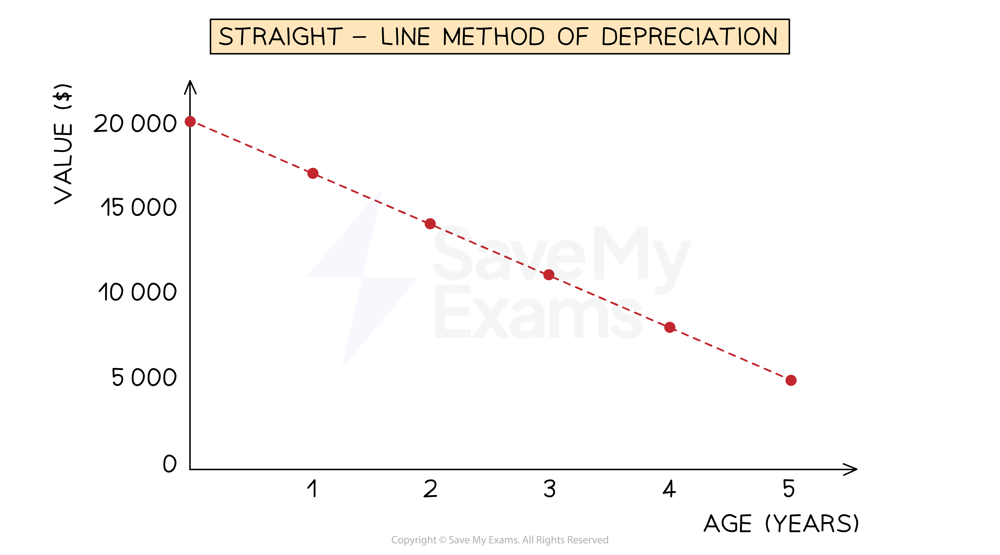
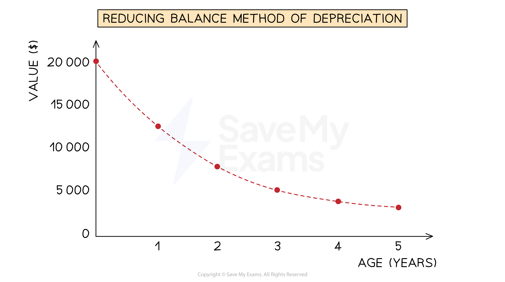
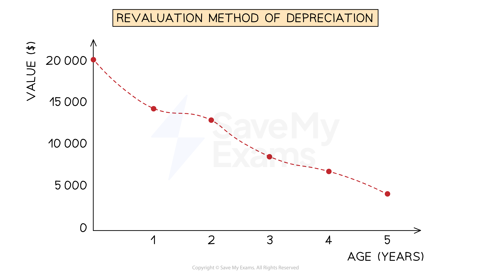

# Depreciation

## Introduction to depreciation

> **Spec point** — `spcpt_Q9TJky6pRfZYWFSg`

## Introduction to depreciation

### What is depreciation?

- **Depreciation** is applied to **non-current assets** to represent the **reduction in their value**
- **Depreciation** is the **financial measure** of how the value of an** asset decreases** over time
- The value of a non-current asset depreciates due to:

  - **Wear and tear **of the asset
  - The asset becoming **outdated or obsolete**
  - The **reduction in the expected useful lifetime** of the asset
  - The asset being** used up or depleted**
- Depreciation is an **expense** that accounts for the **estimated loss in value** of an asset during a given period

  - It is an **expense that does not involve spending money**
- It is used to **spread the cost** of the assets over their expected useful life
- You need to know** three methods** to calculate depreciation

  - Straight-line method
  - Reducing balance method
  - Revaluation method
- The **accounting principle** of **consistency** states that when a business chooses a **method of depreciation** for a type of non-current asset, it must **use that method each year** unless there is a valid reason to change to a different method

  - **Different methods** can be used for **different types** of non-current assets

### Why are non-current assets depreciated?

- Depreciation is used so that the business **adheres to the following accounting principles**:
- **Matching**

  - The **capital expenditure** of a non-current asset is **matched** against the **income that it has contributed to**
  
    - Suppose that a business buys a vehicle for \$30 000 and expects it to be useful for 8 years
    - The full \$30 000 should not be charged as an expense straightaway
    - Instead, the expense should be spread out over the 8 years that it is contributing to income
- **Prudence**

  - The **value of the assets** should **not be overstated**
  
    - Depreciation allows the business to report a more realistic estimation for the valuation of its assets

### Is depreciation charged in the years of purchase and sale?

- **Different businesses** will have **different policies** for dealing with **depreciation** for the year in **which the asset is purchased** and the **year in which the asset is sold or disposed of**
- The business could:

  - Charge a** full year’s worth** of depreciation
  - Charge **no depreciation**
  - Charge a **proportion of the full year’s worth** of depreciation
- The **exam question** will specify which rules should be used

## Straight-line depreciation

> **Spec point** — `spcpt_7ZP4XqvvpK3gdps5`

## Straight-line depreciation

### What is the straight-line method of depreciation?

- The **straight-line method** of depreciation assumes that a non-current asset **loses value at a constant rate **over its useful life

  - This means that the expense for its depreciation is the **same each year**
  - The net book value can reach \$0
  
    - This is when the asset is **fully depreciated**
- You could be given the **depreciation rate** as a **percentage of its original value**

  - E.g. depreciation could be charged at 20% of its original cost
- Or you could be expected to calculate the depreciation using:

  - The **number of years** that the non-current asset will be used
  - The **expected value** of the non-current asset at the **end of its working life**
  
    - This value could be \$0
    - The expected value is also called the** residual value**
- This method is usually used when the asset will be **equally valuable for each year** of its use

  - For example, fixtures and fittings, equipment, etc

*Example of an asset which cost $20 000, being charged depreciation  at 15% per annum using the straight-line method*

### How do I calculate depreciation using the straight-line method?

- If you **are given the percentage for the depreciation**

  - Find the **percentage **of the **original amount**
  - This will be the yearly depreciation charge
- If you **are not given the percentage**

  - Calculate the **expected loss in value during the expected life** of the non-current asset
  
    - The **original value minus the expected value** at the end of its life
  - **Divide** the **loss** by the **number of years** it will be used
  - This will be the yearly depreciation charge

$\mathrm{Depreciation}=\frac{\mathrm{original} \mathrm{value}-\mathrm{expected} \mathrm{value}}{\mathrm{number} \mathrm{of} \mathrm{years}}$

> **Exam Hint**
> The straight-line method is similar to **simple interest** calculations used in maths.

> **Worked Example**
> Abi purchases machinery for \$18 000. Machinery is depreciated at 15% per annum using the straight-line method.
> 
> Calculate the net book value of the machinery after 3 years.
> 
> **Answer**:
> 
> - Calculate the yearly expense due to depreciation
> 
> *15% × \$18 000 = \$2 700*
> 
> - Calculate the total depreciation after 3 years
> 
> *3 × \$2 700 = \$8 100*
> 
> - Subtract the depreciation from the original value
> 
> *\$18 000 - \$8 100 =* **\$9 900**

> **Worked Example**
> Taiki purchases a vehicle for \$30 000. He expects to use the vehicle for 3 years, after which he estimates that it will have a value of \$12 000.
> 
> Calculate the yearly expense due to the depreciation of the vehicle.
> 
> **Answer**:
> 
> - Calculate the loss in value over the 3 years
> 
> *\$30 000 - \$12 000 = \$18 000*
> 
> - Divide this by the number of years
> 
> *\$18 000 ÷ 3 =*** \$6 000**

## Reducing balance depreciation

> **Spec point** — `spcpt_hvQ8cMB843R9WhXc`

## Reducing balance depreciation

### What is the reducing balance method of depreciation?

- The **reducing balance method **of depreciation assumes that the non-current asset **loses value** at a **rate proportional** to its** current value**

  - This means that the **expense for its depreciation** gets **smaller each year** as the **current value decreases**
- You will be **told the percentage** of the current value to use for depreciation
- This method is usually used when a **non-current asset initially loses value at a fast rate**

*Example of an asset, which cost $20 000, being charged depreciation at 30% per annum using the reducing balance method*

### How do I calculate depreciation using the reducing balance method?

- Find the **percentage of the current net book value**

  - This will be the depreciation charge for that year
- If you need to calculate the depreciation for **multiple years,** then calculate **one year at a time**

  - Find the depreciation charge for one year using the **net book value at that start of the year**
  - **Subtract** this amount from the net book value at the start of the year to find the **new net book value**
  - Find the depreciation charge for the next year using the net book value at the start of **that year**
  - Continue this process
- If you just need to find the **current net book value** then you can use some maths skills

  - **Subtract** the percentage from **100%**
  - Write this as a **decimal**
  - Raise this to the power of the **number of years**
  - **Multiply** this by the** original value**

> **Exam Hint**
> The reducing balance method is similar to **compound interest** calculations used in maths.
> 
> Amounts should always be given to the nearest dollar in exams.

> **Worked Example**
> Abi purchases a vehicle for \$16 000. Machinery is depreciated at 25% per annum using the reducing balance method.
> 
> Calculate the net book value of the machinery after 3 years.
> 
> **Answer**:
> 
> **Method 1: Year-by-year**
> 
> - Find the depreciation charged in each year by finding the percentage of the net book value at that time
> - Subtract that year’s depreciation from the net book value to find the net book value at the end of the year
> 
> | *End of year* | *Depreciation charge* | *Net book value* |
> |---|---|---|
> | *0* | *-* | *\$16 000* |
> | *1* | *25% × \$16 000 = \$4 000* | *\$16 000 - \$4 000 = \$12 000* |
> | *2* | *25% × \$12 000 = \$3 000* | *\$12 000 - \$3 000 = \$9 000* |
> | *3* | *25% × \$9 000 = \$2 250* | *\$9 000 - \$2 250 = ***\$6 750** |
> 
> **Method 2: Compound interest**
> 
> - Subtract the percentage from 100%
> 
> *100% - 25% = 75%*
> 
> - Write this as a decimal
> 
> *75% = 0.75*
> 
> - Raise this to the power of the number of years
> 
> *0.75**3*
> 
> - Multiply this by the original value
> 
> *\$16 000 × 0.75**3** =* **\$6 750**

## Revaluation depreciation

> **Spec point** — `spcpt_ZH48zTH9JTp8mBPY`

## Revaluation depreciation

### What is the revaluation method of depreciation?

- The **revaluation method** of depreciation involves **performing a valuation of assets** at the **end of the financial year** to determine the **reduction in value**
- This method is commonly used for assets of **smaller value**

  - Such as loose tools, packing cases

*Example of an asset, which cost $20 000, being charged depreciation using the revaluation method each year*

### How do I calculate depreciation using the revaluation method?

- A **revaluation** of the non-current asset will be **given in the question**
- You need to **identify two numbers**:

  - The net book **value** **before the revaluation**
  - The net book **value** **after the revaluation**
- The depreciation charge is the **value before minus the value after**

> **Worked Example**
> Abi purchased fixtures and fittings for \$5 000 on 1 March 2023. On 29 February 2024, at the end of the financial year, the fixtures and fittings were valued at \$3 650.
> 
> Calculate the depreciation charged for the financial year ending on 29 February 2024.
> 
> **Answer**:
> 
> - Value before the revaluation is \$5 000
> - Value after the revaluation is \$3 650
> - Calculate the difference
> 
> *\$5 000 - \$3 650 =* **\$1 350**
