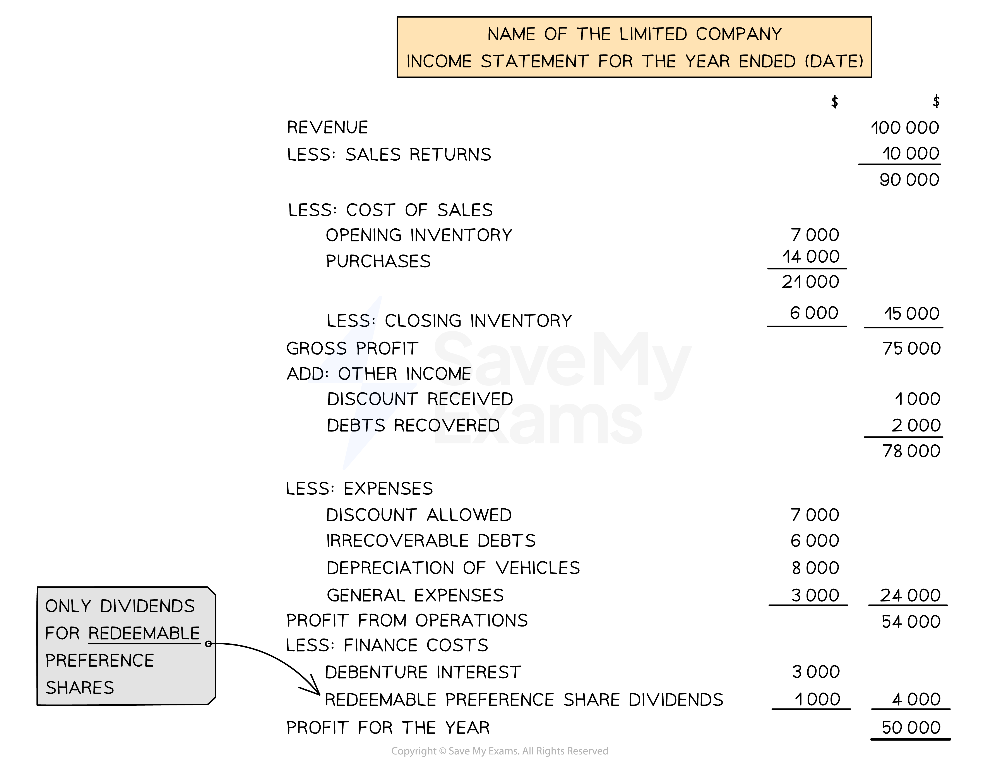

# Income Statement

## Income statements for limited companies

> **Spec point** — `spcpt_6MrKYPC5jTWcnBKP`

## Income statements for limited companies

### What is the layout of the income statement of a limited company?

- The **income statement** of a limited company is prepared in the **same way **it is prepared for that of a sole trader or a partnership business
- It is prepared annually
- It is the **first of the three financial statements** that must be prepared for limited companies
- The only difference is seen in the **finance costs**

  - **Debenture interest** and **redeemable preference share dividends** are included as part of finance costs
  - These appear **after the profit from operations**
- Dividends for **ordinary shares** and **non-redeemable preference shares** do **not **appear on the income statement

*Layout of an income statement for a limited company*

> **Worked Example**
> The trial balance of Abrakadabra Limited at 31 March 2024 was as follows:
> 
> | **Abrakadabra Limited**  **Trial Balance at 31 March 2024** |   |   |
> |---|---|---|
> |   | **Debit**  **\$** | **Credit**  **\$** |
> | Revenue |   | 166 000 |
> | Inventory at 1 April 2023 | 6 820 |   |
> | Purchases | 65 900 |   |
> | Rent and insurance | 10 280 |   |
> | Wages | 25 850 |   |
> | Operating expenses | 9 600 |   |
> | Fittings at cost | 250 000 |   |
> | Provision for depreciation of fittings |   | 75 000 |
> | Trade receivables | 14 400 |   |
> | Bank | 14 965 |   |
> | Trade payables |   | 8 415 |
> | 4% Debenture (repayable in 10 years) |   | 46 000 |
> | Ordinary share capital |   | 80 000 |
> | Retained earnings |   | 28 000 |
> | Dividends paid on ordinary shares | 5 600 |   |
> |   | **403** **415** | **403** **415** |
> 
> **Additional information**:
> 
> 1. Inventory at 31 March 2024 was valued at \$7 080
> 2. Depreciation on fittings is to be charged at 20% method per annum using the reducing balance
> 3. Rent includes a payment of \$2 700 for the 3 months from 1 March 2024 to 31 May 2024
> 4. Accrued wages at 31 March 2024 were \$4 550
> 5. No debenture interest has been paid for the year ended 31 March 2024
> 6. No dividends were outstanding at 31 March 2024
> 7. \$2 200 of the retained earnings is to be transferred to a general reserve on 31 March 2024
> 
> Prepare the income statement for Abrakadabra Limited for the year ended 31 March 2024.
> 
> **Answer**:
> 
> - Identify which balances affect the income statement
> 
> | **Abrakadabra Limited**  **Trial Balance at 31 March 2024** |   |   |   |
> |---|---|---|---|
> |   | **Debit**  **\$** | **Credit**  **\$** | **Income Statement?** |
> | Revenue |   | 166 000 | *IS* |
> | Inventory at 1 April 2023 | 6 820 |   | *IS* |
> | Purchases | 65 900 |   | *IS* |
> | Rent and insurance | 10 280 |   | *IS* |
> | Wages | 25 850 |   | *IS* |
> | Operating expenses | 9 600 |   | *IS* |
> | Fittings at cost | 250 000 |   |   |
> | Provision for depreciation of fittings |   | 75 000 |   |
> | Trade receivables | 14 400 |   |   |
> | Bank | 14 965 |   |   |
> | Trade payables |   | 8 415 |   |
> | 4% Debenture (repayable in 10 years) |   | 46 000 |   |
> | Ordinary share capital |   | 80 000 |   |
> | Retained earnings |   | 28 000 |   |
> | Dividends paid on ordinary shares | 5 600 |   |   |
> |   | **403** **415** | **403** **415** |   |
> 
> Deal with the additional notes and identify how they affect the income statement
> 
> **Item 1** - The closing inventory will be subtracted as part of the cost of sales
> 
> **Item 2** - Find the year's depreciation charge
> 
> - Find the current net book value
> 
> *\$250 000 - \$75 000 = \$175 000*
> 
> - Multiply the net book value by 20%
> 
> *20% × \$175 000 = \$35 000*
> 
> **Item 3** - Subtract the prepaid rent from the balance
> 
> - Find the cost per month
> 
> *\$2 700 ÷ 3 = \$900*
> 
> - Multiply this by two for the prepaid months (April & May)
> 
> *\$900 × 2 = \$1 800*
> 
> - Subtract this from the amount on the trial balance
> 
> *\$10 280 - \$1 800 = \$8 480*
> 
> **Item 4** - Add the accrued wages to the balance
> 
> *\$25 850 + \$4 550 = \$30 400*
> 
> **Item 5 **- Calculate the debenture interest
> 
> *4% × \$46 000 = \$1 840*
> 
> **Item 6 **- Dividends for ordinary shares do not affect the income statement
> 
> **Item 7** - Transferring money to the general reserve does not affect the income statement
> 
> - Prepare the income statement using the usual layout
> - Remember to put the debenture interest after the profit from operations as it is a finance cost
> 
> | **Final answer:** **Abrakadabra  Limited**  **Final answer:** **Income Statement for the year ended 31 March 2024** |   |   |
> |---|---|---|
> |   | **Final answer:** **\$** | **Final answer:** **\$** |
> | **Final answer:** **Revenue ** |   | **Final answer:** **166 000** |
> | **Final answer:** **Less: Cost of sales** |   |   |
> | **Final answer:** **     Opening inventory** | **Final answer:** **6 820** |   |
> | **Final answer:** **     Purchases** | **Final answer:** **65 900** |   |
> |   | **Final answer:** **72 720** |   |
> | **Final answer:** **     Less: closing inventory** | **Final answer:** **7 080** | **Final answer:** **65 640** |
> | **Final answer:** **Gross profit** |   | **Final answer:** **100,360** |
> | **Final answer:** **Less: Expenses** |   |   |
> | **Final answer:** **     Rent and insurance** | **Final answer:** **8 480** |   |
> | **Final answer:** **     Wages** | **Final answer:** **30 400** |   |
> | **Final answer:** **     Operating expenses** | **Final answer:** **9 600** |   |
> | **Final answer:** **     Depreciation of fittings** | **Final answer:** **35 000** | **Final answer:** **83 480** |
> | **Final answer:** **Profit from operations** |   | **Final answer:** **16 880** |
> | **Final answer:** **Debenture interest** |   | **Final answer:** **1 840** |
> | **Final answer:** **Profit for the year** |   | **Final answer:** **15 040** |
