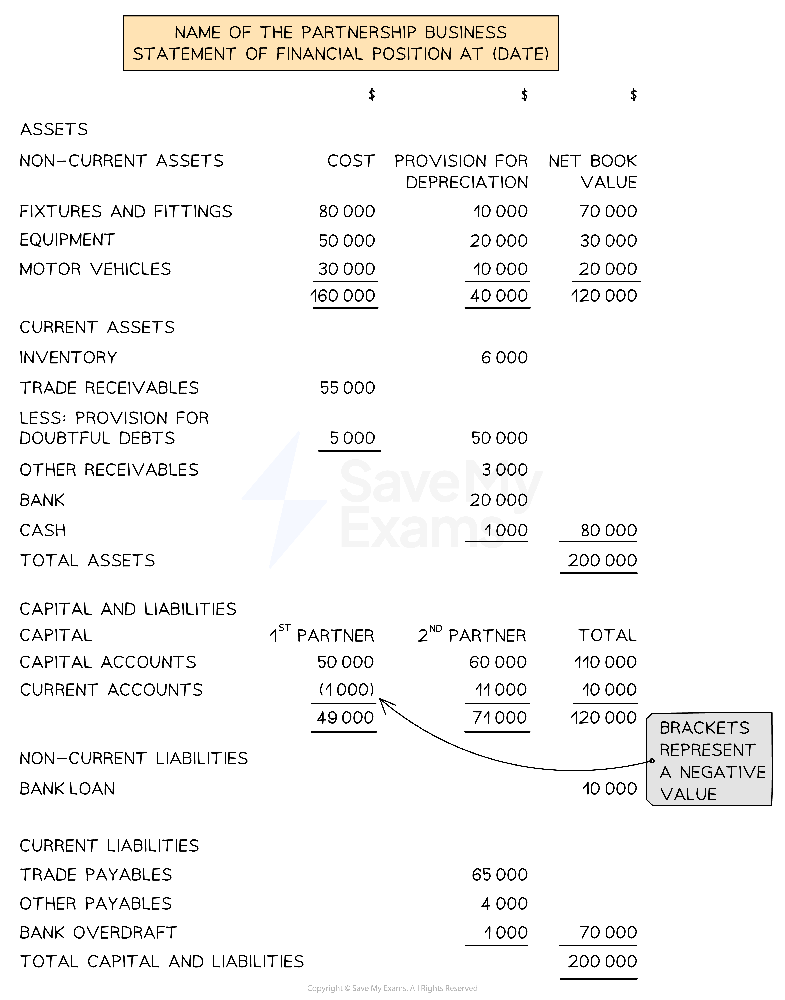
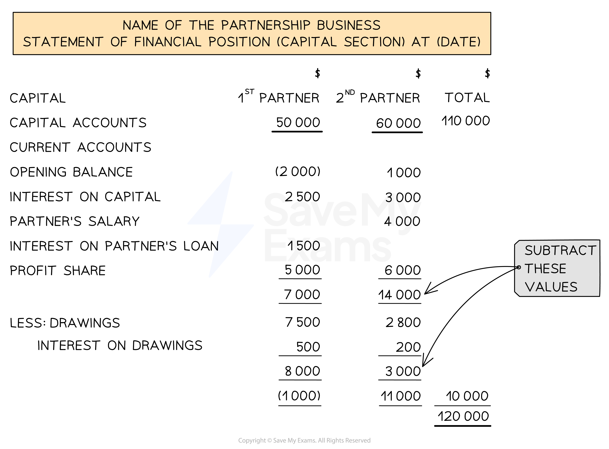

# Statement of Financial Position

## Statements of financial position for partnerships

> **Spec point** — `spcpt_8VxsFVjQNBfDmsJv`

## Statements of financial position for partnerships

### What is the layout of the statement of financial position of a partnership?

- The statement of financial position of a partnership is the **same **as that of a sole trader **with the exception** of the capital section

  - It first states the **total assets**
  
    - Non-current assets
    - Current assets
  - And then the **total capital and liabilities**
  
    - Capital
    - Non-current liabilities
    - Current liabilities
- The **capital section** of the statement of financial position shows the **balances **of each partner from their **capital accounts and current accounts** separately
- If the current account has a **debit **balance then:

  - Put brackets around the balance on the statement of financial position
  - Treat the number like a **negative **number

*Layout of a statement of financial position for a partnership*

### Do I need to show the full details for the current accounts?

- A question might ask you to show full details of the current accounts
- Start with the **opening balances** for each partner

  - **Add **the **interest on capital**
  - **Add **the **salaries**
  - **Add **the **interest on loans**
  - **Add **the **profit shares**
  - **Less **the **drawings **and the **interest on drawings**
  - **Calculate **the **closing **balances for each partner
  - **Add together** to give the **combined balance** for the current account

*Layout of the capital section of the statement of financial position for partnerships showing full details of the current account*

> **Exam Hint**
> If the question does not ask you to provide full details, then you do not need to. However, if you do not have the current accounts, then it might be easier to show the full details anyway.

> **Worked Example**
> Below is the capital and current account of Adi and Bilal at 31 December 2023. Prepare an extract of the statement of financial position at 31 December 2023 showing the capital section with full details of the current accounts.
> 
> | **Adi and Bilal**  **Capital Accounts** |   |   |   |   |   |   |   |
> |---|---|---|---|---|---|---|---|
> |   |   | Adi | Bilal |   |   | Adi | Bilal |
> | Date | Details | \$ | \$ | Date | Details | £ | £ |
> |   |   |   |   | 2023  Jan 1 | Bal b/d | 20 000 | 12 000 |
> 
> | **Adi and Bilal**  **Current Accounts** |   |   |   |   |   |   |   |
> |---|---|---|---|---|---|---|---|
> |   |   | Adi | Bilal |   |   | Adi | Bilal |
> | Date | Details | \$ | \$ | Date | Details | \$ | \$ |
> | 2023 Dec 31 | Drawings | 3 000 | 6 000 | 2023 Jan 1 | Balance b/d | 5 000 | 1 000 |
> | Dec 31 | Interest on drawings | 300 | 600 | Dec 31 | Interest on capital | 1 000 | 600 |
> |   |   |   |   | Dec 31 | Salaries | 2 000 |   |
> |   |   |   |   | Dec 31 | Profit share | 6 000 | 4 000 |
> 
> **Answer**:
> 
> - Enter the details into the layout for the statement of financial position
> - You get a negative value when you subtract the drawings and interest on drawings for Bilal
> 
>   - You need to use brackets.
> 
> | **Final answer:** **Adi and Bilal**  **Final answer:** **Statement of Financial Position (extract) at 31 December 2023** |   |   |   |
> |---|---|---|---|
> |   | **Final answer:** **\$** | **Final answer:** **\$** | **Final answer:** **\$** |
> | **Final answer:** **Capital** | **Final answer:** **Adi** | **Final answer:** **Bilal** | **Final answer:** **Total** |
> | **Final answer:** **Capital accounts** | **Final answer:** **20 000** | **Final answer:** **12 000 ** | **Final answer:** **32 000** |
> | **Final answer:** **Current accounts** |   |   |   |
> | **Final answer:** **Opening balance** | **Final answer:** **5 000 ** | **Final answer:** **1 000 ** |   |
> | **Final answer:** **Interest on capital** | **Final answer:** **1 000 ** | **Final answer:** **600 ** |   |
> | **Final answer:** **Partner's salary** | **Final answer:** **2 000** |   |   |
> | **Final answer:** **Profit share** | **Final answer:** **6 000 ** | **Final answer:** **4 000 ** |   |
> |   | **Final answer:** **14 000** | **Final answer:** **5 600** |   |
> | **Final answer:** **Less: Drawings** | **Final answer:** **3 000 ** | **Final answer:** **6 000 ** |   |
> | **Final answer:** **     Interest on drawings** | **Final answer:** ** 300 ** | **Final answer:** **600 ** |   |
> |   | **Final answer:** **3 300** | **Final answer:** **6 600** |   |
> |   | **Final answer:** **10 700** | **Final answer:** **(1 000)** | **Final answer:** **9 700** |
> |   |   |   | **Final answer:** **41 700** |
