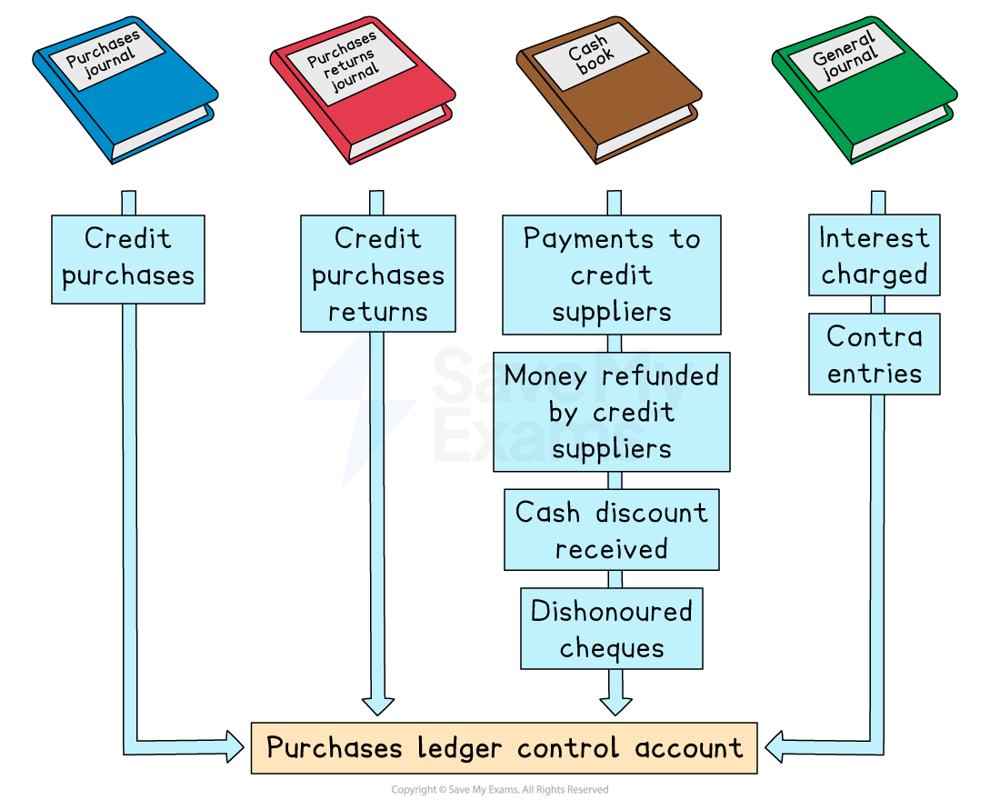
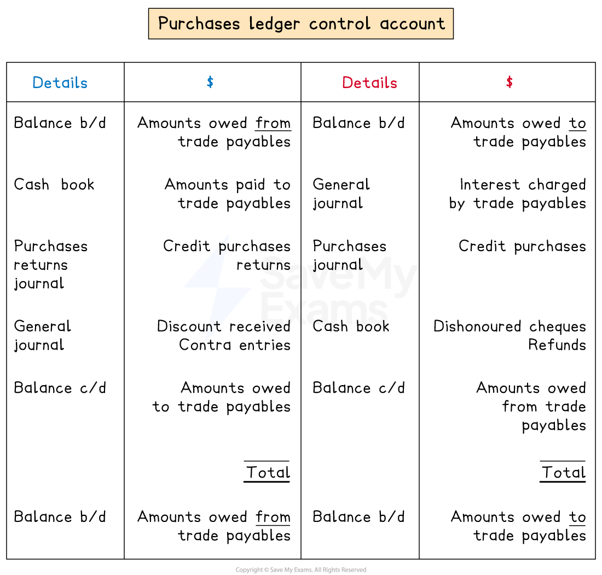

# Purchases Ledger Control Accounts

## Purchases ledger control accounts

> **Spec point** — `spcpt_hcdmSNKYyYv3qKJZ`

## Purchases ledger control accounts

### Where do I find the information to complete a purchases ledger control account?

- The** books of prime entry **are used to find the **totals**
- The **purchases journal **is used to find the total value of **credit purchases**
- The **purchases returns journal **is used to find the total value of **returned goods**
- The **cash book** is used to find the total values for:

  - **Money paid** to credit suppliers
  - **Money refunded **by credit suppliers
  - **Cash discounts received **from credit suppliers
- The** journal **is used to find the total values for:

  - **Interest charged** by credit suppliers on overdue accounts
  - ***Contra entries*** against the sales ledger

> **Exam Hint**
> The ledger accounts are not used when preparing control accounts. The information is taken from the books of prime entry.

### Why might there be a debit balance in a purchases ledger control account?

- A **trade payables account** will usually have a **credit balance**

  - This indicates that the business **owes the credit supplier money**
- However, a trade payables account could have a **debit balance**

  - This indicates that the **credit supplier owes the business money**
- **Debit balances** can occur when:

  - The business **pays** credit suppliers** in advance**
  - The business makes **overpayments** to credit suppliers
  - The business is **owed refunds** from the credit suppliers
  
    - The business has paid for goods and then returned them
- **Debit and credit balances** are **totalled separately** in the purchases ledger control account

  - This means there could be **two opening balances** and **two closing balances**

### What is the layout of a purchases ledger control account?

- The layout looks very **similar to the layout of a trade payables ledger account**
- The main differences are:

  - There could be two opening balances
  - There could be two closing balances

| **Entries on the debit side:** | **Entries on the credit side:** |
|---|---|
| - **Opening balance**    - Money that credit suppliers owe  - **Purchases returns**    - Credit purchases only - **Bank**    - Bank transfers to credit suppliers - **Cash**    - Cash paid to credit suppliers - **Discount received** - **Contra** | - **Opening balance**    - Money owed to credit suppliers - **Purchases**    - Credit purchases - **Interest** - **Bank**    - Refunds from credit suppliers |

*Layout of a purchases ledger control account*

> **Exam Hint**
> Remember that cash purchases are not recorded in the purchases ledger. Only enter cash paid to credit suppliers when the cash is used to make a payment towards an invoice.

> **Worked Example**
> Mika is a trader. He has provided the following information
> 
> | **2023** | \$ |   |
> |---|---|---|
> | **1 March** | Purchases ledger control account credit balance | 17 150 |
> |   | Purchases ledger control account debit balance | 1 350 |
> | **2024** |   |   |
> | **29 February** | Totals for the year: |   |
> |   | Credit purchases | 231 200 |
> |   | Cash purchases | 5 000 |
> |   | Bank payments to credit suppliers | 210 600 |
> |   | Cash payments to credit suppliers | 1 500 |
> |   | Returns to credit suppliers | 6 400 |
> |   | Discount received | 3 200 |
> |   | Contra entries | 2 100 |
> |   | Interest charged by credit suppliers | 800 |
> |   |   |   |
> |   | Purchases ledger control account credit balance | ? |
> |   | Purchases ledger control account debit balance | 450 |
> 
> Prepare the purchases ledger control account for the year ended 29 February 2024. Balance the account and bring down the balances on 1 March 2024.
> 
> **Answer**:
> 
> Ignore the cash purchases, as they do not affect the purchases ledger accounts.
> 
> Enter the balances and totals on the correct sides of the account.
> 
> Transactions which increase the amount the business owes appear on the credit side.
> 
> - Credit purchases
> - Interest
> 
> Transactions which reduce the amount the business owes appear on the debit side.
> 
> - Payments to credit suppliers using cash or bank transfers
> - Purchases returns
> - Discount received
> - Contra entries
> 
> At the end of the month there is \$450 debit balance. On 1 March 2024, there will be a debit balance of \$450; therefore, there will need to be a balance c/d on the credit side on 29 February 2024.
> 
> **Final answer:** **Mika**
> **Purchases Ledger Control Account**
> 
> | **Final answer:** **Date** | **Final answer:** **Details** | **Final answer:** **\$** | **Final answer:** **Date** | **Final answer:** **Details** | **Final answer:** **\$** |
> |---|---|---|---|---|---|
> | **Final answer:** **2023**  **Final answer:** **Mar 1** | **Final answer:** ** **  **Final answer:** **Balance b/d** | **Final answer:** **1 350** | **Final answer:** **2023**  **Final answer:** **Mar 1** | **Final answer:** **Balance b/d** | **Final answer:** **17 150** |
> | **Final answer:** **2024**  **Final answer:** **Feb 29** | **Final answer:** **Bank** | **Final answer:** **210 600** | **Final answer:** **2024**  **Final answer:** **Feb 29** | **Final answer:** **Purchases** | **Final answer:** **231 200** |
> | **Final answer:** **29** | **Final answer:** **Cash** | **Final answer:** **1 500** | **Final answer:** **29** | **Final answer:** **Interest** | **Final answer:** **800** |
> | **Final answer:** **29** | **Final answer:** **Purchases returns** | **Final answer:** **6 400** | **Final answer:** **29** | **Final answer:** **Balance c/d** | **Final answer:** **450** |
> | **Final answer:** **29** | **Final answer:** **Discount received** | **Final answer:** **3 200** |   |   |   |
> | **Final answer:** **29** | **Final answer:** **Contra** | **Final answer:** **2 100** |   |   |   |
> | **Final answer:** **29** | **Final answer:** **Balance c/d** | **Final answer:** **24 450** |   |   | **Final answer:** **                   ** |
> |   |   | **Final answer:** **249 600** |   |   | **Final answer:** **249 600** |
> | **Final answer:** **Mar 1** | **Final answer:** **Balance b/d** | **Final answer:** **450** | **Final answer:** **Mar 1** | **Final answer:** **Balance b/d** | **Final answer:** **24 450** |
